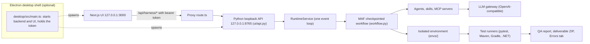

# Agentic QE Platform

Agentic QE Platform is an internal test-engineering tool. Give it a GitHub repository (brownfield) or specs from documents or Jira Cloud (greenfield). It analyzes the code, plans and designs tests, generates unit and integration tests, and runs them after your approval. It ends with a QA report and a ZIP of the deliverables. It runs as an unsigned desktop app, as a local web UI launched from a source checkout, or as a command-line tool. The repository is private and for the internal team only.

## Use the desktop app

If you only want to install and use the platform, read the **[user guide](docs/USER_GUIDE.md)**. Download the installer for your system from the [latest GitHub release](https://github.com/sarveshtalele/maf-harness-testing/releases/latest) (Windows `.msi`, macOS `.dmg` for Apple silicon or Intel, Linux `.AppImage`). The guide covers the unsigned first-launch steps, setting your model API key under **Configuration**, and how to run a test.

## Architecture at a glance

The UI is a Next.js app. It calls its own `/api/harness` proxy, which adds the bearer token and forwards to the Python API on loopback. The API runs one checkpointed Microsoft Agent Framework workflow. The workflow calls agents, skills, MCP servers and the LLM gateway, and it drives an isolated environment and the test runners. The results appear in the QA report, the ZIP and the Errors tab. The Electron desktop shell starts the same backend and UI as child processes.



The nine approval gates. The workflow pauses at each one and waits for a human decision. Gates 1, 7 and 8 are machine actions (clone, install, run). The others review an artifact.

```mermaid
flowchart LR
  G1["1 Clone tool approval"] --> G2["2 Repository analysis review"]
  G2 --> G3["3 Deterministic requirements review"]
  G3 --> G4["4 Planning review"]
  G4 --> G5["5 Component-batched design review"]
  G5 --> G6["6 Generated source review"]
  G6 --> G7["7 Install test environment approval"]
  G7 --> G8["8 Run execution approval"]
  G8 --> G9["9 Scoped QA review and ZIP"]
```



Details: [CLAUDE.md](CLAUDE.md) ("Workflow and guardrails") and [docs/DEVELOPER_GUIDE.md](docs/DEVELOPER_GUIDE.md) section 3.

## Set up your dev environment

**Prerequisites**

- [Git](https://git-scm.com/).
- [Node.js 24](https://nodejs.org/). Exactly major 24 is required. The launchers, `frontend/.npmrc` (`engine-strict=true`) and `npm` refuse other majors. With nvm: `nvm install 24` and `nvm use 24`.
- [uv](https://docs.astral.sh/uv/getting-started/installation/). uv provisions Python 3.12 for you.
- For the repositories you test (not needed to change the harness): their toolchains. See [docs/ENVIRONMENTS.md](docs/ENVIRONMENTS.md).

**1. Clone and check out `develop`**

macOS and Linux:

```bash
git clone https://github.com/sarveshtalele/maf-harness-testing.git
cd maf-harness-testing
git checkout develop
```

Windows (PowerShell):

```powershell
git clone https://github.com/sarveshtalele/maf-harness-testing.git
cd maf-harness-testing
git checkout develop
```

**2. Install the Python and frontend dependencies**

macOS and Linux:

```bash
uv sync --python 3.12 --extra dev --extra e2e
cd frontend && npm ci --include=dev && cd ..
cd desktop && npm ci && cd ..
```

Windows (PowerShell):

```powershell
uv sync --python 3.12 --extra dev --extra e2e
cd frontend; npm ci --include=dev; cd ..
cd desktop; npm ci; cd ..
```

`--extra e2e` installs the Python Playwright package used by the browser tests. `npm ci --include=dev` installs the frontend's dev dependencies (TypeScript, Playwright).

**3. Create `.env`**

macOS and Linux:

```bash
cp .env.example .env
chmod 600 .env
```

Windows (PowerShell):

```powershell
Copy-Item .env.example .env
```

Set `OPENAI_API_KEY`, `OPENAI_BASE_URL` and `OPENAI_MODEL` in `.env`. The file is git-ignored. Never commit it. You can also set the key later in the UI under **Configuration**. A variable already set in your shell wins over `.env`.

**4. Start dev mode**

```bash
uv run python scripts/start_ui.py
```

This starts the Python API on `127.0.0.1:8765` and the Next.js dev server with hot reload on `127.0.0.1:3000`. Open http://127.0.0.1:3000. Press Ctrl+C in the same terminal to stop both. Logs go to `.maf-harness/logs/launch-*.log`.

Run `uv run python scripts/start_ui.py --help` for all flags (`--port`, `--api-port`, `--prepare`, `--production`, `--check-only`, `--smoke-test`).

**5. Verify the setup**

Check prerequisites and ports without starting anything:

```bash
uv run python scripts/start_ui.py --check-only
```

Start both services, check the home page and the authenticated backend proxy, then stop. This does not need a model key:

```bash
./start-macos.command --smoke-test     # macOS
bash start-linux.sh --smoke-test       # Linux
.\start-windows.cmd --smoke-test       # Windows
```

Check the bundled skills against their lock file:

```bash
uv run maf-harness lint-skills --strict
```

**Source launchers.** `start-macos.command`, `start-linux.sh` and `start-windows.cmd` are thin. They check Node 24, create `.env` if it is missing, and then run `scripts/start_ui.py`. The first start installs dependencies and builds the UI, which takes a few minutes. The production UI is served with `next start` (`--production`); use the dev mode above when you change code.

**Command line (no browser).** The CLI runs the same workflow. From the repository root:

```bash
uv run maf-harness run https://github.com/owner/repo
uv run maf-harness run https://github.com/owner/repo --no-execution
uv run maf-harness run https://github.com/owner/repo --auto-approve
uv run maf-harness trace .maf-harness/runs/<run-id>
uv run maf-harness verify-run .maf-harness/runs/<run-id>
```

Without `--auto-approve` each gate asks in the terminal. `--auto-approve` is explicit consent to clone, install and run on this machine. `--no-execution` stops after generation.

**Desktop shell in dev mode.** `DESKTOP_BUILD=1 npm run build` in `frontend/`, then `npm start` in `desktop/`. Steps and Windows variants: [docs/DESKTOP.md](docs/DESKTOP.md). To build installers, see that file and [docs/RELEASING.md](docs/RELEASING.md).

**Agent model.** Changes in this repository are planned, implemented and reviewed by three models with fixed roles: Opus plans and does the final review and merge, Haiku implements in a worktree, and Sonnet reviews the diff. See the "Orchestration and memory" rules in [CLAUDE.md](CLAUDE.md). Humans follow the same gates in this README.

## Change code and get it merged

**1. Branch from `develop`.**

```bash
git checkout develop
git pull
git checkout -b feature/<short-name> develop
```

**2. Find where to change.** Read the `CLAUDE.md` in the directory you will edit (each area has one; list in [docs/DEVELOPER_GUIDE.md](docs/DEVELOPER_GUIDE.md) section 1.9). Use [docs/ARCHITECTURE_MAP.md](docs/ARCHITECTURE_MAP.md) to find modules and their importers. The recipes for common changes (new stage, prompt section, language, skill, API route, error classifier) are in [docs/DEVELOPER_GUIDE.md](docs/DEVELOPER_GUIDE.md) section 4.

**3. Make the change for all three systems.** Every change must work on Windows, macOS and Linux. Use `pathlib` and `encoding="utf-8"`. Run subprocesses through `run_command` or `run_cancellable`, never `shell=True`. Keep the launchers thin. Never relax a repository dependency pin or replace a missing dependency with a fake test.

**4. Add or adjust tests.** Put them next to the existing ones in `tests/` (or `frontend/tests/` for browser journeys, `desktop/src/*.test.ts` for the shell). Layers are in [docs/DEVELOPER_GUIDE.md](docs/DEVELOPER_GUIDE.md) section 6.

**5. Update docs in the same commit.** If you change behaviour in an area, update its `CLAUDE.md` and the relevant `docs/*.md`. If you add, remove, move or re-wire a `.py` file under `src/`, `scripts/` or `skills/`, or a `.ts` file under `frontend/app`, `frontend/components` or `frontend/lib`, regenerate the map:

```bash
uv run python scripts/gen_architecture.py
```

**6. Run the local checks.** Run them from the repository root.

```bash
uv sync --locked --python 3.12 --extra dev --extra e2e
uv run python scripts/check_all.py      # the full merge gate: lint, map, skills, pytest, frontend, desktop
```

`check_all.py` sets `PYTHONPATH` and a dummy `OPENAI_API_KEY` for the browser tests. Install the frontend and desktop dependencies first (`npm ci --include=dev` in `frontend/`, `npm ci` in `desktop/`), or skip those groups with `--skip-ui` or `--skip-desktop`. Tests that bind ports need to run outside a restrictive sandbox.

If you change a locked skill file, refresh only its hash in `skills/SKILLS.lock.json` and rerun `lint-skills --strict`. See [docs/SKILL_PLUGINS.md](docs/SKILL_PLUGINS.md).

**7. Commit with Conventional Commits.** One logical change per commit.

```
<type>(<optional scope>): <imperative summary>
```

Types: `feat`, `fix`, `docs`, `chore`, `test`, `refactor`, `ci`, `build`, `style`. Examples: `feat(evidence): resolve bare symbol targets`, `fix(ui): keep run table sorted`.

**8. Push the branch and open a pull request into `develop`.**

```bash
git push -u origin feature/<short-name>
gh pr create --base develop --title "<summary>" --body "<what changed and why; for file or process code, how the Windows path was checked>"
```

Mention any significant change (a new stage, skill, architecture change, release or non-trivial bug fix) in the PR so the maintainers add a dated entry to the "Core memory log" in `memory.md`.

**9. Wait for the required checks.**

| Check | Workflow and job | What it does |
|---|---|---|
| `ci` | `ci.yml`, jobs `test` and `secrets-scan` | Lint and format, architecture map, skill lock, Python tests on Ubuntu, Windows and macOS, and a scan for credential-shaped strings. |
| `Local UI compatibility` | `ui.yml`, job `local-ui` | Python UI tests, real GitHub clones, frontend typecheck and build, launcher smoke checks on all three systems, Playwright browser tests, and desktop `npm test`. |

**10. Review.** Get an approving review. Security-sensitive changes (plugins, MCP, secrets, desktop) get extra care. The repository owner sets the review rules (see [docs/RELEASING.md](docs/RELEASING.md)). On the current GitHub plan these rules may not be enforced, so follow them anyway.

**11. Merge into `develop`.** The orchestrator merges agent work. A person merges other work after review.

**12. Release from `main`.** Releases are cut from `develop` as a `release/x.y` branch, merged to `main` by pull request, then tagged `vX.Y.Z`. The tag starts `desktop-release.yml`, which creates a **draft** GitHub Release for the owner to publish. Full procedure: [docs/RELEASING.md](docs/RELEASING.md). Branch and commit rules: [CONTRIBUTING.md](CONTRIBUTING.md).

**Branches.** `develop` is the default branch and the integration branch. `main` holds released code. `release/x.y` is cut from `develop` for QA.

**CI workflows** (in `.github/workflows/`):

| Workflow | When it runs | What it checks |
|---|---|---|
| `ci.yml` | Pushes to `main`, `develop`, `release/**`, and pull requests | Ruff, architecture map, skill lock, the Python tests on Ubuntu, Windows and macOS, and the `secrets-scan` job. |
| `ui.yml` | Same branches, plus manual runs | `Local UI compatibility`: UI tests, real clones, frontend typecheck and build, launcher smoke checks, Playwright, desktop `npm test`. |
| `nightly.yml` | Daily at 02:00 UTC, and manual runs | Full Python test suite on Linux. |
| `desktop-prerelease.yml` | Tags `v*-rc*`, and manual runs | Builds desktop installers as workflow artifacts. No release. |
| `desktop-release.yml` | Tags `v*.*.*` | Builds desktop installers and creates a draft GitHub Release. |

## Documentation

Every documentation file in the repository is listed below. Audience is one of **user**, **developer**, **agent** (read by coding agents, or used as their rules or prompts) or **historical** (a dated review, plan or evidence file: it records what was true on that date, so it is not a current claim). The docs index is [docs/README.md](docs/README.md).

Skill files (`skills/*/SKILL.md`, `skills/*/references/`) and the document templates under `qa/templates/` are omitted here. They are read by the agents at run time. [`memory.md`](memory.md) is the orchestrator's project log. It is not listed here.

| Document | Audience | What it covers |
|---|---|---|
| `docs/USER_GUIDE.md` | user | Install the desktop app from GitHub Releases, first launch per OS, API key, using runs, updating, uninstalling, troubleshooting. |
| `.claude/agents/docs-maintainer.md` | agent | Agent definition that regenerates the architecture map and updates drifted docs. |
| `.github/pull_request_template.md` | developer | Template for pull request descriptions. |
| `AGENTS.md` | agent | Short entry point for other coding assistants. Points to CLAUDE.md and the developer guide. |
| `CLAUDE.md` | agent | Project rules for contributors and coding agents: commands, workflow gates, cross-OS rules, agent model, permissions. |
| `CONTRIBUTING.md` | developer | Branch model, pull request steps, Conventional Commits, local checks, cross-OS rule. |
| `README.md` | developer, user | Entry point. Desktop app use, architecture, developer setup, change and merge steps, documentation index. |
| `benchmarks/generation/csv/PROMPT.md` | developer | Task prompt for the csv case of the generation benchmark. |
| `benchmarks/generation/sqlite/PROMPT.md` | developer | Task prompt for the sqlite case of the generation benchmark. |
| `benchmarks/generation/transcript/PROMPT.md` | developer | Task prompt for the transcript case of the generation benchmark. |
| `desktop/CLAUDE.md` | agent | Electron shell: key files, contracts, gotchas and test commands. |
| `docs/ARCHITECTURE.md` | developer | Design of the harness, its stages and its guarantees. |
| `docs/ARCHITECTURE_MAP.md` | developer | Generated module table with imports and importers. Regenerate with scripts/gen_architecture.py; never edit by hand. |
| `docs/AUTOMATION.md` | developer | Recovery between gates, the diagnosis agent, prompt assembly and evaluators. |
| `docs/AZURE_DEPLOYMENT_PROPOSAL.md` | developer | Azure hosting proposal. Documentation only; no Azure resources exist. |
| `docs/Azure-deployment.md` | developer | Short pointer to the Azure proposal. Its Terraform in azure-plan/ (removed 2026-10-11; see git history). |
| `docs/BACKEND_FIX_PLAN_2026-10-02.md` | historical | Backend correction and cleanup plan, 2 October 2026. |
| `docs/BACKEND_REVIEW_2026-10-01.md` | historical | Backend review and approval plan, 1 October 2026. |
| `docs/CACHING.md` | developer | Token spend, prompt caching, daily token ledger and the response cache. |
| `docs/CATALOG.md` | developer | Stage personas, central tools and Agent Skills in one reference. |
| `docs/CLONE_AND_PLATFORM_DIAGNOSTICS.md` | user, developer | Clone progress, platform diagnostics and what the launcher logs show. |
| `docs/DEAD_CODE_REVIEW_2026-10-01.md` | historical | Dead-code review, 1 October 2026. |
| `docs/DEAD_CODE_REVIEW_2026-10-07.md` | historical | Dead-code candidates, 7 October 2026. Removal still needs approval. |
| `docs/DESKTOP.md` | developer | Electron app: architecture, development, packaging, unsigned builds and the model key. |
| `docs/DETERMINISTIC_SKILL_REVIEW.md` | developer | Deterministic analysis flow for repository analysis and run navigation. |
| `docs/DEVELOPER_GUIDE.md` | developer | Dev environment, repository layout, run lifecycle, how-to recipes, debugging, testing, conventions. |
| `docs/ENVIRONMENTS.md` | developer, user | Isolated Python, Java and .NET environments and the toolchains they need. |
| `docs/ERROR_PLAYBOOK.md` | user, developer | Every error code, whose fault it is, and the recommended action. |
| `docs/GAP_REVIEW_2026-10-07.md` | historical | Gap review after the implementation waves, 7 October 2026. |
| `docs/GENERATION_BENCHMARK.md` | developer | Offline scorer for generated pytest suites (scripts/benchmark_generation.py). |
| `docs/HOOKS.md` | developer | Hook engine: fail-closed checks around tool and model calls, and typed tools. |
| `docs/IMPLEMENTATION_PLAN.md` | historical | Original implementation plan for the harness, with counts from its date. |
| `docs/MCP.md` | user, developer | Adding Model Context Protocol servers in Marketplace and giving them to chosen stages. |
| `docs/MODULAR_WORKFLOW_IMPLEMENTATION.md` | developer | How the modular workflow and deferred execution setup were implemented. |
| `docs/NEXTJS_UI.md` | developer | The Next.js workspace and how it talks to the local API. |
| `docs/OBSERVABILITY.md` | developer, user | Run tracing, the Observability tab and the maf-harness trace command. |
| `docs/PETSTORE_STRICT_TEST_GENERATION.md` | historical | Snapshot of strict test generation and its evidence, 6 October 2026. |
| `docs/README.md` | developer | Index of all documentation under docs/, with the historical markers. |
| `docs/RELEASING.md` | developer | Versioning, the release flow, unsigned macOS builds and the owner settings checklist. |
| `docs/RUN_FAILURE_AND_SKILL_EXECUTION_REVIEW.md` | historical | Review of one recorded run failure and skill execution. |
| `docs/SKILL_PLUGINS.md` | developer | Skill folder format, hash lock and the trust model for user plugins. |
| `docs/UI_VERIFICATION.md` | historical | Verification notes for the Next.js migration, 1 October 2026. |
| `docs/WINDOWS_RUN_E9681C3_REVIEW.md` | historical | Review of one saved Windows run deliverable. |
| `docs/WINDOWS_SETUP_AND_DEBUGGING.md` | user, developer | Windows setup, Node and npm problems, long paths, antivirus locks and log locations. |
| `docs/WORKFLOW_SERVICE_MIGRATION_PLAN.md` | historical | Proposal for moving the workflow behind a service. |
| `docs/audit/E2E_RESULTS.md` | historical | Results of live end-to-end runs. |
| `docs/audit/ERRORS.md` | historical | Defect register from the audit of 19 September 2026, updated later. |
| `docs/audit/STRICT_GENERATION_2026-10-06.md` | historical | Strict-generation report, 6 October 2026. |
| `docs/audit/TOKENTELEMETRY_LIVE_2026-10-01.md` | historical | Live token-telemetry report, 1 October 2026. |
| `docs/audit/TOKEN_TELEMETRY_FRESH_2026-10-02.md` | historical | Token-telemetry report, 2 October 2026. |
| `docs/azure-plan-desktop.md` | developer | Proposal for an Azure workspace for the desktop app. Nothing is built or deployed. |
| `docs/plans/PLAN_2026-10-10_DESKTOP_GREENFIELD.md` | historical | Dated plan for the desktop app, plugins and greenfield runs. Named as the plan in CLAUDE.md. |
| `frontend/CLAUDE.md` | agent | Next.js workspace: key files, contracts, gotchas and test commands. |
| `prompts/repository-review.md` | agent | Repository review prompt shipped with the app. |
| `scripts/CLAUDE.md` | agent | Launchers and maintenance scripts: files and rules. |
| `skills/CLAUDE.md` | agent | Rules for the skill packages: layout, hash lock, approval. |
| `skills/playwright-test-generator/assets/templates.md` | agent | Templates used by the playwright-test-generator skill. |
| `skills/test-design-generator/README.md` | developer | What the test-design-generator skill does and how it is used. |
| `skills/test-design-generator/assets/EXAMPLE_REPORT.md` | agent | Example test design report used as a skill asset. |
| `src/maf_test_harness/CLAUDE.md` | agent | Python backend overview and the module map. |
| `src/maf_test_harness/agent/CLAUDE.md` | agent | Area rules for agent/: Agent runtime, personas, prompt settings and diagnosis. |
| `src/maf_test_harness/envs/CLAUDE.md` | agent | Area rules for envs/: Isolated environments, toolchains, runners and recovery. |
| `src/maf_test_harness/errors/CLAUDE.md` | agent | Area rules for errors/: Error taxonomy, classifiers and the playbook. |
| `src/maf_test_harness/hooks/CLAUDE.md` | agent | Area rules for hooks/: Fail-closed hook engine and built-in hooks. |
| `src/maf_test_harness/llm/CLAUDE.md` | agent | Area rules for llm/: Prompt section order and the daily token ledger. |
| `src/maf_test_harness/monitoring/CLAUDE.md` | agent | Area rules for monitoring/: Run trace recorder, observability report and telemetry. |
| `src/maf_test_harness/qa/CLAUDE.md` | agent | Area rules for qa/: QA report, triage, step reports and deliverable packaging. |
| `src/maf_test_harness/repo/CLAUDE.md` | agent | Area rules for repo/: Clone, static analysis, stack detection, routes and specs. |
| `src/maf_test_harness/skills/CLAUDE.md` | agent | Area rules for skills/: Skill registry, trust, host script runner and contracts. |
| `src/maf_test_harness/tools/CLAUDE.md` | agent | Area rules for tools/: Deterministic central tools and the typed tool registry. |
| `src/maf_test_harness/ui/CLAUDE.md` | agent | Area rules for ui/: Loopback HTTP API, runtime service, ETA, errors and settings. |
| `src/maf_test_harness/workflow_steps/CLAUDE.md` | agent | Area rules for workflow_steps/: Per-stage operations mixed into the Harness. |
| `tests/CLAUDE.md` | agent | pytest suite: layers, shared helpers and how to run them. |

## Security

- Settings come from the UI **Configuration** page, the shell, or `.env`. The order is runtime value in the UI, then the environment, then `.env`. [.env.example](.env.example) lists all options.
- **Never commit** `.env`, run evidence (`.maf-harness/`) or `docs/agent-framework.pdf`. The `.gitignore` covers all three.
- The UI and the logs show only the last 4 characters of any key.
- The API listens on loopback only and needs a token generated at launch.
- **Local execution is not a sandbox.** Generated tests and the commands of the repositories you test run as your user on this machine. Use a disposable machine or account for repositories you do not trust.
- **Report vulnerabilities privately** to the repository maintainer. Do not open a public issue or a pull request that describes an unpatched problem.

## Troubleshooting

- [docs/ERROR_PLAYBOOK.md](docs/ERROR_PLAYBOOK.md): every error code, whose fault it is, and what to do.
- [docs/WINDOWS_SETUP_AND_DEBUGGING.md](docs/WINDOWS_SETUP_AND_DEBUGGING.md): Windows setup, long paths, antivirus locks and log locations.
- [docs/CLONE_AND_PLATFORM_DIAGNOSTICS.md](docs/CLONE_AND_PLATFORM_DIAGNOSTICS.md): clone failures and platform checks.
- [docs/DEVELOPER_GUIDE.md](docs/DEVELOPER_GUIDE.md) section 5: where evidence lives and how to debug a run.

Launcher logs are in `.maf-harness/logs/launch-*.log`. Run evidence is in `.maf-harness/runs/<run-id>/`. The desktop app writes its logs to its data folder, described in the [user guide](docs/USER_GUIDE.md).
