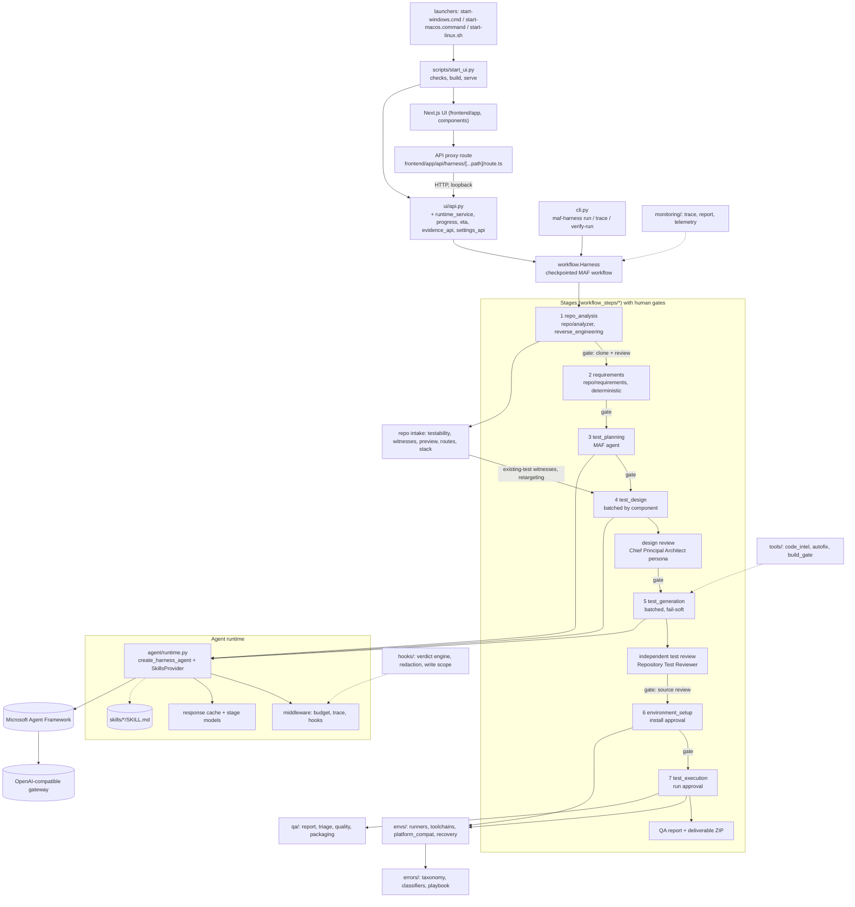
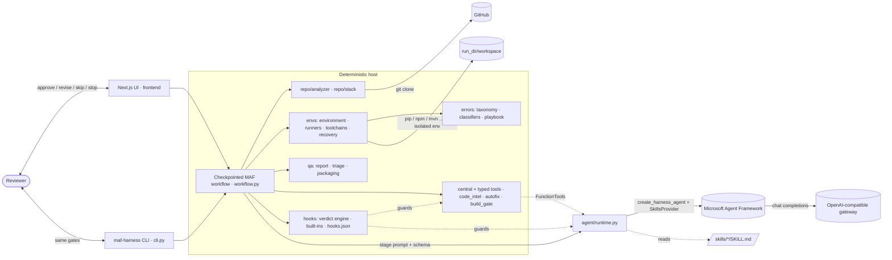
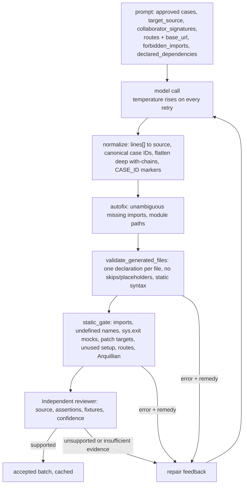
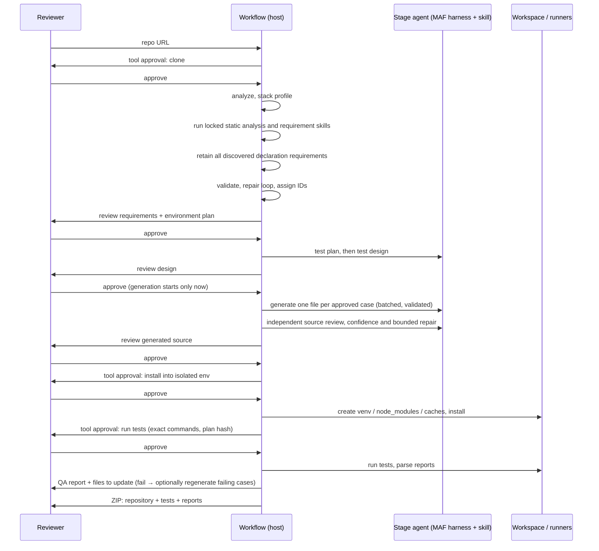

# Architecture

This document explains how the harness is built, what every file does, and where each guarantee is enforced.
Generated per-file map with Mermaid graphs and an import table: [ARCHITECTURE_MAP](ARCHITECTURE_MAP.md) (regenerate with `python scripts/gen_architecture.py`; the `docs-maintainer` agent does this).
Companion documents: [README](../README.md) (setup and usage), [CATALOG](CATALOG.md) (every persona, tool and Agent Skill),
[ENVIRONMENTS](ENVIRONMENTS.md) (Python/Java/.NET isolation and toolchains), [ERROR_PLAYBOOK](ERROR_PLAYBOOK.md) (every known error, whose fault, what to do),
[AUTOMATION](AUTOMATION.md) (bounded recovery, diagnosis agent, prompt assembly), [HOOKS](HOOKS.md) (hooks and typed tools), [CACHING](CACHING.md) (token/prefix-cache metrics),
[IMPLEMENTATION_PLAN](IMPLEMENTATION_PLAN.md) (decisions, roadmap), [audit/ERRORS.md](audit/ERRORS.md) (defect register), [audit/E2E_RESULTS.md](audit/E2E_RESULTS.md) (live runs),
[OBSERVABILITY.md](OBSERVABILITY.md) (tracing and the Observability tab), [NEXTJS_UI.md](NEXTJS_UI.md) (the web UI), [DESKTOP.md](DESKTOP.md) (Electron app), [MCP.md](MCP.md) and [SKILL_PLUGINS.md](SKILL_PLUGINS.md) (extension points), [RELEASING.md](RELEASING.md) (versions and installers). The project's own working notes: [../memory.md](../memory.md).

## 1. What the system does

Given a public GitHub repository, the harness produces an **executed, traceable test suite** and a **QA report**, under human control:

1. approve cloning, then statically analyze the repository with the reviewed reverse-engineering host skill,
2. retain all discovered declarations as source-linked candidates using the requirement-analysis host skill, with zero requirements model calls,
3. review model planning, component-batched design and generated source; reject unexplained omissions and misleading invocation claims,
4. at Test execution only, create the isolated target workspace and approve dependency/toolchain installation; incomplete installation blocks execution,
5. approve runtime build/collection and tests, then report generated, existing unit and existing integration results separately,
6. deliver a ZIP containing source and saved evidence; traceability is not measured runtime or complete application coverage.

Every model-authored artifact passes a human review gate. Anything that touches the machine (clone, install, run) needs its own approval.

Greenfield runs use documents (Markdown, TXT, DOCX or PDF, up to 10) or Jira Cloud stories instead of a repository. Generated tests are limited to the unit and integration levels (`run_options.py`).

Facts the host can compute exactly (does this import resolve, what are this class's real constructors, which routes exist, does this file
compile) are **not left to the model**: a central set of deterministic tools (`code_intel`, `autofix`, `build_gate`, `agent_tools`) answers them,
so generation calls are spent on test design, not on guessing. Around every tool call, model call and gate a fail-closed **hook engine** applies secret
redaction, a write scope and download consent, plus any user hooks ([HOOKS.md](HOOKS.md)). Works on Windows, macOS and Linux (every OS-specific decision lives in `envs/platform_compat.py`).

## 2. How the project works (end to end)

Generated file-level detail lives in [ARCHITECTURE_MAP](ARCHITECTURE_MAP.md); this is the same flow in one picture.

## 2.1 System context

## 3. Workflow

Seven stages, each a MAF `Executor`; gates are MAF `request_info` events; state is checkpointed to disk.

| # | Stage | Actor | Result and approval | Code |
|---|---|---|---|---|
| 1 | `repo_analysis` | host · reverse-engineering | Clone approval, static inventory and source-linked facts, then review | `repo.analyzer`, `skills.host` |
| 2 | `requirements` | host · requirement-analysis | Complete discovered declaration inventory and preview setup plan, then review | `repo.requirements`, `skills.contracts` |
| 3 | `test_planning` | MAF agent · test-planning | Source-first strategy, levels and explicit gaps, then review | `workflow_steps.planning` |
| 4 | `test_design` | MAF agent · test-design-generator + test-data-generator; independent Chief Principal Architect design review (advisory, bounded; `HARNESS_DESIGN_REVIEW`, min confidence `HARNESS_DESIGN_REVIEW_MIN_CONFIDENCE`) | Component-batched cases, linked requirements or exclusions, reviewer flags fed back into repair, then review | `workflow_steps.design`, `workflow_steps.design_review`, `skills.contracts` |
| 5 | `test_generation` | MAF author + independent Repository Test Reviewer | Per-case source, static gates, confidence and repair; failed batches are fail-soft (`generation_failures`, `HARNESS_MAX_FAILED_BATCH_RATIO`, default 0.5; failed cases show as `generation_failed` and block PASS); then source review | `workflow_steps.generation`, `workflow_steps.test_review`, `qa.quality` |
| 6 | `environment_setup` | host | Test execution · Setup: approve exact installation plan before creating the isolated workspace or installing dependencies; then review | `workflow_steps.execution`, `envs.runners` |
| 7 | `test_execution` | host | Approve exact runtime/collection/test commands; fresh results, scoped QA, reports and ZIP; bounded healing where applicable | `envs.runners`, `qa.report`, `qa.packaging` |

Generation-only runs omit stages 6 and 7. Legacy checkpoints retain their recorded stage order for compatibility.

Greenfield runs (`workflow_steps/greenfield.py`, `repo/specs.py`) replace stage 1 with a scaffold when the run has no code, so they never execute anything. Before requirements, the `spec-authoring` skill turns the documents or Jira stories into specs with IDs `SPEC-<hash8>-<n>`. Earlier stages inspect source and generated text; dependency installation, runtime imports, collection and compilation wait for execution approval.

### 3.1 Generation pipeline (stage 5, per batch of approved cases)

Errors carry a concrete remedy (`qa.triage.remedy_for`); after `GENERATION_MAX_ATTEMPTS` failures the batch surfaces a retry/stop gate and the next round
starts at a higher temperature (a deterministic model otherwise repeats a rejected answer verbatim). Accepted batches are cached, so a retry or a
heal round regenerates only what failed.

## 4. Guarantees and where they are enforced

| Guarantee | Enforcement point |
|---|---|
| The assigned Agent Skill was loaded through MAF's `load_skill` | `agent.runtime.ToolTraceMiddleware` + `_verify_skill_loaded`; audited by `maf-harness verify-run` |
| Skills follow the Agent Skills spec and vendored upstream skills are unmodified | `skills.registry.lint_skill`, `verify_lock` against `skills/SKILLS.lock.json` (per-file SHA-256), both inside `require_valid` before each stage |
| Skill scripts run only if reviewed and unchanged | `skills.scripts.HarnessScriptRunner` (allow-list + SHA-256 per run, argv-only, temp dir, sanitized env, timeout); MAF `run_skill_script` is auto-approved only for model-tier scripts (`script_approval_rule`) |
| Only a daily cap of 50,000,000 tokens (all runs on the machine); no per-run, per-call or call-count limits | `llm.usage.DailyUsageLedger` (locked JSON file per local day), `agent.runtime.BudgetGuard` (reserve → call → settle), `settings.DAILY_TOKEN_LIMIT` |
| Design cases exist at unit level, per actor, and per requirement (or the gap is explained) | `workflow_steps.generation._require_coverage_or_reason` (repair loop; unexplained gaps remain blocked on the last attempt) |
| Cases per requirement are bounded (default 2, maximum 10) and a run can override them | `settings.CASES_PER_REQUIREMENT` (`HARNESS_CASES_PER_REQUIREMENT`), run field `case_budget`, `POST /runs/{id}/case-budget`, `ui/eta.case_budget_view` |
| Test source only after the design is approved | graph edge `test_design → test_generation` only fires on approve; `state.approved` hash checked; `tests/test_policies.py` |
| Generated source is structurally sound | `skills.contracts.validate_generated_files`: paths, markers, one declaration per file, no placeholders/skips, syntax (Python AST + `compile()`; javac/node/gofmt or brace balance) |
| Generated tests cannot fail for reasons the host can see in advance | `tools.code_intel.static_gate`: import resolution (Python names and modules, Java libraries), undefined names, mocked `sys.exit`, patch targets that do not exist, setup collections never used, URL paths that are not application routes, Arquillian; then `tools.build_gate.try_build` (collect/compile) after the approved install |
| Mechanical mistakes are repaired, not re-asked, and every repair is visible | `tools.autofix.autofix_files` (only fixes that cannot change what a test means); `autofix` events in `audit.jsonl`, counters in `state.tooling` |
| A rejected answer is not repeated verbatim | retry temperature schedule in `workflow_steps.generation._generate_tests_batched`, `forbidden_imports` in the generation policy, actionable feedback (`qa.triage.remedy_for`, named extra test methods) |
| Provider limits are reported as such | `workflow_support.friendly_error` (HTTP 429 → "the provider's limit, not the harness's daily cap"); never worked around |
| Nothing is installed or run without approval; plan cannot change after approval | `workflow.ask` (tool gate) + `plan_hash` comparison in `run_environment` / `run_execution` |
| Install is isolated | `envs.runners.setup_steps` (venv, project `node_modules`, cache-dir repositories); system tools only reported (`envs.environment.TOOLS` hints) |
| Secrets never reach installed/test code | `envs.execution._child_env` allow-list, fake `HOME` |
| Secrets are removed from what a model sees and what a tool receives | `hooks.builtin.secret_redaction` (PreToolUse arguments, PostToolUse results), also for MAF `list[Content]` results (`hooks.maf_bridge`) |
| An agent can only write inside the workspace, and only read non-secret repository files | `tools.file_tools` resolves every path against its roots (independent of hooks) and `hooks.builtin.path_scope` denies write tools that escape; secret-looking files (`.env`, keys) are refused and hidden |
| A hook that fails does not fail open | `hooks.engine.HookEngine.fire`: crash, timeout or garbage on PreToolUse / PreModelCall / StageGate is a deny; a veto at a gate leaves the approval pending and unconsumed (`workflow.Harness.respond`) |
| A toolchain download is consented to, verified and contained | listed in the environment approval (`envs.plan_toolchains`), `hooks.builtin.download_consent`, SHA-256/512 check before extraction, archive path-escape refusal, file lock, private cache (`envs.toolchains`) |
| **Strict environment guardrail**: no stage after `environment_setup` starts with a missing or conflicting requirement | `workflow_steps/execution.py` (`_environment_shortfalls`, `_block_incomplete_environment`; error gate, retry/stop only), `Harness.enter` refuses later stages while `environment.status == incomplete`; `envs.recovery.python_fallback` proposes another interpreter (approved as a download in the next plan); `settings.STRICT_ENV` |
| Generated tests do not repeat known run-time mistakes | `tools.mock_pitfalls.check_mock_pitfalls` in `code_intel.static_gate`: `@asynccontextmanager` driven as a generator, `autospec` on `app.state`, a MagicMock LLM in a real LangChain chain, Streamlit HTML fetched as a UI test, a literal path passed to a function that checks it exists |
| The installed Python packages are mutually consistent | `envs.runners.execute_setup` re-resolves what installed in one pip run after a per-package fallback, then `envs.env_check.dependency_conflicts` (`pip check`) and `envs.runners.repair_conflicts` (joint resolution with the declared requirements, at most 2 rounds); leftovers are reported and make an API-mismatch `TypeError` environmental (`ENV-PY-009`), not a test defect |
| Automatic recovery is bounded | `envs.recovery.choose` (autonomy auto/auto_once only, each recipe once per step, 4 per run, never a download without consent) applied by `envs.runners.execute_setup` |
| Every environment or execution failure is classified, not guessed | `errors.classify` (39 codes: category, autonomy, recipes) used by `execute_setup`, `tools.build_gate`, `qa.report`, `qa.triage` |
| Every skill and tool invocation of a run can be inspected afterwards, and the trace is checked against the run's own accounting | `trace.jsonl` written from MAF middleware; `monitoring.report.build_report` integrity checks (skills loaded, no unexpected tools, trace tokens = ledger tokens) |
| A green verdict means something | `envs.runners.execute_plan` (fresh reports only), `qa.report.verdict_for` |
| Every failure names the files/lines to change | `qa.triage.build_updates` → `qa_report["updates"]` |

## 5. Run directory (`.maf-harness/runs/<run>/`)

| Path | Content |
|---|---|
| `run.json` | view + full state (artifacts, approvals, provenance, budget, `routes`, `tooling` counters, `generation_rounds`) |
| `workflow.log` | API dispatch and failures before an operation runs |
| `clone_operation.json`, `clone-operations/<id>/` | current Git clone attempt; live `stdout.log` and `stderr.log` |
| `checkpoints/` | MAF `FileCheckpointStorage` |
| `audit.jsonl` | every request, response, tool start/finish, repair, heal, `autofix` and `build_gate` event; `hook_decision` / `hook_error` / `hook_event` records; `toolchains_ready` / `toolchains_failed`; `typed_tool` calls; `agent_diagnosis_*` |
| `trace.jsonl` | MAF-middleware trace: `model_run`, `chat_call` (tokens, duration) and `tool_call` (category, summarised arguments, duration) events |
| `repo/` | shallow clone (never modified) |
| `workspace/` | repository copy + isolated env + generated tests (what actually ran) |
| `environment/attempt-N/` | install step logs + `report.json` (immutable): steps (a recovery retry keeps its own `NN-<step>-retryK` directory), `recoveries`, per-step `recovery` (what was considered and why), `agent_diagnosis` when the opt-in agent ran |
| `executions/attempt-N/` | test step logs + `report.json` (immutable) |
| `generation_attempts/` | every raw model attempt for test generation |
| `build_checks/` | per-attempt `pytest --collect-only` / `mvn test-compile` output of the build gate |
| `qa_report.md/.json` | final report (also inside the ZIP) |
| `deliverables/<repo>-with-tests-<run>.zip` | complete repository + generated tests + `harness-report/` |

## 6. File-by-file reference

### 6.1 Application package `src/maf_test_harness/`

Modules are grouped in subpackages: `repo/` (intake), `envs/` (environment, execution, toolchains), `skills/` (Agent Skills),
`tools/` (central tools), `agent/` (MAF runtime, personas), `llm/` (token ledger), `qa/` (report, triage, packaging),
`monitoring/` (trace, report, telemetry), `ui/` (loopback API, progress/ETA and evidence helpers), `workflow_steps/` (stage operations) and `errors/` (taxonomy and playbook). The pre-refactor
flat module names no longer exist; every import uses its subpackage path. They were bridged by `sys.modules` compatibility
shims for one phase of the Phase 1 restructure, then removed once every caller (all internal, in `tests/`) was updated —
this is a private repo with no external consumers of the old paths, so there was nothing left for the shims to protect.

| File | Responsibility | Key contents | Notes |
|---|---|---|---|
| `__init__.py` | Package marker | exports `RepoAnalysis`, `TestPlan` | — |
| `settings.py` | Single source of configuration | `load_dotenv` (git-ignored `.env`, never overrides the shell, reads only `OPENAI_*`/`LLM_MODEL`/`HARNESS_*`), gateway env vars (`OPENAI_MODEL`, alias `LLM_MODEL`), `DAILY_TOKEN_LIMIT` (default 50,000,000, env `HARNESS_DAILY_TOKEN_LIMIT`), `AGENT_TOOLS` / `AUTOFIX` / `BUILD_GATE` switches, batch/attempt sizes, timeouts, `SKILL_MODE` | Credentials are read from the environment or the git-ignored `.env` only |
| `models.py` | Pydantic contracts for model output | `RequirementsDraft` (actors, requirements, criteria, rules, contracts, environment needs), `TestPlan`, `TestDesignDraft`/`TestDesignCaseDraft` (level/actor/target), `GeneratedFilesDraft` (source as `lines[]`), `RepoAnalysis` | `extra="forbid"` + bounded lists so structured output is enforceable and cannot run away |
| `agent/personas.py` | Role, goal and rules per stage | `PERSONAS` for the 5 agent stages + 2 host stages, `persona_instructions()` | Host stages appear so the UI/audit list every stage uniformly |
| `repo/analyzer.py` | Repository intake (incl. `declared_dependencies`, `extract_target_sources`, `collaborator_signatures`, `java_signatures`) | `validate_github_url` (page or clone URL, optional `/tree/<ref>`), `clone_repository` (no prompts, no hooks), `analyze_repository`, `_detect_frameworks`, `build_repository_evidence` (source-first, line-numbered, bounded, secrets redacted) | Only tracked files are analyzed |
| `tools/code_intel.py` | Central deterministic tools | `RepoContext`, `resolve_import`, `module_api`, `find_symbol`, `read_source`, `installed_packages`, `list_routes`, `probe_tools`, `static_gate` (all static gates for one file), `undefined_python_names` | One implementation serves the host pre-check, the auto-fixers and the agent tools; read-only and bounded |
| `tools/autofix.py` | Mechanical repairs before any model retry | `fix_python` (missing stdlib/mock imports, unresolvable module path → the one repository module with that leaf), `fix_java` (JDK, unique repository class and JUnit imports, static assertion imports), `autofix_files` | Only fixes that cannot change what a test means; every fix is audited (`autofix` events, `state.tooling`) |
| `tools/build_gate.py` | Compile/collect candidates in the prepared workspace | `try_build` (`pytest --collect-only` per file, `mvn test-compile`), `_maven_errors` (file:line + symbol detail, de-duplicated) | Runs only after the approved environment install; never runs test bodies; candidates and their classes are removed afterwards |
| `hooks/` | Hooks | `HookEngine` (deny > ask > transform > allow, fail-closed), built-ins, `.harness/hooks.json` loader, `HookFunctionMiddleware` / `HookChatMiddleware` | Enforcing events: PreToolUse, PreModelCall, StageGate; see [HOOKS.md](HOOKS.md) |
| `envs/recovery.py` | Bounded recovery | `choose` (allow-listed action for a diagnosed failure), `preview`; applied by `execute_setup` | Max 4 recoveries per run, once per recipe per step; see [AUTOMATION.md](AUTOMATION.md) |
| `agent/diagnosis.py` | Diagnosis agent (opt-in) | `DiagnosisNote`, `diagnose`; runs through `MAFHarnessRuntime.run_tool_agent` | Read-only tools, advisory only |
| `llm/prompts.py` | Prompt assembly | `build_prompt`, `generation_prompt`, `prefix_ratio` | Stable content first for the provider's prefix cache |
| `tools/mock_pitfalls.py` | Run-time pitfalls, found statically | `check_mock_pitfalls` (called by `static_gate`) | Narrow heuristics with the fix in the message; false positive = one repair round |
| `tools/registry.py` + `env_tools.py`, `file_tools.py`, `skill_tools.py`, `typed.py` | Typed tools | `ToolRegistry.call` (validate → hooks → handler → hooks), `ToolResult` envelope, scoped file tools, diagnosis tools | Used by the diagnosis agent and opt-in evaluators; see [HOOKS.md](HOOKS.md) |
| `tools/agent_tools.py` | The central tools as MAF `FunctionTool`s | `HarnessToolbox`, `STAGE_TOOLS`, `tool_instructions` | Small per-stage selection; calls appear in `skill_tool_trace[stage].harness_tool_calls` |
| `repo/routes.py` | Route inventory | `extract_routes` (JAX-RS, Spring, Flask/FastAPI, Express), `route_prefixes` | Shown to generation and used by `check_route_literals`; best effort, empty inventory disables the URL gate |
| `repo/stack.py` | Deterministic stack profile | `detect_stack` → ecosystems, primary, test runner, web UI/service hints, OpenAPI/CI/container files, missing tools | Drives runner and environment plan |
| `envs/environment.py` | Environment plan | `build_environment_plan` (prerequisites with versions and install hints, isolation strategy, exact install steps incl. nested `requirements*.txt` and evidence-backed documented packages), `nested_requirements`, `documented_packages`, `steps_from_plan` | System tools are reported, never installed |
| `envs/runners.py` | Per-ecosystem adapters and execution | `setup_steps`, `build_plan`, `execute_setup`, `execute_plan` (fresh evidence only, compile-error quarantine), result parsers (JUnit/Jest/Go/TRX), `map_results_to_cases`, allow-listed pytest helpers | Python, Node (jest/vitest/Playwright), Maven, Gradle, Go, .NET |
| `envs/execution.py` | Safe process execution + workspace | `run_command` (argv only, process-group timeout, sanitized env, immutable result dir), `copy_repo`, `write_generated`, JUnit reader | Local process — **not a sandbox** |
| `envs/platform_compat.py` | Every OS-specific decision | venv layout (`Scripts` vs `bin`), tool resolution (`.cmd`/`.exe` on Windows, never an extensionless script), process-tree kill, fake-`HOME` isolation, cache paths | No other module branches on `sys.platform`; a relative `argv[0]` is never passed to a child (Windows resolves it against the caller) |
| `envs/env_check.py` | Declared vs installed | `declared_requirements`, `installed_distributions`, `missing_packages` | Turns a failed bulk install into a named list, so tests stub what could not be installed instead of failing on it |
| `envs/app_launcher.py` | Start the application under test | `detect_launch` (for target apps: Streamlit, FastAPI, Flask, npm `start`/`dev`), `free_port`, `running` (context manager that starts the app and waits until it answers) | For UI/E2E (Playwright) cases with `--start-app`; shown in the run approval |
| `envs/spec.py` | What a repository needs | `detect_spec` (Python from `requires-python`/`.python-version`; JDK from pom/Gradle/`.sdkmanrc`; .NET from `global.json`/`TargetFramework`; Maven/Gradle wrapper) | No network |
| `envs/toolchains.py` | Find or provision a toolchain | `find`, `ensure`, `resolve_download`, `provision`, `apply_toolchains` (Temurin JDK, Maven, Gradle, .NET SDK, Python via `uv`) | Checksum before extraction, path-escape refusal, file lock, private cache `~/.maf-harness/toolchains`; downloads only after the environment approval |
| `envs/python_env.py`, `java_env.py`, `dotnet_env.py` | Per-language adapters | environment variables (`JAVA_HOME`, `DOTNET_ROOT`, isolated `NUGET_PACKAGES`, ...) for a provisioned toolchain | |
| `errors/` | Error taxonomy and playbook | `taxonomy.CODES` (38 codes), `classifiers/{python,java,dotnet,common}.py`, `engine.classify`, `playbook.RECIPES` | Category (environment / infra / test defect / app defect), autonomy (auto / auto_once / ask / manual), recipes; generates [ERROR_PLAYBOOK.md](ERROR_PLAYBOOK.md) |
| `skills/contracts.py` | Deterministic adapters around skill contracts (incl. `resolve_id`, `flatten_nested_with`, import gates, `check_python_test_hygiene`, `check_route_literals`) | ID assignment, `finalize_discovered_requirements`, `finalize_design` (traceability matrix, coverage, gaps, schema check), `validate_generated_files`, syntax/import gates | The "trust boundary" between model text and accepted artifacts |
| `skills/registry.py` | Agent Skills spec lint + supply-chain lock | `lint_skill`, `lint_all`, `load_lock`, `verify_lock`, `reviewed_scripts`, `require_valid`, `tree_sha256` | Package hash goes into provenance; tampering with a vendored skill is refused |
| `skills/config.py` | Which skills each stage loads | `SKILL_NAMES`, `COMPANION_PURPOSE`, `skills_for(stage, state)` → primary + companions | Deterministic over the stack profile and the approved design |
| `skills/scripts.py` | Reviewed-script execution | `HarnessScriptRunner` (MAF `SkillScriptRunner` + host executor), `script_approval_rule`, `ScriptRefused` | Two tiers: model-callable and host-only |
| `skills/reports.py` | Skill-contract QA reports | `build_traceability`, `build_coverage`, `run_skill_checks` | Validated by the upstream `validate_traceability.py` and `coverage_templates.yaml` |
| `agent/runtime.py` | MAF integration | `MAFHarnessRuntime` (per-stage `create_harness_agent`, `SkillsProvider`, central tools via `tool_provider`, priming, verification, per-call `temperature`), `ToolTraceMiddleware`, `BudgetGuard`, `extract_json_object` | See §7 |
| `ui/runtime_service.py` | One asyncio loop thread | `RuntimeService.submit/close` | Keeps MAF clients on one loop for the Next.js HTTP adapter |
| `workflow_steps/*.py`, `workflow_support.py` | Stage operations and shared policy | `planning`, `planning_batches`, `design`, `design_review` (Chief Principal Architect), `generation`, `test_review` (Repository Test Reviewer), `execution`, `rerun`, `greenfield`; `LANGUAGE_RULES` / `language_rules()` / `retry_reminder()` | Language rules live only there and in `skills/generic-test-generator/references/<lang>.md`; prompts stay language-neutral |
| `repo/testability.py` | Testability analysis | `analyze_testability`, `non_public_targets`, `retarget_cases` | Regex-based, no model calls; flags constructors that need statics/UI toolkits and retargets cases whose arithmetic lives in a same-class callee |
| `repo/preview.py` | Repo preview | quick static profile behind `POST /repo-preview` | Autofills the new-run form (language, setup hints) before a run starts |
| `ui/progress.py`, `ui/eta.py` | Progress, ETA and case budget | `progress(view)`, `run_eta` (from recorded stage durations in the run history), `case_budget_view`, `budget_recommendations` | Shown in the UI run header and beside the case-budget control |
| `ui/errors.py`, `ui/evidence.py`, `ui/presentation.py` | UI helpers | `errors.run_errors` (the Errors tab: generation, stage, build-gate and gate errors in one list); evidence served only from contained run folders; redaction at the UI boundary | Used by `ui/api.py` |
| `ui/settings_api.py`, `ui/evidence_api.py`, `ui/mcp_api.py` | Focused API operations | prompts and model settings; evidence and downloads; MCP server settings (secrets go in, never out) | Split out of `ui/api.py` |
| `repo/specs.py` | Greenfield intake | documents and Jira Cloud stories → sections → specs → requirements (REST or through a configured MCP server) | No model call in parsing |
| `repo/git_transport.py`, `repo/import_recipes.py`, `repo/requirements.py`, `repo/preview.py` | Clone transport, import recipes, evidence-bound requirements, read-only preview | file-backed Git output with cancellable process trees; import fixes a plain dotted import cannot reach; `preview.py` reads the GitHub REST API only | See [CLONE_AND_PLATFORM_DIAGNOSTICS.md](CLONE_AND_PLATFORM_DIAGNOSTICS.md) |
| `workflow_steps/planning_batches.py`, `design.py`, `greenfield.py`, `rerun.py` | Batch and replay operations | component-batched planning and design; greenfield specs; explicit stage replay with retained evidence | Used by `workflow_steps/*` |
| `envs/regression.py`, `envs/setup_guide.py` | Maven regression scopes and manual setup | existing unit and integration evidence, kept separate from generated cases; numbered manual guide that never executes pasted notes | See [PETSTORE_STRICT_TEST_GENERATION.md](PETSTORE_STRICT_TEST_GENERATION.md) |
| `qa/step_reports.py`, `tools/python_contracts.py` | Step reports and fixture checks | deterministic per-step Markdown from saved artifacts; source-only checks for generated Python fixture contracts | — |
| `skills/host.py`, `skills/trust.py` | Host skills and trust | locked host skill entry points with script evidence; verified, unverified and approved package states | See [SKILL_PLUGINS.md](SKILL_PLUGINS.md) |
| `agent/prompt_settings.py` | Prompt templates | user-owned templates; each run keeps its own snapshot, so historical requests never change | See [NEXTJS_UI.md](NEXTJS_UI.md) |
| `workflow.py` | Checkpointed workflow | `Harness` (gates, approvals, checkpoints, `respond`, `enter`), `StageExecutor` | Central orchestration; stage operations are mixins in `workflow_steps/*.py`; `STAGES` and `friendly_error` live in `workflow_support.py` |
| `run_options.py` | Run mode and test types | `parse_run_options`, `RUN_MODES` (brownfield, greenfield), `TEST_TYPES` (unit, integration), greenfield document limits | The Jira token is kept in memory only |
| `storage.py`, `paths.py`, `desktop_backend.py` | Persistence, resources and desktop entry | `storage` retries short Windows sharing locks; `paths` resolves bundled read-only resources and per-user data (`HARNESS_DATA_DIR`, `HARNESS_RESOURCE_ROOT`); `desktop_backend` is the `maf-backend` entry (`--self-check`) | See [DESKTOP.md](DESKTOP.md) |
| `mcp_servers.py` | User-configured MCP servers | config on disk, secrets in memory or keychain only, presets, MAF tool construction | See [MCP.md](MCP.md) |
| `qa/quality.py` | Source quality and witnesses | `existing_requirement_witnesses` (static match of existing tests to a requirement's `source_symbol`; not measured coverage) | Scoped generated / existing unit / existing integration evidence |
| `qa/report.py` | QA report | `build_qa_report`, `verdict_for`, `render_markdown` | requirement → case → file → result |
| `qa/triage.py` | Files/lines to update | `locations`, `classify`, `build_updates`, `REMEDIES` / `remedy_for` (concrete fix per failure pattern) | Test-defect vs application-first classification; remedies feed regeneration and the QA report |
| `qa/packaging.py` | Deliverable ZIP | `build_deliverable`, `run_instructions` | Repo + generated tests + `harness-report/` |
| `ui/artifact_presenter.py` | JSON → readable UI/Markdown | `json_to_markdown`, `humanize` | Shared by UI and `scripts/json_to_markdown.py` |
| `monitoring/trace.py` | Run trace recorder | `TraceRecorder` (thread-safe JSON Lines), `read_trace`, `summarize_arguments` / `redact`, `tool_category` | Never stores prompts, responses or complete files |
| `monitoring/report.py` | Observability and traceability report | `build_report` (from `trace.jsonl`, `audit.jsonl`, `run.json`, `qa_report.json`), `render_markdown` | Works for runs made before tracing existed (summary level); integrity checks |
| `monitoring/telemetry.py` | Optional OpenTelemetry export | `configure_telemetry` (`HARNESS_OTEL` = off, console or otlp; sensitive data always off) | See OBSERVABILITY.md §5 |
| `llm/usage.py` | Daily token ledger | `DailyUsageLedger` (`reserve`, `settle`, `snapshot`), `DailyLimitError` | File lock makes concurrent runs safe |
| `cli.py` | Headless driver | `run` (resumes an existing `--run-dir` at its pending gate), `verify-run`, `trace`, `lint-skills` | Exit codes 0 pass, 1 fail, 2 inconclusive/error |

### 6.2 Entry points and scripts

| File | Responsibility |
|---|---|
| `scripts/json_to_markdown.py` | Convert any saved JSON artifact to Markdown with the same formatter as the UI |
| `scripts/vendor_skills.py` | Vendor selected skills from the upstream repository: copy, audit (upstream `evaluator-skill`, offline), hash, write `skills/SKILLS.lock.json` incl. the reviewed-script allow-list |
| `pyproject.toml` | Package metadata, pinned MAF versions, `maf-harness` script, ruff lint/format and pytest config |
| `uv.lock` | Locked dependency set |
| `.env.example` | Documented environment variables (no secrets) |
| `.gitignore` | Excludes venvs, runs, caches, target checkouts, local tool state |
| `scripts/start_ui.py`, `start-*.{command,cmd,sh}` | Launcher: checks, build, both servers (the platform scripts are thin wrappers) |
| `scripts/gen_architecture.py`, `scripts/check_version.py`, `scripts/build_desktop.py` | Regenerate and check [ARCHITECTURE_MAP](ARCHITECTURE_MAP.md); pyproject and frontend version check; PyInstaller backend plus desktop build (`--dry-run` prints the plan) |
| `desktop/`, `packaging/backend.spec` | Electron shell (main, preload, process manager, keystore) and the PyInstaller spec for `maf-backend` |
| `azure-plan/` | Proposal-only Terraform and price evidence; not applied |
| `.github/workflows/ci.yml`, `ui.yml`, `desktop-*.yml`, `nightly.yml` | Lint, format, skills lint, tests and secrets scan (`ci.yml`); launcher, browser and platform checks (`ui.yml`); desktop builds on tags and manual runs; nightly runs |

### 6.3 Agent Skills `skills/`

Selection is by what the harness requires, from [github.com/shivswami/awesome-agent-skills](https://github.com/shivswami/awesome-agent-skills)
(branch `update-skills`, pinned in `skills/SKILLS.lock.json`). Each vendored skill was audited with the upstream `evaluator-skill`
(NVIDIA SkillSpector rules, offline): all six have **0 security findings** (scores 94.5-95.5).

| Skill | Origin | Loaded by | Purpose in the harness | Scripts |
|---|---|---|---|---|
| `repository-requirements` | local | requirements (primary) | evidence-based requirements, actors, criteria, environment needs | — |
| `test-planning` | local | test_planning (primary) | risk-based plan by level/framework | — |
| `repository-requirements` | local | requirements (primary, model mode) | evidence-based requirements, actors, criteria, environment needs | — |
| `test-planning` | local | test_planning (primary) | risk-based plan by level/framework | — |
| `test-design-generator` | local (began as an upstream import; the lock lists it as local; schema `assets/testcase_templates.yaml` is authoritative) | test_design (primary) | cases with traceability, coverage, gaps | `validate_design.py` (not run) |
| `generic-test-generator` | local | test_generation (primary) | one-file-per-case polyglot generation rules | — |
| `api-contract-analyzer` | upstream | requirements when an OpenAPI/Swagger file exists | normalized HTTP contracts | `validate_contract.py` (host tier, reviewed) |
| `test-data-generator` | upstream | test_design + test_generation | deterministic seeds, IDs, fixtures | `deterministic_helpers.py` (**model tier**: callable by the agent), `validate_fixtures.py` (host tier) |
| `junit-generator` | upstream | test_generation for Java/Kotlin repos | JUnit conventions | `generate_junit.js` reviewed, **not enabled** (writes files; output contains placeholders) |
| `playwright-test-generator` | upstream | test_generation when ui/e2e cases exist | resilient browser tests | `mcp.json` (not a script) |
| `traceability-generator` | upstream | QA (host) | requirement → test → artifact matrix contract | `validate_traceability.py` (host tier, run on every QA report) |
| `coverage-analyzer` | upstream | QA (host) | coverage/gap contract (`assets/coverage_templates.yaml`, validated with jsonschema) | `run-coverage.js` reviewed, **not enabled** (`execSync` of npx) |
| `reverse-engineering` | host-adapted | repo_analysis (host) | source-only declaration inventory with original lines and file hashes | `analyze.py` (host tier, reviewed) |
| `requirement-analysis` | host-adapted | requirements (host) | retains the full discovered inventory with stable IDs, counts and explicit gaps | `analyze.py` (host tier, reviewed) |
| `spec-authoring` | local | requirements in greenfield runs | specs with `SPEC-<hash8>-<n>` IDs from documents or Jira | — |

`skills/SKILLS.lock.json` classifies six packages as upstream, two as host-adapted (`reverse-engineering` and `requirement-analysis`, run by the host at stages 1-2) and five as local. The table lists all thirteen. Not selected from the upstream repository, with reasons: `requirement-analysis` (plans feature changes, not test requirements),
`reverse-engineering-skill` (it is one of the qualification targets), `gherkin-generator` (no BDD requirement), `change-impact-analysis`
(deployment risk), `playwright-test-executor` (needs Playwright traces/MCP), `jira-/confluence-story-converter` (no Jira/Confluence input),
`vulnerability-checks-bundle` (needs Snyk/SonarQube/Wiz accounts), `skill-creator/-auditor/-gap-analyzer/-evaluator` (meta tools; the
`evaluator-skill` is used only by `scripts/vendor_skills.py` as the pre-adoption audit).

**Script policy.** MAF treats skill scripts as third-party code. A script may run only if it is in `SKILLS.lock.json` → `reviewed_scripts`
(reviewed by reading it) and its bytes still match the recorded SHA-256. *Model tier* scripts are pure functions of their arguments and may be
called by an agent through MAF `run_skill_script` (auto-approved by `script_approval_rule`); *host tier* scripts are run only by the harness on
its own artifacts. Everything else is refused, and every run is recorded in `state.skill_script_runs`.

### 6.4 Tests `tests/`

| File | What it verifies |
|---|---|
| `fakes.py` | Scripted stage runtime + environment double shared by workflow tests |
| `test_native_maf.py` | Real MAF harness/`SkillsProvider`/middleware with a scripted transport: skill loaded once per stage, rejection when not loaded, script requests rejected, preloaded mode labelled |
| `test_policies.py` | Daily-cap ledger (default 50,000,000) (shared across runs, day rollover, concurrency, refunds), generation only after design approval, unit/actor/requirement design policy |
| `test_execution_stage.py` | End-to-end workflow with real subprocess execution: environment approval, run approval, QA verdicts, heal loop, skip, tamper checks, repair loops, ZIP contents |
| `test_stack_and_runners.py` | Stack detection, adapters, parsers, quarantine of uncompilable files, secrets not forwarded |
| `test_execution.py` | `run_command`, JUnit reading, workspace copy, no overwrite, no stale bytecode |
| `test_central_tools.py` | Import resolution, API/symbol tools, auto-fixers (Python and Java), build gate (real pytest; Maven diagnostics), MAF tool wrappers |
| `test_observability.py` | Recorder, redaction, real-MAF middleware trace, report (full / older runs / integrity failures), traceability, `trace` CLI, telemetry |
| `test_generation_gates.py` | sys.exit-mock lint, undefined names, patch targets, unused setup, route literals and extraction, collaborator signatures, nested requirements and documented packages, Arquillian gate, declaration feedback, forbidden libraries, `friendly_error` |
| `test_triage.py` | Location parsing, classification, files-to-update report |
| `test_skill_contracts.py`, `test_validation_regressions.py`, `test_urls_and_contracts.py` | Schema, IDs, traceability, generated-source validators, URL policy, import gates |
| `test_repo_analyzer.py` | Analysis and evidence selection |
| `test_skills_registry.py`, `test_personas.py`, `test_cli.py` | Skill lint, persona contracts, `verify-run` |
| `test_harness_gates.py`, `test_recovery.py`, `test_attempt_audit.py`, `test_runtime_utils.py`, `test_artifact_presenter.py` | Approval replay guards, retry gates, attempt retention, runtime loop, presenters |
| `test_module_layout.py` | every module in the package imports, the skills root resolves correctly |
| `test_platform_compat.py`, `test_env_check.py`, `test_app_launcher.py` | Windows/POSIX venv layout, tool resolution, process-tree kill, declared-vs-installed packages, starting the app under test |
| `test_errors.py`, `test_errors_wiring.py` (+ `error_cases.py`) | 56 recorded error logs classified to the right code, playbook consistency, wiring into install/build/QA |
| `test_envs.py` | requirement detection (Python/Java/.NET), toolchain find/download/verify/extract against a local mirror, plan rewriting |
| `test_env_recovery.py` | recovery chooser (pure) and `execute_setup` with real subprocesses (timeout retry, venv rewind, caps), plus a full workflow run |
| `test_hooks.py`, `test_hooks_builtin.py`, `test_hooks_config.py` | verdict combination, fail-closed, evaluate-only, command/python hooks with real subprocesses, redaction, write scope, consent, `hooks.json` validation |
| `test_hooks_maf.py`, `test_hooks_sdk.py`, `test_hooks_workflow.py` | hooks in a real MAF loop (in-house and AGENT-HOOKS backends; the SDK file skips without the extra) and in the real workflow gates |
| `test_typed_tools.py`, `test_skill_tools.py`, `test_diagnosis_agent.py` | typed tool envelope/registry/scopes, reviewed-script validators as a tool, the diagnosis agent in a real MAF loop |
| `test_prompt_assembly.py`, `test_cache_metrics.py`, `test_automation_report.py` | stable-first prompts and the measured prefix share, cached-token accounting, the Automation report and tab |
| `test_ui_api.py`, `test_ui_errors.py`, `test_ui_eta.py`, `test_ui_launcher.py`, `test_case_budget.py`, `test_stop.py`, `test_greenfield_specs.py`, `test_mcp_servers.py`, `test_skill_plugins.py`, `test_run_options.py`, `test_design_review.py`, `test_fail_soft_generation.py`, `test_strict_environment.py`, `test_architecture_map.py`, `test_desktop_build.py` | HTTP API, its auth and origin rules, the Errors tab, ETA and case budget, launcher, stop semantics, greenfield intake, MCP, skill plugins, run options, design review, fail-soft batches, strict environment, the generated architecture map and the desktop build plan |
| `targets/test_reverse_engineering.py`, `targets/test_petstore_browser.py` | Opt-in acceptance suites for the two qualification targets |

### 6.5 Documentation and evidence

| File | Content |
|---|---|
| `docs/ARCHITECTURE.md` | This document |
| `docs/IMPLEMENTATION_PLAN.md` | Decisions, MS Learn alignment, milestones, risks |
| `docs/OBSERVABILITY.md` | Observability design (from the MAF guide), data model, tab, CLI, OpenTelemetry |
| `docs/ENVIRONMENTS.md`, `docs/ERROR_PLAYBOOK.md` | Python/Java/.NET isolation and toolchain provisioning; every known error code (generated) |
| `docs/HOOKS.md`, `docs/AUTOMATION.md`, `docs/CACHING.md` | hooks and typed tools; recovery, diagnosis agent, prompt assembly; prompt-cache metrics |
| `docs/NEXTJS_UI.md`, `docs/DESKTOP.md`, `docs/MCP.md`, `docs/SKILL_PLUGINS.md`, `docs/RELEASING.md` | the web UI; the Electron app; MCP servers; user skill packages; release and branch steps |
| `../memory.md` | working notes for whoever continues the project: decisions, status, gotchas |
| `docs/audit/ERRORS.md` | Defect register with fixes |
| `docs/audit/E2E_RESULTS.md` | Live end-to-end results and analysis of the original failing runs |
| `docs/audit/*-e2e.xml`, `screenshots/` | Test evidence for defects found in the target applications |
| `patches/*.patch` | Upstream fixes for those target defects |

## 7. MAF integration in detail (`agent/runtime.py`, `skills/config.py`, `skills/scripts.py`)

* **Two agent shapes.** Model stages use one harness agent per stage and skill set (below). `MAFHarnessRuntime.run_tool_agent` builds a short bounded loop with typed tools and no skills (the opt-in diagnosis agent, [AUTOMATION.md](AUTOMATION.md)). Both get the same middleware, ordered `[HookChat, BudgetGuard, ToolTrace, HookFunction]` (or `[AGENT-HOOKS bundle, BudgetGuard, ToolTrace]` with `HARNESS_HOOKS_BACKEND=sdk`).
* **One harness agent per stage and skill set**: `create_harness_agent(client=…, skills_provider=…, auto_approval_rules=[read-only rule, script rule], middleware=[BudgetGuard, ToolTraceMiddleware])`. Web search, todos, modes, file memory and compaction are disabled; the tools are the skill tools plus the small per-stage selection of central tools.
* **Skill selection**: `skills_for(stage, state)` returns the primary skill plus companions chosen from the stack profile (OpenAPI file present) and the approved design (Java/Kotlin, ui/e2e levels). The instructions name the primary skill as the task contract and state what each companion is for.
* **Skill provider**: `SkillsProvider(DeduplicatingSkillsSource(FilteringSkillsSource(FileSkillsSource(skills_dir, script_runner=HarnessScriptRunner, script_filter=model-tier allow-list))))`, filtered to exactly the assigned skills.
* **Priming**: a tool-only turn ("call `load_skill` once for each of …, then reply READY", up to 5 attempts) runs first because some gateways skip tool calls when structured output is requested in the same turn. The primed session snapshot is copied for every later call of that stage.
* **Verification**: `ToolTraceMiddleware` records each real tool invocation; output is rejected unless `load_skill` succeeded for **every** assigned skill. Provenance (`skill_provenance` with companions, `skill_tool_trace`, `runtime_provenance`, `skill_script_runs`, per-call hashes) is stored in `run.json`; `maf-harness verify-run` re-checks it and the lock.
* **Budget**: `BudgetGuard` reserves estimate + max output against the daily ledger before each call (raising `DailyLimitError` before any provider call) and settles to the provider-reported usage afterwards; failed calls are refunded. The only refusal is exceeding the daily cap (default 50,000,000 tokens for the local day). The model gateway may enforce its own, separate quota; a provider 429 is reported as such and is never worked around.
* **Central tools** (`tools/agent_tools.py`, `tools/code_intel.py`): eleven deterministic tools are registered as MAF function tools (`approval_mode="never_require"`, read-only or scratch-only): `resolve_import`, `module_api`, `find_symbol`, `read_source`, `check_test`, `list_routes`, `installed_packages`, `probe_tools`, `try_build`, `environment_gaps`, `app_launch_plan`. Each stage gets a small selection (`STAGE_TOOLS`), and the instructions tell the agent to use them sparingly. The host applies the same functions itself on every candidate (autofix → static gates → build gate), so correctness never depends on the agent choosing to call them.
* **Fallback**: `HARNESS_SKILL_MODE=preloaded` injects all assigned skill texts into instructions and is recorded as `uses_maf_skills_provider: false`.

## 8. Extending

| To add | Do this |
|---|---|
| An ecosystem | `repo.stack.detect_stack` (signals) → `repo.stack.REQUIRED_TOOLS` → `envs.environment.TOOLS/ISOLATION` → `envs.runners.setup_steps` and `build_plan` (+ a result parser) → tests in `test_stack_and_runners.py` |
| A stage | add an `Executor` name to `workflow_support.STAGES`, a persona, and either a model stage (schema in `models.py`, skill in `skills/`, entry in `SKILL_NAMES`) or a host stage (`enter` branch) |
| A skill | add it to `SELECTED` in `scripts/vendor_skills.py` (upstream) or create `skills/<name>/SKILL.md` (local), reference it in `skills.config.skills_for`, review any script and list it in `REVIEWED_SCRIPTS`; `maf-harness lint-skills` must pass |
| A hook | add a built-in in `hooks/builtin.py` (register it in `build_builtins`), or a `.harness/hooks.json` entry; test with `tests/test_hooks*.py` ([HOOKS.md](HOOKS.md)) |
| A recovery recipe | add a builder in `envs/recovery.py` (`_BUILDERS`) for a recipe id that exists in `errors/playbook.py`; the code's autonomy must be `auto`/`auto_once`; test in `tests/test_env_recovery.py` |
| An error code | add rules under `errors/classifiers/`, a code in `errors/taxonomy.py`, a recorded log in `tests/error_cases.py`; regenerate `docs/ERROR_PLAYBOOK.md` |
| A typed tool | a handler `(ToolContext, args) -> ToolResult` and a `ToolSpec` with a JSON schema in `tools/`; register it in `tools/typed.py` and its stage list |
| A toolchain | `envs/toolchains.py` (`resolve_download`, `_home_in`, detection) and the requirement in `envs/spec.py` |
| A user skill package | a folder with `plugin.yaml` and `SKILL.md` in `HARNESS_PLUGIN_DIR`, then approve it in the UI; see [SKILL_PLUGINS.md](SKILL_PLUGINS.md) |
| A sandbox | replace `envs.execution.run_command` behind the same signature (container/VM); everything above it is unchanged |

## 9. Configuration reference

| Setting | Source | Default | Purpose |
|---|---|---|---|
| `OPENAI_API_KEY`, `OPENAI_BASE_URL`, `OPENAI_MODEL` | env or `.env` | — / — / `deepseek-v4-flash-global` | model gateway (a shell variable wins over `.env`) |
| `HARNESS_DAILY_TOKEN_LIMIT` | env | 50,000,000 | the only token limit, per local day across all runs (the machine's owner may raise it for a day) |
| `HARNESS_AGENT_TOOLS` / `HARNESS_AUTOFIX` / `HARNESS_BUILD_GATE` | env | `on` | central agent tools / mechanical repairs / compile-collect gate (each can be switched off for A/B comparison) |
| `HARNESS_USAGE_DIR` | env | `~/.maf-harness/usage` | where the daily ledger is stored |
| `HARNESS_SKILL_MODE` | env | `progressive` | MAF SkillsProvider vs preloaded fallback |
| `HARNESS_GENERATION_BATCH_SIZE` / `HARNESS_GENERATION_MAX_ATTEMPTS` | env | 3 / 3 | cases per model call (1-8) / repair attempts |
| `HARNESS_CASES_PER_REQUIREMENT` | env | 2 (maximum 10) | default case budget per requirement; a run can override it |
| `HARNESS_MAX_FAILED_BATCH_RATIO` | env | 0.5 | fail-soft threshold for generation batches |
| `HARNESS_MAX_OUTPUT_TOKENS` | env | 16384 | per-response cap (not a workflow limit) |
| `HARNESS_EXECUTION_TIMEOUT` | env | 900 s | per install/test command |
| `HARNESS_MODEL_TIMEOUT_SECONDS` | env | 300 s | maximum duration of one model operation, then a retry gate |
| `HARNESS_STRICT_ENV` | env | `on` | no later stage until every declared requirement is installed and consistent |
| `HARNESS_DESIGN_REVIEW` / `HARNESS_DESIGN_REVIEW_MIN_CONFIDENCE` | env | `1` / 60 | advisory Chief Principal Architect review of design cases |
| `HARNESS_STAGE_MODELS` | env or runtime setting | unset | JSON `{stage: model}`; a runtime setting wins over the environment and `.env` |
| `HARNESS_RESPONSE_CACHE` / `HARNESS_RESPONSE_CACHE_DIR` | env | `1` / `.maf-harness/cache/responses` | cache of accepted temperature-0 answers |
| `HARNESS_PLUGIN_DIR` / `HARNESS_PLUGIN_APPROVALS` | env | `.maf-harness/plugins` / `~/.maf-harness/plugins.lock.json` | user skill packages and their approval record |
| `HARNESS_MCP_SECRET_<SERVER>_<KEY>` | env | none | secret for an MCP server (the desktop keychain supplies it) |
| `HARNESS_DATA_DIR` / `HARNESS_RESOURCE_ROOT` | env | set by the desktop app | per-user data and bundled backend resources |
| `HARNESS_TEST_PYTHON` | env | repository `.venv` Python | interpreter for the frontend Playwright tests only |
| `HARNESS_RUNS_DIR` | env | `<repo-root>/.maf-harness/runs` (desktop: user data folder) | run storage for the UI and CLI |
| `HARNESS_LOG_DIR` | env | `<repo-root>/.maf-harness/logs` | launcher and service logs |
| `HARNESS_HOOKS` / `HARNESS_HOOKS_BACKEND` | env | `enforce` / `inhouse` | hooks on, evaluate-only or off / in-house or AGENT-HOOKS-0.1 middleware (`[hooks]` extra) |
| `HARNESS_DIAGNOSIS_AGENT` / `HARNESS_SKILL_EVALUATORS` | env | `off` | opt-in diagnosis agent / skill validators as a design-stage tool |
| `HARNESS_TOOLCHAIN_DIR` / `HARNESS_TOOLCHAIN_MIRROR` | env | `~/.maf-harness/toolchains` / — | where provisioned JDK/Maven/Gradle/.NET/Python live / a mirror serving the same download paths |
| `HARNESS_OTEL` | env | `off` | `console` or `otlp` OpenTelemetry export (content never captured) |
| `.harness/hooks.json`, `~/.maf-harness/hooks.json` | files | none | user hooks and built-in options ([HOOKS.md](HOOKS.md)) |

## 10. Current behaviours worth knowing

* **Per-stage models**: `HARNESS_STAGE_MODELS` (JSON `{stage: model}`) picks a model per stage. `settings.current()` resolves it at runtime (runtime override, then environment, then `.env`); stages not named use `OPENAI_MODEL`.
* **Case budget and errors**: each run has a cases-per-requirement budget, set from the UI header. The Errors tab lists every run error in one place (`ui/errors.py`).
* **Greenfield and MCP**: greenfield intake (documents or Jira) and user MCP servers are described in [NEXTJS_UI.md](NEXTJS_UI.md) and [MCP.md](MCP.md). An MCP server reaches only the stages it is enabled for, and the model sees only the tools it allow-lists.
* **Response cache**: validated temperature-0 stage answers are stored under `.maf-harness/cache/responses` (`HARNESS_RESPONSE_CACHE=0` disables, `HARNESS_RESPONSE_CACHE_DIR` relocates; see [CACHING](CACHING.md)).
* **Testability and retargeting**: `repo/testability.py` marks hard-to-test classes and non-public targets; design cases are retargeted before generation instead of mocking statics.
* **Existing-test witnesses**: a requirement may be satisfied by a `pre_existing_witness` (an existing repository test directly invokes its source symbol); this is static evidence, never measured coverage.
* **Fail-soft batches**: a failed generation batch does not abort the run until the failed share exceeds `HARNESS_MAX_FAILED_BATCH_RATIO` (default 0.5); failed cases block PASS.
* **Progress and ETA**: `ui/progress.py` and `ui/eta.py` derive stage progress and a remaining-time estimate from the run's own audit history.
* **Stopping**: UI Stop (with confirmation) sets status `stopping`, sets the cancel event, cancels the task and kills the process tree; the run becomes `stopped` once the task ends (cancel points between batches and before model calls). CLI Ctrl-C ends as `stopped` with exit 130. Resuming reruns from the active stage.
