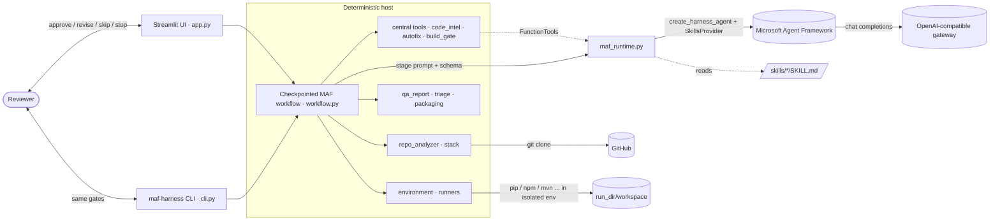
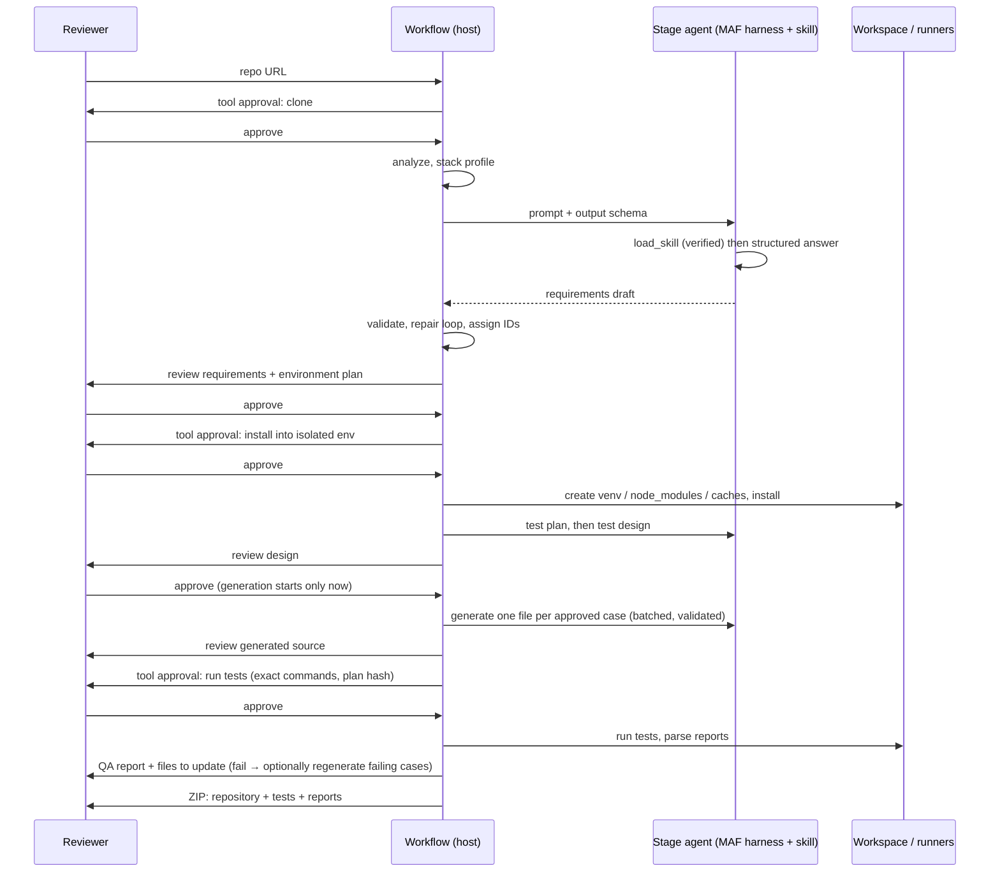

# Architecture

This document explains how the harness is built, what every file does, and where each guarantee is enforced.
Companion documents: [README](../README.md) (setup and usage), [IMPLEMENTATION_PLAN](IMPLEMENTATION_PLAN.md) (design decisions,
roadmap), [audit/ERRORS.md](audit/ERRORS.md) (defect register), [audit/E2E_RESULTS.md](audit/E2E_RESULTS.md) (live runs), [OBSERVABILITY.md](OBSERVABILITY.md) (tracing and the Observability tab).

## 1. What the system does

Given a public GitHub repository, the harness produces an **executed, traceable test suite** and a **QA report**, under human control:

1. clone and statically analyze the repository (host),
2. infer requirements, actors and the environment needed to run the repo (agent + Agent Skill),
3. install dependencies into an **isolated environment** after a tool-call approval (host),
4. plan tests, design test cases per actor (agents + Agent Skills), and — only after the design is approved — generate test source,
5. run the tests after a second tool-call approval, and report per case / per requirement, with the **files and lines to update** (host),
6. hand back a **ZIP** with the complete repository, all generated and executed tests, and the evidence.

Every model-authored artifact passes a human review gate. Anything that touches the machine (clone, install, run) needs its own approval.

Facts the host can compute exactly (does this import resolve, what are this class's real constructors, which routes exist, does this file
compile) are **not left to the model**: a central set of deterministic tools (`code_intel`, `autofix`, `build_gate`, `agent_tools`) answers them,
so generation calls are spent on test design, not on guessing.

## 2. System context



## 3. Workflow

Seven stages, each a MAF `Executor`; gates are MAF `request_info` events; state is checkpointed to disk.

| # | Stage | Actor | Consumes | Produces | Human gate | Code |
|---|---|---|---|---|---|---|
| 1 | `repo_analysis` | host | URL | clone, inventory, frameworks, stack profile, evidence | tool approval (clone) → review | `workflow.answer`, `repo_analyzer`, `stack` |
| 2 | `requirements` | agent · `repository-requirements` (+ `api-contract-analyzer` when an OpenAPI/Swagger file exists) | analysis, evidence | actors, requirements, acceptance criteria, rules, API contracts, **environment needs** + deterministic environment plan | review / revise | `workflow.model`, `skill_contracts.finalize_discovered_requirements` |
| 3 | `environment_setup` | host | requirements, stack | isolated environment with dependencies installed | **tool approval (install)** → review; can skip | `workflow.plan_environment/run_environment`, `environment`, `runners.setup_steps/execute_setup` |
| 4 | `test_planning` | agent · `test-planning` | requirements | levels, frameworks, risks, order | review / revise | `workflow.model` |
| 5 | `test_design` | agent · `test-design-generator` + `test-data-generator` | requirements, plan | cases with level/actor/target, traceability, coverage | review / revise; **generation cannot start before approval** | `skill_contracts.finalize_design`, `workflow._require_coverage_or_reason` |
| 6 | `test_generation` | agent · `generic-test-generator` + `test-data-generator` (+ `junit-generator` for Java/Kotlin, + `playwright-test-generator` for ui/e2e cases) | approved cases, evidence | one test file per case (validated) | review / revise | `workflow._generate_tests_batched`, `skill_contracts.validate_generated_files` |
| 7 | `test_execution` | host | generated files, environment | results, QA report, files to update, skill-contract reports (`traceability-generator`, `coverage-analyzer`), ZIP | **tool approval (run)** → review; regenerate failing tests (≤3 rounds) or skip | `workflow.plan_execution/run_execution/heal`, `runners.execute_plan`, `qa_report`, `triage`, `packaging` |

`execute=False` removes stages 3 and 7 (generation-only workflow).

### 3.1 Generation pipeline (stage 6, per batch of approved cases)

```mermaid
flowchart TD
  P[prompt: approved cases, target_source, collaborator_signatures,\nroutes + base_url, forbidden_imports, declared_dependencies] --> M[model call<br/>temperature rises on every retry]
  M --> N[normalize: lines[] → source, canonical case IDs, flatten deep with-chains, CASE_ID markers]
  N --> F[autofix: unambiguous missing imports, module paths]
  F --> V[validate_generated_files: one declaration per file, no skips/placeholders, syntax, compile]
  V --> S[static_gate: imports, undefined names, sys.exit mocks, patch targets, unused setup, routes, Arquillian]
  S --> B[build_gate: pytest --collect-only / mvn test-compile in the prepared workspace]
  B -->|ok| A[accepted batch, cached]
  V -->|error + remedy| R[repair feedback]
  S -->|error + remedy| R
  B -->|file:line diagnostics + remedy| R
  R --> M
```

Errors carry a concrete remedy (`triage.remedy_for`); after `GENERATION_MAX_ATTEMPTS` failures the batch surfaces a retry/stop gate and the next round
starts at a higher temperature (a deterministic model otherwise repeats a rejected answer verbatim). Accepted batches are cached, so a retry or a
heal round regenerates only what failed.



## 4. Guarantees and where they are enforced

| Guarantee | Enforcement point |
|---|---|
| The assigned Agent Skill was loaded through MAF's `load_skill` | `maf_runtime.ToolTraceMiddleware` + `_verify_skill_loaded`; audited by `maf-harness verify-run` |
| Skills follow the Agent Skills spec and vendored upstream skills are unmodified | `skills_registry.lint_skill`, `verify_lock` against `skills/SKILLS.lock.json` (per-file SHA-256), both inside `require_valid` before each stage |
| Skill scripts run only if reviewed and unchanged | `skill_scripts.HarnessScriptRunner` (allow-list + SHA-256 per run, argv-only, temp dir, sanitized env, timeout); MAF `run_skill_script` is auto-approved only for model-tier scripts (`script_approval_rule`) |
| Only a daily cap of 50,000,000 tokens (all runs on the machine); no per-run, per-call or call-count limits | `usage.DailyUsageLedger` (locked JSON file per local day), `maf_runtime.BudgetGuard` (reserve → call → settle), `settings.DAILY_TOKEN_LIMIT` |
| Design cases exist at unit level, per actor, and per requirement (or the gap is explained) | `workflow._require_coverage_or_reason` (repair loop, last attempt reaches the human with the gap recorded) |
| Test source only after the design is approved | graph edge `test_design → test_generation` only fires on approve; `state.approved` hash checked; `tests/test_policies.py` |
| Generated source is structurally sound | `skill_contracts.validate_generated_files`: paths, markers, one declaration per file, no placeholders/skips, syntax (Python AST + `compile()`; javac/node/gofmt or brace balance) |
| Generated tests cannot fail for reasons the host can see in advance | `code_intel.static_gate`: import resolution (Python names and modules, Java libraries), undefined names, mocked `sys.exit`, patch targets that do not exist, setup collections never used, URL paths that are not application routes, Arquillian; then `build_gate.try_build` (collect/compile) after the approved install |
| Mechanical mistakes are repaired, not re-asked, and every repair is visible | `autofix.autofix_files` (only fixes that cannot change what a test means); `autofix` events in `audit.jsonl`, counters in `state.tooling` |
| A rejected answer is not repeated verbatim | retry temperature schedule in `workflow._generate_tests_batched`, `forbidden_imports` in the generation policy, actionable feedback (`triage.remedy_for`, named extra test methods) |
| Provider limits are reported as such | `workflow.friendly_error` (HTTP 429 → "the provider's limit, not the harness's daily cap"); never worked around |
| Nothing is installed or run without approval; plan cannot change after approval | `workflow.ask` (tool gate) + `plan_hash` comparison in `run_environment` / `run_execution` |
| Install is isolated | `runners.setup_steps` (venv, project `node_modules`, cache-dir repositories); system tools only reported (`environment.TOOLS` hints) |
| Secrets never reach installed/test code | `execution._child_env` allow-list, fake `HOME` |
| Every skill and tool invocation of a run can be inspected afterwards, and the trace is checked against the run's own accounting | `trace.jsonl` written from MAF middleware; `observability.build_report` integrity checks (skills loaded, no unexpected tools, trace tokens = ledger tokens) |
| A green verdict means something | `runners.execute_plan` (fresh reports only), `qa_report.verdict_for` |
| Every failure names the files/lines to change | `triage.build_updates` → `qa_report["updates"]` |

## 5. Run directory (`.harness_runs/<run>/`)

| Path | Content |
|---|---|
| `run.json` | view + full state (artifacts, approvals, provenance, budget, `routes`, `tooling` counters, `generation_rounds`) |
| `checkpoints/` | MAF `FileCheckpointStorage` |
| `audit.jsonl` | every request, response, tool start/finish, repair, heal, `autofix` and `build_gate` event |
| `trace.jsonl` | MAF-middleware trace: `model_run`, `chat_call` (tokens, duration) and `tool_call` (category, summarised arguments, duration) events |
| `repo/` | shallow clone (never modified) |
| `workspace/` | repository copy + isolated env + generated tests (what actually ran) |
| `environment/attempt-N/` | install step logs + `report.json` (immutable) |
| `executions/attempt-N/` | test step logs + `report.json` (immutable) |
| `generation_attempts/` | every raw model attempt for test generation |
| `build_checks/` | per-attempt `pytest --collect-only` / `mvn test-compile` output of the build gate |
| `qa_report.md/.json` | final report (also inside the ZIP) |
| `deliverables/<repo>-with-tests-<run>.zip` | complete repository + generated tests + `harness-report/` |

## 6. File-by-file reference

### 6.1 Application package `src/maf_test_harness/`

| File | Responsibility | Key contents | Notes |
|---|---|---|---|
| `__init__.py` | Package marker | exports `RepoAnalysis`, `TestPlan` | — |
| `settings.py` | Single source of configuration | `load_dotenv` (git-ignored `.env`, never overrides the shell, reads only `OPENAI_*`/`LLM_MODEL`/`HARNESS_*`), gateway env vars (`OPENAI_MODEL`, alias `LLM_MODEL`), `DAILY_TOKEN_LIMIT` (default 50,000,000, env `HARNESS_DAILY_TOKEN_LIMIT`), `AGENT_TOOLS` / `AUTOFIX` / `BUILD_GATE` switches, batch/attempt sizes, timeouts, `SKILL_MODE` | Credentials are read from the environment or the git-ignored `.env` only |
| `models.py` | Pydantic contracts for model output | `RequirementsDraft` (actors, requirements, criteria, rules, contracts, environment needs), `TestPlan`, `TestDesignDraft`/`TestDesignCaseDraft` (level/actor/target), `GeneratedFilesDraft` (source as `lines[]`), `RepoAnalysis` | `extra="forbid"` + bounded lists so structured output is enforceable and cannot run away |
| `personas.py` | Role, goal and rules per stage | `PERSONAS` for the 5 agent stages + 2 host stages, `persona_instructions()` | Host stages appear so the UI/audit list every stage uniformly |
| `repo_analyzer.py` | Repository intake (incl. `declared_dependencies`, `extract_target_sources`, `collaborator_signatures`, `java_signatures`) | `validate_github_url` (page or clone URL, optional `/tree/<ref>`), `clone_repository` (no prompts, no hooks), `analyze_repository`, `_detect_frameworks`, `build_repository_evidence` (source-first, line-numbered, bounded, secrets redacted) | Only tracked files are analyzed |
| `code_intel.py` | Central deterministic tools | `RepoContext`, `resolve_import`, `module_api`, `find_symbol`, `read_source`, `installed_packages`, `list_routes`, `probe_tools`, `static_gate` (all static gates for one file), `undefined_python_names` | One implementation serves the host pre-check, the auto-fixers and the agent tools; read-only and bounded |
| `autofix.py` | Mechanical repairs before any model retry | `fix_python` (missing stdlib/mock imports, unresolvable module path → the one repository module with that leaf), `fix_java` (JDK, unique repository class and JUnit imports, static assertion imports), `autofix_files` | Only fixes that cannot change what a test means; every fix is audited (`autofix` events, `state.tooling`) |
| `build_gate.py` | Compile/collect candidates in the prepared workspace | `try_build` (`pytest --collect-only` per file, `mvn test-compile`), `_maven_errors` (file:line + symbol detail, de-duplicated) | Runs only after the approved environment install; never runs test bodies; candidates and their classes are removed afterwards |
| `agent_tools.py` | The central tools as MAF `FunctionTool`s | `HarnessToolbox`, `STAGE_TOOLS`, `tool_instructions` | Small per-stage selection; calls appear in `skill_tool_trace[stage].harness_tool_calls` |
| `routes.py` | Route inventory | `extract_routes` (JAX-RS, Spring, Flask/FastAPI, Express), `route_prefixes` | Shown to generation and used by `check_route_literals`; best effort, empty inventory disables the URL gate |
| `stack.py` | Deterministic stack profile | `detect_stack` → ecosystems, primary, test runner, web UI/service hints, OpenAPI/CI/container files, missing tools | Drives runner and environment plan |
| `environment.py` | Environment plan | `build_environment_plan` (prerequisites with versions and install hints, isolation strategy, exact install steps incl. nested `requirements*.txt` and evidence-backed documented packages), `nested_requirements`, `documented_packages`, `steps_from_plan` | System tools are reported, never installed |
| `runners.py` | Per-ecosystem adapters and execution | `setup_steps`, `build_plan`, `execute_setup`, `execute_plan` (fresh evidence only, compile-error quarantine), result parsers (JUnit/Jest/Go/TRX), `map_results_to_cases`, allow-listed pytest helpers | Python, Node (jest/vitest/Playwright), Maven, Gradle, Go, .NET |
| `execution.py` | Safe process execution + workspace | `run_command` (argv only, process-group timeout, sanitized env, immutable result dir), `copy_repo`, `write_generated`, JUnit reader | Local process — **not a sandbox** |
| `skill_contracts.py` | Deterministic adapters around skill contracts (incl. `resolve_id`, `flatten_nested_with`, import gates, `check_python_test_hygiene`, `check_route_literals`) | ID assignment, `finalize_discovered_requirements`, `finalize_design` (traceability matrix, coverage, gaps, schema check), `validate_generated_files`, syntax/import gates | The "trust boundary" between model text and accepted artifacts |
| `skills_registry.py` | Agent Skills spec lint + supply-chain lock | `lint_skill`, `lint_all`, `load_lock`, `verify_lock`, `reviewed_scripts`, `require_valid`, `tree_sha256` | Package hash goes into provenance; tampering with a vendored skill is refused |
| `skills_config.py` | Which skills each stage loads | `SKILL_NAMES`, `COMPANION_PURPOSE`, `skills_for(stage, state)` → primary + companions | Deterministic over the stack profile and the approved design |
| `skill_scripts.py` | Reviewed-script execution | `HarnessScriptRunner` (MAF `SkillScriptRunner` + host executor), `script_approval_rule`, `ScriptRefused` | Two tiers: model-callable and host-only |
| `skill_reports.py` | Skill-contract QA reports | `build_traceability`, `build_coverage`, `run_skill_checks` | Validated by the upstream `validate_traceability.py` and `coverage_templates.yaml` |
| `maf_runtime.py` | MAF integration | `MAFHarnessRuntime` (per-stage `create_harness_agent`, `SkillsProvider`, central tools via `tool_provider`, priming, verification, per-call `temperature`), `ToolTraceMiddleware`, `BudgetGuard`, `extract_json_object` | See §7 |
| `runtime_service.py` | One asyncio loop thread | `RuntimeService.submit/close` | Keeps MAF clients on one loop for the Streamlit UI |
| `workflow.py` | Checkpointed workflow | `Harness` (stages, gates, repair loops, heal loop, environment/execution stages), `StageExecutor`, batched generation with caching and the autofix → gate → build-gate pipeline (`_generate_tests_batched`, `_repo_context`, `_build_gate`), `_generation_policy`, `friendly_error` | Central orchestration |
| `qa_report.py` | QA report | `build_qa_report`, `verdict_for`, `render_markdown` | requirement → case → file → result |
| `triage.py` | Files/lines to update | `locations`, `classify`, `build_updates`, `REMEDIES` / `remedy_for` (concrete fix per failure pattern) | Test-defect vs application-first classification; remedies feed regeneration and the QA report |
| `packaging.py` | Deliverable ZIP | `build_deliverable`, `run_instructions` | Repo + generated tests + `harness-report/` |
| `artifact_presenter.py` | JSON → readable UI/Markdown | `json_to_markdown`, `render_json_ui`, `artifact_downloads`, `humanize` | Shared by UI and `scripts/json_to_markdown.py` |
| `trace.py` | Run trace recorder | `TraceRecorder` (thread-safe JSON Lines), `read_trace`, `summarize_arguments` / `redact`, `tool_category` | Never stores prompts, responses or complete files |
| `observability.py` | Observability and traceability report | `build_report` (from `trace.jsonl`, `audit.jsonl`, `run.json`, `qa_report.json`), `render_markdown` | Works for runs made before tracing existed (summary level); integrity checks |
| `observability_ui.py` | Streamlit page for the report | `render_observability` (Overview, Skills, Tools, Timeline, Traceability, Integrity checks, Export) | Imported lazily by `app.py` |
| `telemetry.py` | Optional OpenTelemetry export | `configure_telemetry` (`HARNESS_OTEL` = off, console or otlp; sensitive data always off) | See OBSERVABILITY.md §5 |
| `usage.py` | Daily token ledger | `DailyUsageLedger` (`reserve`, `settle`, `snapshot`), `DailyLimitError` | File lock makes concurrent runs safe |
| `cli.py` | Headless driver | `run` (resumes an existing `--run-dir` at its pending gate), `verify-run`, `trace`, `lint-skills` | Exit codes 0 pass, 1 fail, 2 inconclusive/error |

### 6.2 Entry points and scripts

| File | Responsibility |
|---|---|
| `app.py` | Streamlit UI: start form (URL, optional app URL), review/tool gates, QA tab with files to update, generated tests, **Observability** tab, audit/provenance, ZIP download, daily token meter |
| `scripts/json_to_markdown.py` | Convert any saved JSON artifact to Markdown with the same formatter as the UI |
| `scripts/vendor_skills.py` | Vendor selected skills from the upstream repository: copy, audit (upstream `evaluator-skill`, offline), hash, write `skills/SKILLS.lock.json` incl. the reviewed-script allow-list |
| `pyproject.toml` | Package metadata, pinned MAF versions, `maf-harness` script, ruff lint/format and pytest config |
| `uv.lock` | Locked dependency set |
| `.env.example` | Documented environment variables (no secrets) |
| `.gitignore` | Excludes venvs, runs, caches, target checkouts, local tool state |
| `.github/workflows/ci.yml` | Lint + format check, skills lint, tests, UI browser tests, secrets scan |

### 6.3 Agent Skills `skills/`

Selection is by what the harness requires, from [github.com/shivswami/awesome-agent-skills](https://github.com/shivswami/awesome-agent-skills)
(branch `update-skills`, pinned in `skills/SKILLS.lock.json`). Each vendored skill was audited with the upstream `evaluator-skill`
(NVIDIA SkillSpector rules, offline): all six have **0 security findings** (scores 94.5-95.5).

| Skill | Origin | Loaded by | Purpose in the harness | Scripts |
|---|---|---|---|---|
| `repository-requirements` | local | requirements (primary) | evidence-based requirements, actors, criteria, environment needs | — |
| `test-planning` | local | test_planning (primary) | risk-based plan by level/framework | — |
| `test-design-generator` | upstream (earlier import, locally adapted `SKILL.md`; schema `assets/testcase_templates.yaml` is authoritative) | test_design (primary) | cases with traceability, coverage, gaps | `validate_design.py` (not run) |
| `generic-test-generator` | local | test_generation (primary) | one-file-per-case polyglot generation rules | — |
| `api-contract-analyzer` | upstream | requirements when an OpenAPI/Swagger file exists | normalized HTTP contracts | `validate_contract.py` (host tier, reviewed) |
| `test-data-generator` | upstream | test_design + test_generation | deterministic seeds, IDs, fixtures | `deterministic_helpers.py` (**model tier**: callable by the agent), `validate_fixtures.py` (host tier) |
| `junit-generator` | upstream | test_generation for Java/Kotlin repos | JUnit conventions | `generate_junit.js` reviewed, **not enabled** (writes files; output contains placeholders) |
| `playwright-test-generator` | upstream | test_generation when ui/e2e cases exist | resilient browser tests | `mcp.json` (not a script) |
| `traceability-generator` | upstream | QA (host) | requirement → test → artifact matrix contract | `validate_traceability.py` (host tier, run on every QA report) |
| `coverage-analyzer` | upstream | QA (host) | coverage/gap contract (`assets/coverage_templates.yaml`, validated with jsonschema) | `run-coverage.js` reviewed, **not enabled** (`execSync` of npx) |

Not selected from the upstream repository, with reasons: `requirement-analysis` (plans feature changes, not test requirements),
`reverse-engineering-skill` (it is one of the qualification targets), `gherkin-generator` (no BDD requirement), `change-impact-analysis`
(deployment risk), `playwright-test-executor` (needs Playwright traces/MCP), `jira-/confluence-story-converter` (no Jira/Confluence input),
`vulnerability-checks-bundle` (needs Snyk/SonarQube/Wiz accounts), `skill-creator/-auditor/-gap-analyzer/-evaluator` (meta tools; the
`evaluator-skill` is used only by `scripts/vendor_skills.py` as the pre-adoption audit).

**Script policy.** MAF treats skill scripts as third-party code. A script may run only if it is in `SKILLS.lock.json` → `reviewed_scripts`
(reviewed by reading it) and its bytes still match the recorded SHA-256. *Model tier* scripts are pure functions of their arguments and may be
called by an agent through MAF `run_skill_script` (auto-approved by `script_approval_rule`); *host tier* scripts are run only by the harness on
its own artifacts. Everything else is refused, and every run is recorded in `state.skill_script_runs`.

### 6.4 Tests `tests/`

| File | What it verifies |
|---|---|
| `fakes.py` | Scripted stage runtime + environment double shared by workflow tests |
| `test_native_maf.py` | Real MAF harness/`SkillsProvider`/middleware with a scripted transport: skill loaded once per stage, rejection when not loaded, script requests rejected, preloaded mode labelled |
| `test_policies.py` | Daily-cap ledger (default 50,000,000) (shared across runs, day rollover, concurrency, refunds), generation only after design approval, unit/actor/requirement design policy |
| `test_execution_stage.py` | End-to-end workflow with real subprocess execution: environment approval, run approval, QA verdicts, heal loop, skip, tamper checks, repair loops, ZIP contents |
| `test_stack_and_runners.py` | Stack detection, adapters, parsers, quarantine of uncompilable files, secrets not forwarded |
| `test_execution.py` | `run_command`, JUnit reading, workspace copy, no overwrite, no stale bytecode |
| `test_central_tools.py` | Import resolution, API/symbol tools, auto-fixers (Python and Java), build gate (real pytest; Maven diagnostics), MAF tool wrappers |
| `test_observability.py` | Recorder, redaction, real-MAF middleware trace, report (full / older runs / integrity failures), traceability, `trace` CLI, telemetry |
| `test_generation_gates.py` | sys.exit-mock lint, undefined names, patch targets, unused setup, route literals and extraction, collaborator signatures, nested requirements and documented packages, Arquillian gate, declaration feedback, forbidden libraries, `friendly_error` |
| `test_triage.py` | Location parsing, classification, files-to-update report |
| `test_skill_contracts.py`, `test_validation_regressions.py`, `test_urls_and_contracts.py` | Schema, IDs, traceability, generated-source validators, URL policy, import gates |
| `test_repo_analyzer.py` | Analysis and evidence selection |
| `test_skills_registry.py`, `test_personas.py`, `test_cli.py` | Skill lint, persona contracts, `verify-run` |
| `test_harness_gates.py`, `test_recovery.py`, `test_attempt_audit.py`, `test_runtime_utils.py`, `test_artifact_presenter.py` | Approval replay guards, retry gates, attempt retention, runtime loop, presenters |
| `targets/test_harness_browser.py` | Streamlit UI in a real browser (`HARNESS_BROWSER=1`) |
| `targets/test_reverse_engineering.py`, `targets/test_petstore_browser.py` | Opt-in acceptance suites for the two qualification targets |

### 6.5 Documentation and evidence

| File | Content |
|---|---|
| `docs/ARCHITECTURE.md` | This document |
| `docs/IMPLEMENTATION_PLAN.md` | Decisions, MS Learn alignment, milestones, risks |
| `docs/OBSERVABILITY.md` | Observability design (from the MAF guide), data model, tab, CLI, OpenTelemetry |
| `docs/audit/ERRORS.md` | Defect register with fixes |
| `docs/audit/E2E_RESULTS.md` | Live end-to-end results and analysis of the original failing runs |
| `docs/audit/*-e2e.xml`, `screenshots/` | Test evidence for defects found in the target applications |
| `patches/*.patch` | Upstream fixes for those target defects |

## 7. MAF integration in detail (`maf_runtime.py`, `skills_config.py`, `skill_scripts.py`)

* **One harness agent per stage and skill set**: `create_harness_agent(client=…, skills_provider=…, auto_approval_rules=[read-only rule, script rule], middleware=[BudgetGuard, ToolTraceMiddleware])`. Web search, todos, modes, file memory and compaction are disabled; the tools are the skill tools plus the small per-stage selection of central tools.
* **Skill selection**: `skills_for(stage, state)` returns the primary skill plus companions chosen from the stack profile (OpenAPI file present) and the approved design (Java/Kotlin, ui/e2e levels). The instructions name the primary skill as the task contract and state what each companion is for.
* **Skill provider**: `SkillsProvider(DeduplicatingSkillsSource(FilteringSkillsSource(FileSkillsSource(skills_dir, script_runner=HarnessScriptRunner, script_filter=model-tier allow-list))))`, filtered to exactly the assigned skills.
* **Priming**: a tool-only turn ("call `load_skill` once for each of …, then reply READY", up to 5 attempts) runs first because some gateways skip tool calls when structured output is requested in the same turn. The primed session snapshot is copied for every later call of that stage.
* **Verification**: `ToolTraceMiddleware` records each real tool invocation; output is rejected unless `load_skill` succeeded for **every** assigned skill. Provenance (`skill_provenance` with companions, `skill_tool_trace`, `runtime_provenance`, `skill_script_runs`, per-call hashes) is stored in `run.json`; `maf-harness verify-run` re-checks it and the lock.
* **Budget**: `BudgetGuard` reserves estimate + max output against the daily ledger before each call (raising `DailyLimitError` before any provider call) and settles to the provider-reported usage afterwards; failed calls are refunded. The only refusal is exceeding the daily cap (default 50,000,000 tokens for the local day). The model gateway may enforce its own, separate quota; a provider 429 is reported as such and is never worked around.
* **Central tools** (`agent_tools.py`, `code_intel.py`): nine deterministic tools are registered as MAF function tools (`approval_mode="never_require"`, read-only or scratch-only): `resolve_import`, `module_api`, `find_symbol`, `read_source`, `check_test`, `list_routes`, `installed_packages`, `probe_tools`, `try_build`. Each stage gets a small selection (`STAGE_TOOLS`), and the instructions tell the agent to use them sparingly. The host applies the same functions itself on every candidate (autofix → static gates → build gate), so correctness never depends on the agent choosing to call them.
* **Fallback**: `HARNESS_SKILL_MODE=preloaded` injects all assigned skill texts into instructions and is recorded as `uses_maf_skills_provider: false`.

## 8. Extending

| To add | Do this |
|---|---|
| An ecosystem | `stack.detect_stack` (signals) → `stack.REQUIRED_TOOLS` → `environment.TOOLS/ISOLATION` → `runners.setup_steps` and `build_plan` (+ a result parser) → tests in `test_stack_and_runners.py` |
| A stage | add an `Executor` name to `workflow.STAGES`, a persona, and either a model stage (schema in `models.py`, skill in `skills/`, entry in `SKILL_NAMES`) or a host stage (`enter` branch) |
| A skill | add it to `SELECTED` in `scripts/vendor_skills.py` (upstream) or create `skills/<name>/SKILL.md` (local), reference it in `skills_config.skills_for`, review any script and list it in `REVIEWED_SCRIPTS`; `maf-harness lint-skills` must pass |
| A sandbox | replace `execution.run_command` behind the same signature (container/VM); everything above it is unchanged |

## 9. Configuration reference

| Setting | Source | Default | Purpose |
|---|---|---|---|
| `OPENAI_API_KEY`, `OPENAI_BASE_URL`, `OPENAI_MODEL` | env or `.env` | — / — / `deepseek-v4-flash-global` | model gateway (a shell variable wins over `.env`) |
| `HARNESS_DAILY_TOKEN_LIMIT` | env | 50,000,000 | the only token limit, per local day across all runs (the machine's owner may raise it for a day) |
| `HARNESS_AGENT_TOOLS` / `HARNESS_AUTOFIX` / `HARNESS_BUILD_GATE` | env | `on` | central agent tools / mechanical repairs / compile-collect gate (each can be switched off for A/B comparison) |
| `HARNESS_USAGE_DIR` | env | `~/.maf-harness/usage` | where the daily ledger is stored |
| `HARNESS_SKILL_MODE` | env | `progressive` | MAF SkillsProvider vs preloaded fallback |
| `HARNESS_GENERATION_BATCH_SIZE` / `_MAX_ATTEMPTS` | env | 3 / 3 | cases per model call / repair attempts |
| `HARNESS_MAX_OUTPUT_TOKENS` | env | 16384 | per-response cap (not a workflow limit) |
| `HARNESS_EXECUTION_TIMEOUT` | env | 900 s | per install/test command |
| `HARNESS_RUNS_DIR` | env | `.harness_runs` | run storage for the UI |
