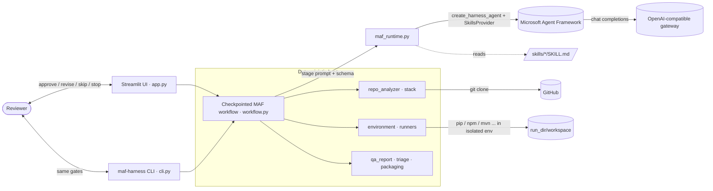
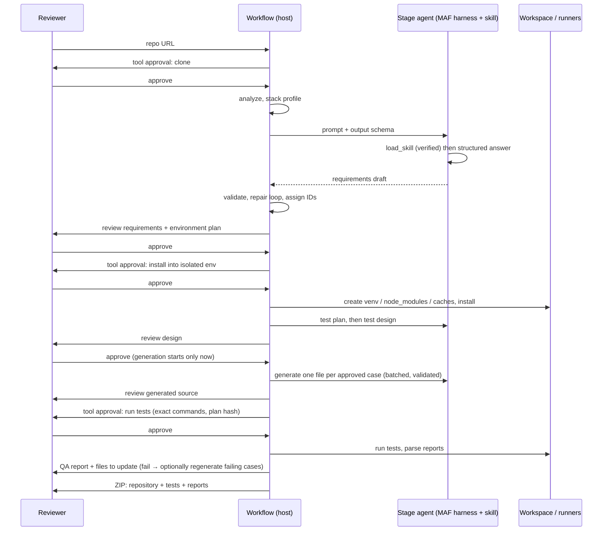

# Architecture

This document explains how the harness is built, what every file does, and where each guarantee is enforced.
Companion documents: [README](../README.md) (setup and usage), [IMPLEMENTATION_PLAN](IMPLEMENTATION_PLAN.md) (design decisions,
roadmap), [audit/ERRORS.md](audit/ERRORS.md) (defect register), [audit/E2E_RESULTS.md](audit/E2E_RESULTS.md) (live runs).

## 1. What the system does

Given a public GitHub repository, the harness produces an **executed, traceable test suite** and a **QA report**, under human control:

1. clone and statically analyze the repository (host),
2. infer requirements, actors and the environment needed to run the repo (agent + Agent Skill),
3. install dependencies into an **isolated environment** after a tool-call approval (host),
4. plan tests, design test cases per actor (agents + Agent Skills), and — only after the design is approved — generate test source,
5. run the tests after a second tool-call approval, and report per case / per requirement, with the **files and lines to update** (host),
6. hand back a **ZIP** with the complete repository, all generated and executed tests, and the evidence.

Every model-authored artifact passes a human review gate. Anything that touches the machine (clone, install, run) needs its own approval.

## 2. System context

## 3. Workflow

Seven stages, each a MAF `Executor`; gates are MAF `request_info` events; state is checkpointed to disk.

| # | Stage | Actor | Consumes | Produces | Human gate | Code |
|---|---|---|---|---|---|---|
| 1 | `repo_analysis` | host | URL | clone, inventory, frameworks, stack profile, evidence | tool approval (clone) → review | `workflow.answer`, `repo_analyzer`, `stack` |
| 2 | `requirements` | agent · `repository-requirements` | analysis, evidence | actors, requirements, acceptance criteria, rules, API contracts, **environment needs** + deterministic environment plan | review / revise | `workflow.model`, `skill_contracts.finalize_discovered_requirements` |
| 3 | `environment_setup` | host | requirements, stack | isolated environment with dependencies installed | **tool approval (install)** → review; can skip | `workflow.plan_environment/run_environment`, `environment`, `runners.setup_steps/execute_setup` |
| 4 | `test_planning` | agent · `test-planning` | requirements | levels, frameworks, risks, order | review / revise | `workflow.model` |
| 5 | `test_design` | agent · `test-design-generator` | requirements, plan | cases with level/actor/target, traceability, coverage | review / revise; **generation cannot start before approval** | `skill_contracts.finalize_design`, `workflow._require_coverage_or_reason` |
| 6 | `test_generation` | agent · `generic-test-generator` | approved cases, evidence | one test file per case (validated) | review / revise | `workflow._generate_tests_batched`, `skill_contracts.validate_generated_files` |
| 7 | `test_execution` | host | generated files, environment | results, QA report, files to update, ZIP | **tool approval (run)** → review; regenerate failing tests (≤3 rounds) or skip | `workflow.plan_execution/run_execution/heal`, `runners.execute_plan`, `qa_report`, `triage`, `packaging` |

`execute=False` removes stages 3 and 7 (generation-only workflow).

## 4. Guarantees and where they are enforced

| Guarantee | Enforcement point |
|---|---|
| The assigned Agent Skill was loaded through MAF's `load_skill` | `maf_runtime.ToolTraceMiddleware` + `_verify_skill_loaded`; audited by `maf-harness verify-run` |
| Skills follow the Agent Skills spec | `skills_registry.lint_skill` / `require_valid` before each stage |
| Only 2,000,000 tokens per workflow run; no per-call or call-count limits | `maf_runtime.BudgetGuard`, `settings.RUN_TOKEN_LIMIT` |
| Design cases exist at unit level, per actor, and per requirement (or the gap is explained) | `workflow._require_coverage_or_reason` (repair loop, last attempt reaches the human with the gap recorded) |
| Test source only after the design is approved | graph edge `test_design → test_generation` only fires on approve; `state.approved` hash checked; `tests/test_policies.py` |
| Generated source is structurally sound | `skill_contracts.validate_generated_files`: paths, markers, one declaration per file, no placeholders/skips, syntax (Python AST; javac/node/gofmt or brace balance), import resolution (Python, Java) |
| Nothing is installed or run without approval; plan cannot change after approval | `workflow.ask` (tool gate) + `plan_hash` comparison in `run_environment` / `run_execution` |
| Install is isolated | `runners.setup_steps` (venv, project `node_modules`, cache-dir repositories); system tools only reported (`environment.TOOLS` hints) |
| Secrets never reach installed/test code | `execution._child_env` allow-list, fake `HOME` |
| A green verdict means something | `runners.execute_plan` (fresh reports only), `qa_report.verdict_for` |
| Every failure names the files/lines to change | `triage.build_updates` → `qa_report["updates"]` |

## 5. Run directory (`.harness_runs/<run>/`)

| Path | Content |
|---|---|
| `run.json` | view + full state (artifacts, approvals, provenance, budget) |
| `checkpoints/` | MAF `FileCheckpointStorage` |
| `audit.jsonl` | every request, response, tool start/finish, repair, heal |
| `repo/` | shallow clone (never modified) |
| `workspace/` | repository copy + isolated env + generated tests (what actually ran) |
| `environment/attempt-N/` | install step logs + `report.json` (immutable) |
| `executions/attempt-N/` | test step logs + `report.json` (immutable) |
| `generation_attempts/` | every raw model attempt for test generation |
| `qa_report.md/.json` | final report (also inside the ZIP) |
| `deliverables/<repo>-with-tests-<run>.zip` | complete repository + generated tests + `harness-report/` |

## 6. File-by-file reference

### 6.1 Application package `src/maf_test_harness/`

| File | Responsibility | Key contents | Notes |
|---|---|---|---|
| `__init__.py` | Package marker | exports `RepoAnalysis`, `TestPlan` | — |
| `settings.py` | Single source of configuration | gateway env vars, `RUN_TOKEN_LIMIT = 2_000_000`, batch/attempt sizes, timeouts, `SKILL_MODE` | Credentials are read from the environment only |
| `models.py` | Pydantic contracts for model output | `RequirementsDraft` (actors, requirements, criteria, rules, contracts, environment needs), `TestPlan`, `TestDesignDraft`/`TestDesignCaseDraft` (level/actor/target), `GeneratedFilesDraft` (source as `lines[]`), `RepoAnalysis` | `extra="forbid"` + bounded lists so structured output is enforceable and cannot run away |
| `personas.py` | Role, goal and rules per stage | `PERSONAS` for the 5 agent stages + 2 host stages, `persona_instructions()` | Host stages appear so the UI/audit list every stage uniformly |
| `repo_analyzer.py` | Repository intake | `validate_github_url` (page or clone URL, optional `/tree/<ref>`), `clone_repository` (no prompts, no hooks), `analyze_repository`, `_detect_frameworks`, `build_repository_evidence` (source-first, line-numbered, bounded, secrets redacted) | Only tracked files are analyzed |
| `stack.py` | Deterministic stack profile | `detect_stack` → ecosystems, primary, test runner, web UI/service hints, OpenAPI/CI/container files, missing tools | Drives runner and environment plan |
| `environment.py` | Environment plan | `build_environment_plan` (prerequisites with versions and install hints, isolation strategy, exact install steps), `steps_from_plan` | System tools are reported, never installed |
| `runners.py` | Per-ecosystem adapters and execution | `setup_steps`, `build_plan`, `execute_setup`, `execute_plan` (fresh evidence only, compile-error quarantine), result parsers (JUnit/Jest/Go/TRX), `map_results_to_cases`, allow-listed pytest helpers | Python, Node (jest/vitest/Playwright), Maven, Gradle, Go, .NET |
| `execution.py` | Safe process execution + workspace | `run_command` (argv only, process-group timeout, sanitized env, immutable result dir), `copy_repo`, `write_generated`, JUnit reader | Local process — **not a sandbox** |
| `skill_contracts.py` | Deterministic adapters around skill contracts | ID assignment, `finalize_discovered_requirements`, `finalize_design` (traceability matrix, coverage, gaps, schema check), `validate_generated_files`, syntax/import gates | The "trust boundary" between model text and accepted artifacts |
| `skills_registry.py` | Agent Skills spec lint | `lint_skill`, `lint_all`, `require_valid`, `tree_sha256` | Package hash goes into provenance |
| `maf_runtime.py` | MAF integration | `MAFHarnessRuntime` (per-stage `create_harness_agent`, `SkillsProvider`, priming, verification), `ToolTraceMiddleware`, `BudgetGuard`, `extract_json_object` | See §7 |
| `runtime_service.py` | One asyncio loop thread | `RuntimeService.submit/close` | Keeps MAF clients on one loop for the Streamlit UI |
| `workflow.py` | Checkpointed workflow | `Harness` (stages, gates, repair loops, heal loop, environment/execution stages), `StageExecutor`, batching and caching of generation | Central orchestration |
| `qa_report.py` | QA report | `build_qa_report`, `verdict_for`, `render_markdown` | requirement → case → file → result |
| `triage.py` | Files/lines to update | `locations`, `classify`, `build_updates` | Test-defect vs application-first classification |
| `packaging.py` | Deliverable ZIP | `build_deliverable`, `run_instructions` | Repo + generated tests + `harness-report/` |
| `artifact_presenter.py` | JSON → readable UI/Markdown | `json_to_markdown`, `render_json_ui`, `artifact_downloads`, `humanize` | Shared by UI and `scripts/json_to_markdown.py` |
| `cli.py` | Headless driver | `run`, `verify-run`, `lint-skills` | Exit codes 0 pass, 1 fail, 2 inconclusive/error |

### 6.2 Entry points and scripts

| File | Responsibility |
|---|---|
| `app.py` | Streamlit UI: start form (URL, optional app URL), review/tool gates, QA tab with files to update, generated tests, audit/provenance, ZIP download, 2M token meter |
| `scripts/json_to_markdown.py` | Convert any saved JSON artifact to Markdown with the same formatter as the UI |
| `pyproject.toml` | Package metadata, pinned MAF versions, `maf-harness` script, ruff lint/format and pytest config |
| `uv.lock` | Locked dependency set |
| `.env.example` | Documented environment variables (no secrets) |
| `.gitignore` | Excludes venvs, runs, caches, target checkouts, local tool state |
| `.github/workflows/ci.yml` | Lint + format check, skills lint, tests, UI browser tests, secrets scan |

### 6.3 Agent Skills `skills/` (only the four the workflow assigns)

| Skill | Stage | What it contributes |
|---|---|---|
| `repository-requirements/SKILL.md` | requirements | Rules for evidence-based requirements, actors, criteria, environment needs |
| `test-planning/SKILL.md` | test_planning | Risk-based plan by level/framework |
| `test-design-generator/` | test_design | Vendored upstream skill: `SKILL.md`, authoritative schema `assets/testcase_templates.yaml` (loaded by `skill_contracts.design_schema`), references/examples readable through `read_skill_resource`; `scripts/validate_design.py`, `marketplace.yaml`, `skill-card.json`, `UPSTREAM.*` are upstream package files (scripts are never executed by the harness; the hash in `UPSTREAM.sha256` records provenance) |
| `generic-test-generator/SKILL.md` | test_generation | One-case-per-file generation rules, `lines[]` output, `BASE_URL` for UI tests |

### 6.4 Tests `tests/`

| File | What it verifies |
|---|---|
| `fakes.py` | Scripted stage runtime + environment double shared by workflow tests |
| `test_native_maf.py` | Real MAF harness/`SkillsProvider`/middleware with a scripted transport: skill loaded once per stage, rejection when not loaded, script requests rejected, preloaded mode labelled |
| `test_policies.py` | 2M-only token budget, generation only after design approval, unit/actor/requirement design policy |
| `test_execution_stage.py` | End-to-end workflow with real subprocess execution: environment approval, run approval, QA verdicts, heal loop, skip, tamper checks, repair loops, ZIP contents |
| `test_stack_and_runners.py` | Stack detection, adapters, parsers, quarantine of uncompilable files, secrets not forwarded |
| `test_execution.py` | `run_command`, JUnit reading, workspace copy, no overwrite, no stale bytecode |
| `test_triage.py` | Location parsing, classification, files-to-update report |
| `test_skill_contracts.py`, `test_validation_regressions.py`, `test_urls_and_contracts.py` | Schema, IDs, traceability, generated-source validators, URL policy, import gates |
| `test_repo_analyzer.py` | Analysis and evidence selection |
| `test_skills_registry.py`, `test_personas.py`, `test_cli.py` | Skill lint, persona contracts, `verify-run` |
| `test_harness_gates.py`, `test_recovery.py`, `test_attempt_audit.py`, `test_runtime_utils.py`, `test_artifact_presenter.py` | Approval replay guards, retry gates, attempt retention, runtime loop, presenters |
| `targets/test_harness_browser.py` | Streamlit UI in a real browser (`HARNESS_BROWSER=1`) |
| `targets/test_reverse_engineering.py`, `targets/test_petstore_browser.py` | Opt-in acceptance suites for the two qualification targets |

### 6.5 Documentation and evidence

| File | Content |
|---|---|
| `docs/ARCHITECTURE.md` | This document |
| `docs/IMPLEMENTATION_PLAN.md` | Decisions, MS Learn alignment, milestones, risks |
| `docs/audit/ERRORS.md` | Defect register with fixes |
| `docs/audit/E2E_RESULTS.md` | Live end-to-end results and analysis of the original failing runs |
| `docs/audit/*-e2e.xml`, `screenshots/` | Test evidence for defects found in the target applications |
| `patches/*.patch` | Upstream fixes for those target defects |

## 7. MAF integration in detail (`maf_runtime.py`)

* **One harness agent per stage**: `create_harness_agent(client=…, skills_provider=…, auto_approval_rules=[read-only rule], middleware=[BudgetGuard, ToolTraceMiddleware])`. Web search, todos, modes, file memory and compaction are disabled; the agent has no tools except the skill tools.
* **Skill provider**: `SkillsProvider(DeduplicatingSkillsSource(FilteringSkillsSource(FileSkillsSource(skills_dir, script_filter=lambda *_: False))))` filtered to exactly the assigned skill. `run_skill_script` exists in MAF 1.18 regardless; it needs approval, is never auto-approved, and any request is rejected.
* **Priming**: a tool-only turn ("call `load_skill('<name>')`, then reply READY") runs first (up to 3 attempts) because some gateways skip tool calls when structured output is requested in the same turn. The primed session snapshot is copied for every later call of that stage.
* **Verification**: `ToolTraceMiddleware` records each real tool invocation; output is rejected unless `load_skill(<assigned>)` succeeded. Provenance (`skill_provenance`, `skill_tool_trace`, `runtime_provenance`, per-call hashes) is stored in `run.json`.
* **Budget**: `BudgetGuard` reserves estimate + max output before each call and reconciles with reported usage; the only refusal is exceeding 2,000,000 tokens for the run.
* **Fallback**: `HARNESS_SKILL_MODE=preloaded` injects the skill text into instructions and is recorded as `uses_maf_skills_provider: false`.

## 8. Extending

| To add | Do this |
|---|---|
| An ecosystem | `stack.detect_stack` (signals) → `stack.REQUIRED_TOOLS` → `environment.TOOLS/ISOLATION` → `runners.setup_steps` and `build_plan` (+ a result parser) → tests in `test_stack_and_runners.py` |
| A stage | add an `Executor` name to `workflow.STAGES`, a persona, and either a model stage (schema in `models.py`, skill in `skills/`, entry in `SKILL_NAMES`) or a host stage (`enter` branch) |
| A skill | directory with `SKILL.md` (name = directory), map it in `skill_contracts.SKILL_NAMES`; `maf-harness lint-skills` must pass |
| A sandbox | replace `execution.run_command` behind the same signature (container/VM); everything above it is unchanged |

## 9. Configuration reference

| Setting | Source | Default | Purpose |
|---|---|---|---|
| `OPENAI_API_KEY`, `OPENAI_BASE_URL`, `OPENAI_MODEL` | env | — / — / `deepseek-v4-flash-global` | model gateway |
| `RUN_TOKEN_LIMIT` | constant in `settings.py` | 2,000,000 | the only token limit, per workflow run |
| `HARNESS_SKILL_MODE` | env | `progressive` | MAF SkillsProvider vs preloaded fallback |
| `HARNESS_GENERATION_BATCH_SIZE` / `_MAX_ATTEMPTS` | env | 3 / 3 | cases per model call / repair attempts |
| `HARNESS_MAX_OUTPUT_TOKENS` | env | 16384 | per-response cap (not a workflow limit) |
| `HARNESS_EXECUTION_TIMEOUT` | env | 900 s | per install/test command |
| `HARNESS_RUNS_DIR` | env | `.harness_runs` | run storage for the UI |
