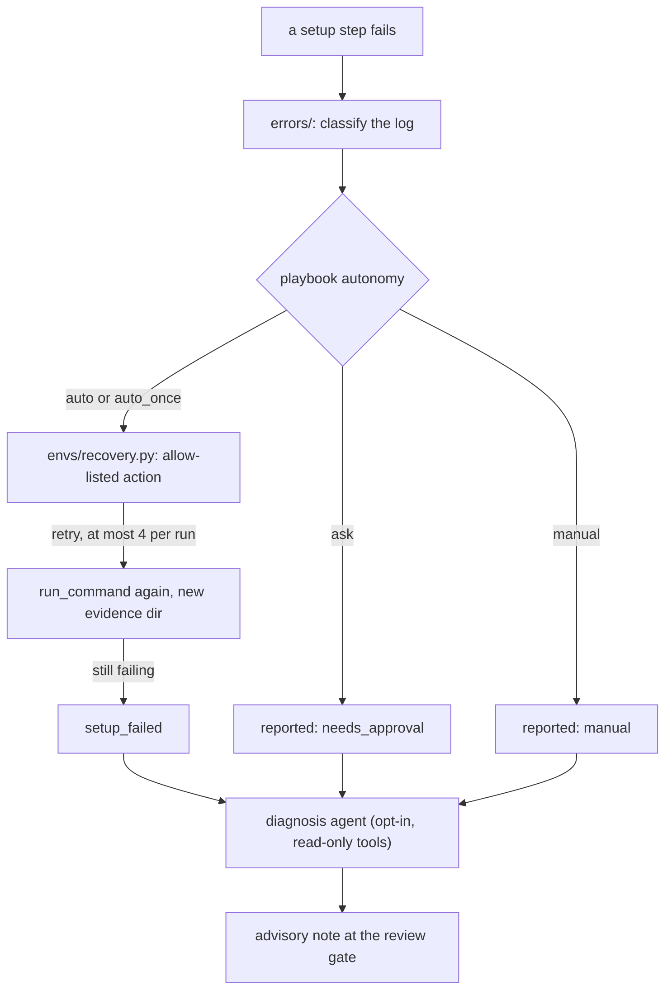

# Automation: recovery, diagnosis agent, prompt assembly, evaluators

What the harness does on its own between the human gates, how far it may go, and what it will not do. The gates, the
approvals and the checkpointed workflow are unchanged; everything here happens *inside* a stage and is visible in the
Observability tab (**Automation**) and in `audit.jsonl`.

## 1. Automatic recovery (`envs/recovery.py`)

The error playbook ([ERROR_PLAYBOOK.md](ERROR_PLAYBOOK.md)) says what went wrong and which recipes exist. Recovery is what
may be *done* without a human. `execute_setup` applies it to a failed **required** step (optional steps keep their pip
one-by-one fallback).

Rules, all enforced in code and tested:

* only diagnoses whose autonomy is `auto` or `auto_once` are acted on; `ask` (a download, a choice) is recorded as
  `needs_approval`, `manual` as `manual`, and the step fails with the reason;
* a recipe is tried **at most once per step**, at most `max_attempts` recipes per step, at most **4 recoveries per run**;
* a recipe that downloads software is never applied without `allow_downloads` (none of the implemented ones do);
* an action is data: a changed copy of the step (or a step to rewind to), run through the same `run_command` (timeout,
  sanitized environment, its own evidence directory `NN-<step>-retryK`), never a shell string;
* the report records every recipe considered and why it was or was not used (`steps[].recovery`, `recoveries`).

| Recipe | Triggered by | Does |
|---|---|---|
| `retry-longer` | `ENV-COMMON-001` timeout, `ENV-COMMON-003` network | doubles the step timeout (cap 3600 s) and runs it again |
| `retry-update` | `ENV-JAVA-003` dependencies cannot be resolved | Maven `-U` / Gradle `--refresh-dependencies` |
| `retry-restore` | `ENV-DOTNET-003` NuGet feed | one more restore |
| `recreate-venv` | `ENV-PY-004`, `ENV-PY-008` externally-managed / interpreter not found | deletes the harness venv (only `.harness-venv` inside the workspace) and restarts from `create-venv` |
| `install-each-package` | a failed bulk `pip install` | retries package by package, then resolves everything that installed together in one pip run so the repository's pins hold together |
| `fix-conflicts` | `ENV-PY-009` (`pip check` reports version conflicts) | after the install steps: re-resolves the declared requirements that installed plus the ranges `pip check` reports, in one pip run (at most 2 rounds); leftovers are reported in `dependency_conflicts` |

Every other recipe in the playbook (`provision-*`, `prefer-binary`, `relax-pin`, `add-test-dependency`, `install-browser`,
`new-port`, `start-app`, `configure-mirror`, `use-wrapper`) is reported but not automated yet. `plan_env_fix` (typed tool)
previews what recovery would do for a log.

## 2. The diagnosis agent (`agent/diagnosis.py`, off by default)

`HARNESS_DIAGNOSIS_AGENT=on`. After a setup failure recovery could not fix (and after an execution that is `blocked` or
produced `no_test_evidence`), a bounded MAF agent loop looks at the log tail and the deterministic diagnosis with **read-only**
typed tools (`detect_stack`, `detect_toolchains`, `list_missing_packages`, `diagnose_env_error`, `diagnose_exec_error`,
`plan_env_fix`, `read_file`, `list_dir`) and writes a `DiagnosisNote` (summary, likely cause, category, suggested fixes,
needs-human) into the report, shown at the review gate.

* it cannot provision, write or delete: those tools are not offered to it;
* it goes through the same guards as a stage agent: daily token budget (reserve, call, settle), the hook engine on every tool
  and model call, the tool trace;
* it keeps a todo list (MAF harness todo provider); plan/execute mode and compaction stay off for a loop capped at 8 tool calls;
* it never blocks a gate: if it fails, the report carries `{"error": ...}` and the gate appears as usual.

## 3. Prompt assembly for the provider's prefix cache (`llm/prompts.py`)

DeepSeek, OpenAI and compatible gateways cache the longest identical *prefix* of a request. A stage prompt is a JSON object,
so **key order** decides how much repeats between two calls. Stable content now comes first (assignment, output schema, rules,
approved inputs), per-call content last (this batch's cases and source, repair feedback). The keys and their values are
unchanged, so nothing in the prompt's meaning or in the tests that read it changed.

Measured on the fixture repository (`tests/test_prompt_assembly.py`): the share of a generation prompt that repeats the
previous batch's prompt byte for byte went from **60.7 % to 82.2 %**. On a real repository the per-batch tail (source and
evidence) is most of the prompt: a live run on requirement-analysis-skill repeated only 8.3 % of each generation request's prefix
(provider-reported cache hit 16-27 %, see [audit/E2E_RESULTS.md](audit/E2E_RESULTS.md) §8), so the saving from ordering alone is small there. The
schema and rules are always inside the prefix; making the per-batch evidence smaller or shared is the next lever. The Observability report already shows the provider-reported cache hit and the `prefix_ratio` per stage
([CACHING.md](CACHING.md)); compare a run before and after with those.

Deliberately not done, and why: **session reuse across repair retries** (a retry already shares everything up to the repair
note, and a fresh session keeps a failed attempt from poisoning the next), **skill-priming removal** (one small call per stage,
and it is what `verify-run` relies on to prove the skill was loaded), **compaction** (each stage call is a single structured
answer, there is no long conversation to compact).

## 4. Skill validators as an agent tool (`tools/skill_tools.py`, opt-in)

`HARNESS_SKILL_EVALUATORS=on` offers the design stage a `check_skill_output` tool. The lock policy is untouched: only scripts
recorded in `skills/SKILLS.lock.json` whose bytes still match their SHA-256 may run, argv-only, in a temp directory, with a
sanitized environment and a timeout. What changes is who may ask: the agent can run the reviewed scripts (host tier included)
of the skills **assigned to its stage**, on files it hands over, and read the validator's verdict before the human does.
Anything else is refused (`SKILL-SCOPE`, `SCRIPT-REFUSED`). Off by default because each tool schema is resent with every call.

## 5. Settings

| Variable | Default | Effect |
|---|---|---|
| `HARNESS_DIAGNOSIS_AGENT` | `off` | the diagnosis agent after unrecovered failures |
| `HARNESS_SKILL_EVALUATORS` | `off` | `check_skill_output` for the design stage |
| `HARNESS_HOOKS` | `enforce` | `enforce`, `evaluate_only`, `off` (see [HOOKS.md](HOOKS.md)) |
| `HARNESS_HOOKS_BACKEND` | `inhouse` | `sdk` enforces hooks through MAF's AGENT-HOOKS-0.1 middleware (needs `pip install maf-test-harness[hooks]`) |

Recovery has no switch: it only ever repeats or slightly adjusts an already approved step, within the limits above, and
`execute_setup(..., recover=False)` turns it off for callers that want the old behaviour.

## 6. What this is not

Not a sandbox: setup steps still run as local processes with the harness's privileges (see [ARCHITECTURE.md](ARCHITECTURE.md)
§4). Not autonomous end to end: every model-authored artifact and every install or run still waits for a human. Not verified
against a live model: the agent loops are covered with a real MAF pipeline and a scripted transport, so tool-calling
reliability of your gateway model in the diagnosis loop is untested here; the loop is capped and advisory for that reason.
