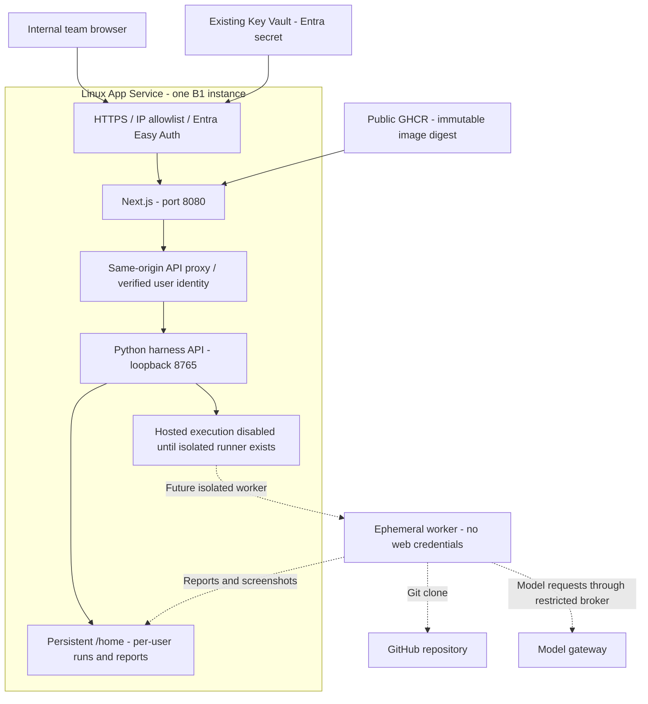

# Azure deployment proposal — Agentic QE Platform

Status (checked against code 2026-10-11): still a proposal. The app runs locally (Next.js UI with the Python API, or the Electron app). The repository has no Dockerfile, hosted-mode switch or per-user isolation, and `azure-plan/` holds Terraform and price evidence that has not been applied.

Status: infrastructure and implementation plan, not a deployment. No Azure resources have been created. The current branch is a local application; the hosted-mode changes below are prerequisites. Terraform does not build an image or make those changes automatically.

## Cheapest practical App Service option

Use one **Linux Basic B1 App Service plan**, one custom-container web app, an existing Entra tenant and an existing Key Vault. Serve Next.js and the internal Python API in one container. Use a public, immutable GHCR image to avoid an additional paid container registry. No Azure SQL, Redis, Front Door, Application Insights or VNet is required for this pilot.

Region: **East US 2**, as requested. The public Retail Prices API returned these Linux Basic consumption meters on **2026-10-02**, in USD:

| SKU | Hourly retail price | Estimate at 730 hours/month | Intended use |
| --- | --- | --- | --- |
| B1 | $0.017 | $12.41 | Small UI/control-plane pilot |
| B2 | $0.034 | $24.82 | More memory after measuring workload |
| B3 | $0.067 | $48.91 | Larger trusted workload after measuring |

These are compute estimates, not a complete bill or a globally cheapest-region comparison. Key Vault operations, outbound transfer, model gateway calls, registry quotas, backups and future isolated worker execution are additional. Discounts, tax and negotiated prices are excluded. Existing Key Vault is a prerequisite, not a free resource supplied by this Terraform. Refresh the raw meter evidence before deployment:

```sh
python azure-plan/refresh_prices.py --region eastus2
```

The script follows NextPageLink and filters the exact Linux Basic product, consumption price, primary region and hourly unit. Raw results and meter IDs are in azure-plan/retail-prices.json. The dated live API result takes precedence over a pricing-page estimate. Stopping the web app does not stop billing for its App Service plan.

B1 has only 1 CPU, 1.75 GB RAM and 10 GB storage. That is a starting point for the UI, not a promise that arbitrary repositories, dependency builds, Chromium, Next.js and Python all fit. Keep one instance and hosted execution disabled until the isolated worker phase is complete. Free/shared hosting is unsuitable for this always-on custom-container design.

## Architecture



The same diagram is available as azure-plan/architecture.mmd. App Service exposes one HTTP port: 8080. Python remains on loopback 8765. Report assets flow through the authenticated same-origin proxy. Target applications belong to isolated workers; exposing their ports publicly is unnecessary.

## Required implementation plan and affected files

| Phase | Files to change or add | Required behavior and acceptance proof |
| --- | --- | --- |
| 1. Container startup | scripts/start_ui.py or a dedicated scripts/start_azure.py; azure-plan/Dockerfile; .dockerignore; frontend/next.config.ts only if choosing standalone output | Build Node and Python with pinned dependencies; bind Next to 0.0.0.0:8080 and API to loopback; generate an internal API token at startup; terminate both processes on signals; write only /home state. Exclude .env, source PDFs, runs and credentials from image/context. Test image locally before publishing. |
| 2. Hosted request boundary | frontend/app/api/harness/[...path]/route.ts; src/maf_test_harness/ui/api.py | Current proxy permits only localhost and HTTP origins, so Azure requests return 403. Add an explicit deployment mode with exact configured HTTPS host/origin checks. Require verified Entra identity, forward a signed/internal identity envelope with the internal token, reject spoofed/missing identities and preserve report iframe handling. Keep local mode defaults. |
| 3. User separation | src/maf_test_harness/ui/api.py; src/maf_test_harness/agent/prompt_settings.py; src/maf_test_harness/ui/runtime_service.py | OS-user folders do not separate web users. Derive namespace from verified tenant/object IDs; partition run listing, files, prompt defaults, audit and downloads. Check owner on every operation and evidence request. Test two users cannot read or mutate each other's run IDs. |
| 4. Execution gate | src/maf_test_harness/workflow.py; src/maf_test_harness/ui/api.py; frontend/components/workspace.tsx | Implement HARNESS_EXECUTION_MODE=disabled as an enforced host-side gate, including installs and user-controlled repository imports/collection. Current code does not implement this variable. Show deployment limitation in UI. Do not rely on a hidden button. Hosted review/clone also needs quotas and URL validation. |
| 5. Reliable state | src/maf_test_harness/ui/runtime_service.py; src/maf_test_harness/workflow.py; src/maf_test_harness/ui/api.py | Persist under /home, recover interrupted operations as interrupted, bound concurrency, disk, artifact size and retention. Keep one web worker/instance; in-memory locks are not distributed. Back up before manual retention deletion. Logs remain redacted and downloadable. |
| 6. Isolated execution | src/maf_test_harness/envs/execution.py; src/maf_test_harness/envs/app_launcher.py; src/maf_test_harness/envs/runners.py; new minimal worker transport after design approval | Separate arbitrary repository code from web identity, Key Vault access and other users' files. Merely sanitizing child environment variables is not process/filesystem isolation. Use short-lived restricted workers, time/resource/network limits and a restricted model broker. Return native Playwright HTML, JUnit, screenshots and traces with exact test counts and failure categories. Worker hosting has additional cost. |
| 7. Release and validation | .github/workflows/ui.yml; .github/workflows/ci.yml; new container publish workflow; tests/test_ui_api.py; frontend/tests/workspace.spec.ts | Preserve Windows/macOS local startup; build Linux image; publish immutable digest using GitHub permissions/OIDC without stored Azure credentials. Test signed-in/out access, user separation, reboot persistence, secret masking, report assets, blocked execution and load before enabling ingress. |

Implementation order: 1–5 and 7 produce a restricted hosted control-plane pilot; 6 is required before hosted end-to-end execution. This plan does not silently relax the local security boundary or implement shared hosting without review. Existing backend fixes and local runs remain independently valid.

## Step-by-step setup and deployment

### 1. Prepare subscription and identity

Install Azure CLI, Terraform >=1.9, Docker with Linux container support, Git, and GitHub CLI or another authenticated image publisher on Windows or macOS. Azure CLI commands below are single-line commands usable in either shell. Docker must build for linux/amd64 even on Apple Silicon.

```sh
az login
az account set --subscription YOUR_SUBSCRIPTION_ID
az provider register --namespace Microsoft.Web
az provider register --namespace Microsoft.KeyVault
```

Use an existing Microsoft Entra workforce tenant. Register a single-tenant web application. Configure web redirect URI https://YOUR_APP_NAME.azurewebsites.net/.auth/login/aad/callback. Create its client secret locally and store it directly in the existing Key Vault as harness-entra-secret; never paste it into Terraform, Git, screenshots or this UI. Supply its versionless secret URI. Restrict the enterprise application to assigned team users. Terraform additionally requires the approved user object IDs. Entra setup requires the appropriate tenant administration rights; tenant availability is not yet confirmed.

### 2. Complete and verify the hosted code phases

Implement the table above before building a deployment image. There is intentionally no pretend working Dockerfile: the current local proxy would reject Azure requests, and current OS-user storage would mix all web users. A Terraform-valid web app does not prove application readiness.

For a future image built with the approved Dockerfile (proposed, not implemented: `HARNESS_DEPLOYMENT_MODE`, `HARNESS_EXECUTION_MODE` and `HARNESS_PUBLIC_ORIGIN` do not exist in the code yet):

```sh
docker build --platform linux/amd64 -f azure-plan/Dockerfile -t ghcr.io/YOUR_OWNER/maf-harness-testing:YOUR_COMMIT .
docker run --rm -p 8080:8080 -v maf-harness-state:/home -e HARNESS_DEPLOYMENT_MODE=azure -e HARNESS_EXECUTION_MODE=disabled -e HARNESS_PUBLIC_ORIGIN=http://localhost:8080 ghcr.io/YOUR_OWNER/maf-harness-testing:YOUR_COMMIT
```

These are future build commands, not commands that work before phases 1–5 exist. Test the hosted identity path in a restricted Azure smoke environment; a local header injected by a test client is not proof that real Easy Auth works. Build-time Next.js must not read production gateway secrets. Publish only after image scanning and smoke tests, set the GHCR package visibility to public, then obtain and use its exact sha256 digest. If source confidentiality requires a private image, plan authenticated registry access and its cost instead.

### 3. Configure Terraform

```sh
cd azure-plan
```

Windows PowerShell:

```powershell
Copy-Item terraform.tfvars.example terraform.tfvars
```

macOS:

```sh
cp terraform.tfvars.example terraform.tfvars
```

Edit all placeholders: subscription, East US 2 region, globally unique app name, tenant/client IDs, approved user object IDs, Entra secret URI, and real public image digest. Keep enable_public_access=false for the first apply. Set allowed_cidrs to team egress CIDRs before enabling ingress; unrestricted 0.0.0.0/0 and ::/0 are rejected. The example intentionally fails image validation until a real digest is supplied.

```sh
terraform init
terraform fmt -check
terraform validate
terraform plan -out=azure.tfplan
```

Review the proposed resources and bill before applying. This creates only a resource group, one Linux plan and one web app. Entra registration and the existing Key Vault are not created or modified automatically. Local Terraform state contains infrastructure metadata; protect it and migrate to an encrypted remote backend with locking before multiple operators work on it. No plaintext secrets are passed as Terraform variables.

### 4. Provision restricted infrastructure, then grant secret access

After reviewing the plan and completing the hosted code:

```sh
terraform apply azure.tfplan
terraform output managed_identity_object_id
```

Grant that object ID the Key Vault Secrets User role scoped to the existing vault (or the appropriate access policy if the vault uses that permission model). Allow the App Service to reach the vault according to its actual network policy. Secret references will remain unresolved until permissions propagate. A private-only vault may require VNet integration and a revised cost/architecture plan.

```sh
az role assignment create --assignee-object-id WEB_APP_IDENTITY_OBJECT_ID --assignee-principal-type ServicePrincipal --role "Key Vault Secrets User" --scope EXISTING_VAULT_RESOURCE_ID
```

No model key is configured in this disabled-execution pilot. When an isolated worker and restricted model broker are implemented, configure gateway URL/model and its secret reference on that broker, not inside arbitrary repository processes. Keep the existing local .env out of Azure images.

### 5. Enable restricted access and validate

Set enable_public_access=true only after the application/security gates pass, with valid allowed_cidrs. Run a new terraform plan and review/apply it. Visit the application URL from an allowed network. Verify Entra redirects, permitted user access, rejected unassigned users, authenticated report assets, per-user folders and cold-start/restart behavior. Confirm installs/test execution remain blocked by the backend. Do not start a real repository cycle on the web container before phase 6.

For diagnostics use App Service Log stream and metrics for CPU, memory, response times and restarts. Keep application structured audit logs and report evidence under per-user storage. Application Insights is optional paid telemetry; add only when those diagnostics are insufficient. Configure budget alerts in Azure Cost Management; alerts notify and do not cap charges.

### 6. Maintain and roll back

Retain the previous tested image digest. Roll back by restoring image_name, reviewing a plan and applying it; do not overwrite historical runs. B1 has no deployment slots, so publish outside active work and expect restart downtime. Scale to B2/B3 only after measurements justify it. To stop pilot billing permanently, review terraform plan -destroy and then destroy only these resources, after exporting /home data. Stopping the app alone leaves plan charges running.

## Validation performed

Live East US 2 retail API query and pagination completed. Terraform schema validation is performed locally with a checksum-verified temporary Terraform binary and the locked AzureRM provider; see azure-plan/validation.json for its actual result. No Azure plan against a subscription, apply, container build or hosted smoke test has been performed. Azure CLI and Docker are not installed on this workspace host.

## Official references

- [Azure documentation overview](https://learn.microsoft.com/en-us/azure/?product=popular)
- [Azure Retail Prices API and pagination](https://learn.microsoft.com/en-us/rest/api/cost-management/retail-prices/azure-retail-prices)
- [Linux App Service pricing and Basic resources](https://azure.microsoft.com/en-us/pricing/details/app-service/linux/)
- [Custom containers, one exposed port and persistent /home](https://learn.microsoft.com/en-us/azure/app-service/configure-custom-container)
- [App Service authentication and authorization](https://learn.microsoft.com/en-us/azure/app-service/overview-authentication-authorization)
- [Microsoft Entra provider setup](https://learn.microsoft.com/en-us/azure/app-service/configure-authentication-provider-aad)
- [Key Vault references and managed identity access](https://learn.microsoft.com/en-us/azure/app-service/app-service-key-vault-references)
- [App Service cost management](https://learn.microsoft.com/en-us/azure/app-service/overview-manage-costs)
- [AzureRM Linux Web App provider documentation](https://registry.terraform.io/providers/hashicorp/azurerm/latest/docs/resources/linux_web_app)
- [Azure official Terraform App Service module, queried with Context7](https://github.com/Azure/terraform-azurerm-avm-res-web-site)

Azure overview, retail API documentation and custom-container documentation were read through Firecrawl. Context7 was used for official Azure Terraform App Service documentation. Resource arguments were checked against HashiCorp's primary provider documentation and locally validated provider schema.
