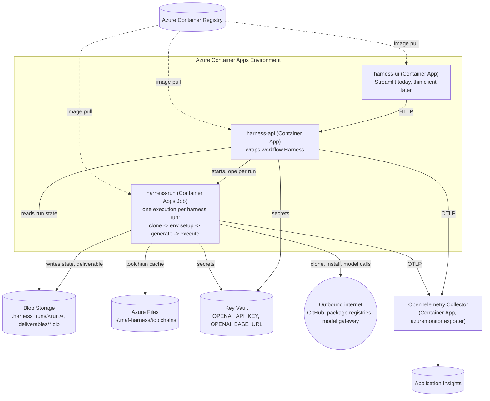
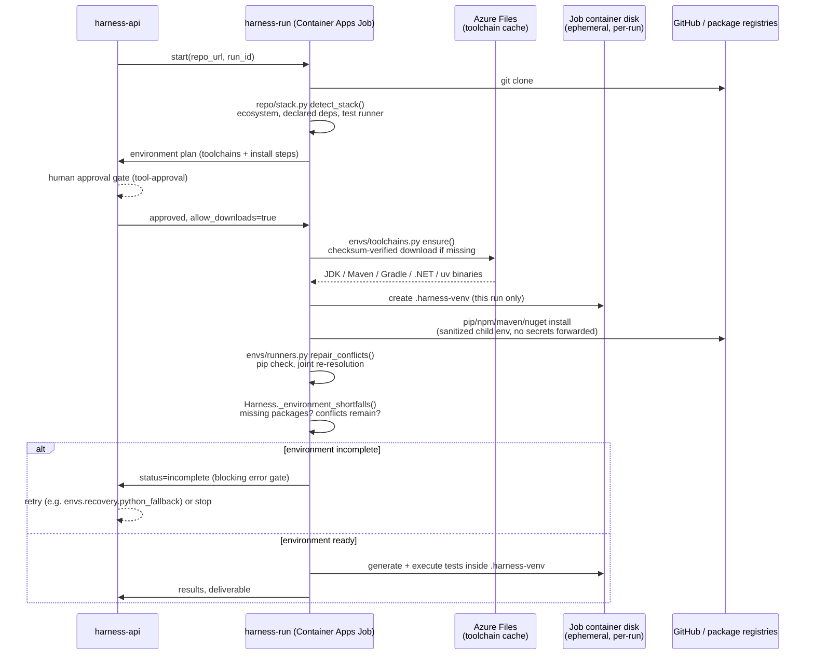

# Azure deployment

How to host the MAF Test Harness on Azure: which services to provision and on which plan, the exact click-through
steps in the Azure Portal, how the harness's per-run isolated test environment maps onto Azure resources, an
error-handling design for a future UI migration, and current retail pricing. Read [ARCHITECTURE.md](ARCHITECTURE.md)
first — this document maps that design onto Azure, it does not repeat it.

> **Provenance.** Every code-level claim below was checked against this repository's current source, not assumed.
> Every price was fetched live from the
> [Azure Retail Prices API](https://learn.microsoft.com/en-us/rest/api/cost-management/retail-prices/azure-retail-prices)
> on **2026-09-23**, `eastus`, with the exact query given so it can be re-run. Anywhere the harness would need a code
> change to work the way a section describes, that is stated explicitly — nothing is glossed over as "just works."

## Contents

1. [At a glance](#1-at-a-glance)
2. [What has to be true regardless of host](#2-what-has-to-be-true-regardless-of-host)
3. [Azure services and plans](#3-azure-services-and-plans)
4. [Target architecture](#4-target-architecture)
5. [Module → Azure service mapping](#5-module--azure-service-mapping)
6. [How the isolated test environment is generated, end to end](#6-how-the-isolated-test-environment-is-generated-end-to-end)
7. [Error handling that survives a future UI migration](#7-error-handling-that-survives-a-future-ui-migration-design-no-code-change-this-pass)
8. [Deployment: step by step in the Azure Portal](#8-deployment-step-by-step-in-the-azure-portal)
9. [Deployment: CLI / CI reference](#9-deployment-cli--ci-reference)
10. [Current Azure retail pricing](#10-current-azure-retail-pricing-live-2026-09-23-eastus)
11. [Known gaps](#11-known-gaps-be-aware-of-these-before-you-rely-on-this-design)

## 1. At a glance

| | |
|---|---|
| **Compute model** | 2 always-available Container Apps (UI, API) + 1 Container Apps Job (per-run, ephemeral) |
| **Isolation strategy** | Every harness run gets its own Job container instance — clones, installs, generates and executes inside it, then it's torn down |
| **Secrets** | Azure Key Vault, referenced by Container Apps as `secretRef` |
| **Durable storage** | Azure Files (shared toolchain cache) + Blob Storage (run state, deliverable ZIPs) |
| **Observability** | OpenTelemetry (already built into the harness, `HARNESS_OTEL=otlp`) → Collector → Application Insights |
| **Estimated platform cost** | ≈ **$43/month** at 200 runs/month (§10) — excludes the model/LLM gateway, which dominates real spend |
| **Code changes required for this design** | None to deploy; two are called out for production-hardening (§5, §11) and intentionally not made in this pass |

## 2. What has to be true regardless of host

From [ARCHITECTURE.md §4](ARCHITECTURE.md#4-guarantees-and-where-they-are-enforced) and this repo's current code,
independent of Azure:

- The harness clones **arbitrary public GitHub repositories** and runs their install/test commands. It needs
  outbound network egress (GitHub, PyPI/npm/Maven Central/NuGet, the model gateway) and, today, **is not a security
  sandbox** — a hosting environment should assume the same blast radius as running it on a developer's own machine,
  not less.
- It downloads and caches toolchains (JDK, Maven, Gradle, .NET SDK, `uv`/Python) into `~/.maf-harness/toolchains`
  (`envs/toolchains.py`) and writes per-run state to `.harness_runs/<run>/` (`workflow.py`, `FileCheckpointStorage`).
  Both are local-disk assumptions today.
- `HARNESS_STRICT_ENV` (default on) blocks every stage after `environment_setup` until the target repo's
  dependencies are fully and consistently installed — this doesn't change on Azure, it's enforced in `workflow.py`
  regardless of where the process runs.
- `app.py` (Streamlit) and `cli.py` already drive the **same** `workflow.Harness` class — the UI is not where any
  business logic lives. §7 leans on this for "migrate the UI later without touching error handling."

## 3. Azure services and plans

| # | Service | Plan / SKU | Used for | Why this tier |
|---|---|---|---|---|
| 1 | **Azure Container Apps** | Consumption plan | `harness-ui`, `harness-api` | Scale-to-zero when idle, billed per vCPU/memory-second (§10) — matches occasional, bursty harness usage instead of paying for an always-on VM |
| 2 | **Azure Container Apps Jobs** | Consumption, trigger type `Manual` | `harness-run` — one execution per harness run | Purpose-built for "start, run to completion, stop"; gives each run its own isolated, ephemeral container (§6) |
| 3 | **Azure Container Registry** | Basic | Stores the 3 images (`harness-ui`, `harness-api`, `harness-run`) | Single low-traffic private registry; move to Standard only if you add geo-replication or hit the Basic throughput/storage cap |
| 4 | **Azure Key Vault** | Standard | `OPENAI_API_KEY`, `OPENAI_BASE_URL`, any GitHub token | Application secrets only, no HSM-backed key requirement |
| 5 | **Azure Storage account — Files share** | Standard (SMB) | Toolchain cache: `~/.maf-harness/toolchains` (JDK/Maven/Gradle/.NET/`uv`), mounted read-write into every `harness-run` Job instance | Must be a real shared, concurrently-mountable filesystem — Blob can't be mounted as a POSIX/SMB volume the way `envs/toolchains.py` expects |
| 6 | **Azure Storage account — Blob container** | Standard, **Hot** LRS | Durable run state + `deliverables/*.zip` | Cheapest durable, URL-addressable object storage; Hot tier because a run's output is read back within minutes/hours of being written, not archived |
| 7 | **Log Analytics workspace** | Pay-as-you-go | Backing store for Application Insights | No committed daily cap needed at this volume |
| 8 | **Application Insights** (workspace-based) | — (billed through Log Analytics) | Dashboards/alerts over the harness's own OpenTelemetry spans | Reuses `HARNESS_OTEL`, no bespoke telemetry code |
| 9 | *(optional)* **Azure OpenAI Service** | Standard (pay-as-you-go) deployment | Model gateway target for `OPENAI_BASE_URL`, if you want inference inside Azure's boundary | The harness is gateway-agnostic (`llm/client.py` talks to any OpenAI-compatible endpoint) — this is a choice, not a requirement |

## 4. Target architecture



**Why a Container Apps Job for execution, not just another replica of the API:** the harness runs a real `git
clone` and executes the target repository's own install/test commands (`envs/runners.py`, `envs/execution.py`).
Giving that a *separate*, single-purpose, ephemeral container — torn down after the run — is a real improvement
over "local process, not sandboxed": network egress can be scoped to that job's container only (NSG / Container
Apps Environment network rules), it gets its own resource limits, and a crashed or hung run can't take the UI/API
down with it. This is additive to the existing design, not a rewrite: `workflow.py`'s stage graph and gates are
unchanged — the job is just *where* `Harness.enter`/`Harness.respond` execute.

## 5. Module → Azure service mapping

| Existing code | What it does today | Azure service | Works as-is, or needs a change? |
|---|---|---|---|
| `envs/toolchains.py` cache (`~/.maf-harness/toolchains`) | Downloads JDK/Maven/Gradle/.NET/`uv` once, checksum-verified, reused across runs | Azure Files share mounted into the job container | ✅ **Works as-is** — it's just a directory; mount it read-write. Without it, every job re-downloads toolchains (slower, more egress, no code change needed either way). |
| `.harness_runs/<run>/` (`workflow.py` `FileCheckpointStorage`) | Per-run state, checkpoints, `deliverables/*.zip` (`qa/packaging.py` `build_deliverable`) | Azure Files (job-writable) **or** upload to Blob on completion | ✅ **Works as-is on Azure Files.** Durable, downloadable-by-URL delivery (a SAS link instead of a shared filesystem) needs a small code addition — `build_deliverable` returns a local `Path` today; nothing in the repo uploads it anywhere. Not done in this pass. |
| `.env` / `OPENAI_API_KEY`, `OPENAI_BASE_URL`, `OPENAI_MODEL` | Read at startup, shell env wins over `.env`, never forwarded to child commands (`envs/execution.py` `_child_env` allow-list) | Key Vault, referenced as Container Apps **secrets** (`secretRef`, not plain env vars) | ✅ **Works as-is** — the harness only ever reads `os.getenv(...)`; it doesn't care that the value came from a Key Vault reference. |
| `llm/usage.py` `DailyUsageLedger` | Per-day JSON file + `FileLock` (OS file lock) under `HARNESS_USAGE_DIR`, one shared daily cap across all runs on **one machine** | — | ⚠️ **Needs a code change to scale past one replica.** `FileLock` on an Azure Files (SMB/NFS) mount is not a safe substitute for same-machine file locking across multiple Container Apps replicas or concurrent Jobs — the daily cap could be double-counted. Keep the API/worker at a single replica until addressed, or move the ledger to Azure Table Storage / Redis (a real code change, logged here, not silently worked around). |
| `monitoring/telemetry.py` (`HARNESS_OTEL=otlp`, reads `OTEL_EXPORTER_OTLP_ENDPOINT`) | Exports MAF OpenTelemetry spans when enabled | An OpenTelemetry Collector container with the `azuremonitor` exporter, feeding Application Insights | ✅ **Works as-is** — point `OTEL_EXPORTER_OTLP_ENDPOINT` at the collector's address. Application Insights does not accept raw OTLP directly; the collector is the standard bridge, don't skip it. |
| `monitoring/trace.py`, `maf-harness trace` | `trace.jsonl` per run, read by the CLI | Azure Files (same mount as run state) | ✅ **Works as-is.** |
| Human gates (`request_info` events in `workflow.py`) | Streamlit polls/reruns on each gate; CLI prompts on stdin | Server-Sent Events or a WebSocket from `harness-api` | 📐 Design-only in this pass (§7) — the gate logic itself (`Harness.respond`) is already transport-agnostic; only the UI's polling mechanism would change. |

## 6. How the isolated test environment is generated, end to end

This is the part of the harness that most needs to survive the move to Azure unchanged: the sequence that turns "a
GitHub URL" into "a working, isolated install of that repo's own dependencies," and the guardrail that refuses to
generate or run tests until it's genuinely complete (`HARNESS_STRICT_ENV`, [CLAUDE.md](../CLAUDE.md) "Guardrails").
Nothing about this sequence changes on Azure — only *where* each step's bytes land changes.



| Step | What the harness does | Module | Where it runs on Azure |
|---|---|---|---|
| 1. Clone | `git clone` the target repository | `repo/analyzer.py` | Inside the `harness-run` Job container, ephemeral disk |
| 2. Detect stack | Ecosystem (Python/Java/.NET/Node/Go), declared dependency files, existing test runner | `repo/stack.py detect_stack` | Same Job container, no external call |
| 3. Plan the environment | Which toolchains are needed (exact/compatible versions), which are already cached, the install steps | `envs/environment.py build_environment_plan`, `envs/toolchains.py plan_toolchains` | Job container; reads (doesn't yet write) the Azure Files toolchain cache |
| 4. **Human approval gate** | The plan (what will be downloaded/installed) is shown for approval before anything runs | `workflow.py` tool-approval | `harness-api`, surfaced to the UI — the one required human-in-the-loop step before any download |
| 5. Provision toolchains | Checksum-verified download of anything missing from the cache | `envs/toolchains.py ensure()` | Job container ⇄ Azure Files share (read-write mount) |
| 6. Create the per-run venv | `.harness-venv`, scoped to **this run only** — never shared with the toolchain cache or other runs | `envs/runners.py`, `envs/platform_compat.py` | Job container's own ephemeral disk — this is the isolation boundary, and it needs no Azure-specific change: a fresh Job instance already gives you a fresh filesystem |
| 7. Install dependencies | Bulk install, per-package fallback on failure, sanitized child environment (no secrets forwarded to the target repo's own install commands) | `envs/runners.py execute_setup`, `envs/execution.py _child_env` | Job container; outbound egress to PyPI/npm/Maven Central/NuGet |
| 8. Resolve conflicts | `pip check` + joint re-resolution of anything still inconsistent (`ENV-PY-009`) | `envs/runners.py repair_conflicts` | Job container |
| 9. **Strict guardrail gate** | If anything is still missing or inconsistent, the environment is `status=incomplete` and **no later stage starts** — retry (possibly a different Python interpreter, `envs.recovery.python_fallback`) or stop; skipping is only ever an explicit human choice | `settings.STRICT_ENV`, `workflow.Harness.enter`/`_block_incomplete_environment` | Enforced in the Job container's own process; reported back to `harness-api` |
| 10. Generate + execute | Test generation and execution both run **inside the same per-run venv** created in step 6 | `workflow.py` stages 5-7 | Job container |
| 11. Persist results | Run state, trace, QA report, deliverable ZIP | `workflow.py FileCheckpointStorage`, `qa/packaging.py` | Job container writes to the Azure Files run-state mount (or Blob, once §5's upload addition exists) |

> **What Azure adds here, and what it doesn't.** Steps 1-11 are unchanged from a local run — that's intentional,
> it's the same code path CI already exercises. What Azure adds is a *fresh, isolated container per run* (step 6's
> isolation boundary was always "a directory nobody else touches"; on Azure it becomes "a directory nobody else can
> even reach," since a Job instance's filesystem isn't shared with any other run) and a *shared, durable cache*
> for the slow, repeatable part (step 5's toolchain downloads) so that isolation doesn't come at the cost of
> re-downloading a JDK on every single run.

## 7. Error handling that survives a future UI migration (design, no code change this pass)

This section is guidance for when the UI changes, not a change made now.

The property that matters is already true: `workflow.Harness` (used identically by `app.py` and `cli.py`) is the
only place business logic and error handling live. The recommended shape for a future non-Streamlit UI:

1. **Put `harness-api` between the UI and `Harness`.** A thin REST layer (FastAPI is a reasonable choice; no
   framework opinion is baked into `workflow.py`) exposing `POST /runs`, `GET /runs/{id}`, `POST
   /runs/{id}/respond` that call `Harness.enter`/`.answer`/`.respond` directly. A new UI then only needs an HTTP
   client — it never re-implements gate logic, retry counting, or the guardrail in `Harness.enter` that already
   refuses to start a later stage on an incomplete environment.
2. **Serialize the existing error taxonomy, don't invent a new one.** `errors/taxonomy.py` /
   `errors/classifiers/` / `errors/playbook.py` already give every failure a `code`, `category`
   (environment/infra/test_defect/app_defect), `autonomy` (auto/auto_once/ask/manual), and a recipe. Have
   `harness-api` return that structure as the JSON error body instead of a bare string — a future UI can render
   "environment problem, retrying automatically" differently from "test defect, needs your input" without any new
   backend logic, because the distinction already exists.
3. **Stream gates, don't poll for them.** `Harness.enter` raising / `request_info` events are already discrete,
   named occurrences (`ENV_STAGE`/`EXECUTION_STAGE` etc.) — server-sent them to the UI as they happen instead of a
   UI-side rerun loop. This removes the Streamlit-specific polling pattern from the *contract* the UI depends on,
   so swapping Streamlit for anything else touches only the client, not `workflow.py`.
4. **Keep the strict-guardrail behavior server-side.** `HARNESS_STRICT_ENV` and `Harness.enter`'s incomplete-
   environment refusal are enforced in the host, not the UI (confirmed in `workflow.py`) — a new UI inherits this
   for free as long as it talks to `harness-api`/`Harness` and never bypasses it with its own logic.

## 8. Deployment: step by step in the Azure Portal

A developer-facing walkthrough using [portal.azure.com](https://portal.azure.com) — no local Azure CLI required for
the first deployment. Do these in order; each step names the resource group and naming convention the later steps
assume. Replace `rg-maf-harness` / `maf-harness-*` with your own naming if you prefer.

**Prerequisite:** the repo ships no `Dockerfile` today — add the one in §9 before step 3.

### Step 1 — Resource group

1. Search **Resource groups** → **+ Create**.
2. Subscription: yours. Resource group name: `rg-maf-harness`. Region: **East US** (matches §10's pricing; pick
   whichever region you'll actually run in, prices differ by region).
3. **Review + create** → **Create**.

### Step 2 — Key Vault (do this early — later steps reference its secrets)

1. Inside `rg-maf-harness`: **+ Create** → search **Key Vault** → **Create**.
2. Name: `kv-maf-harness` (must be globally unique — Azure will tell you if taken). Pricing tier: **Standard**.
3. **Review + create** → **Create**.
4. Once deployed, open it → **Objects** → **Secrets** → **+ Generate/Import**, and create:
   - `openai-api-key` = your gateway's key
   - `openai-base-url` = your gateway's root URL (omit if using `api.openai.com`)

### Step 3 — Container Registry

1. **+ Create** → search **Container Registry** → **Create**.
2. Resource group `rg-maf-harness`, name `acrmafharness` (alphanumeric only, globally unique), SKU **Basic**.
3. **Review + create** → **Create**.
4. Build and push the three images (`harness-ui`, `harness-api`, `harness-run` — Dockerfile in §9) — the fastest
   path from the Portal is **ACR → Repositories → this registry → Run** (ACR Tasks build in the cloud from your
   pushed source, no local Docker required), or push from your machine with `az acr build` (§9).

### Step 4 — Storage account (Files + Blob)

1. **+ Create** → search **Storage account** → **Create**.
2. Resource group `rg-maf-harness`, name `stmafharness`, Performance **Standard**, Redundancy **LRS**.
3. **Review + create** → **Create**.
4. Once deployed: **Data storage → File shares → + File share** — name `toolchain-cache`, no quota needed beyond a
   few GB per cached toolchain set.
5. **Data storage → Containers → + Container** — name `harness-runs`, access level **Private**.

### Step 5 — Container Apps Environment

1. **+ Create** → search **Container Apps Environment** → **Create**.
2. Resource group `rg-maf-harness`, name `cae-maf-harness`, region matching step 1.
3. **Networking** tab: default (Consumption) is fine for a first deployment; revisit if you need VNet injection for
   egress locking down later.
4. **Review + create** → **Create**.
5. Once deployed: **Settings → Azure Files** → **+ Add** — link the `toolchain-cache` share from step 4 as a
   storage mount named `toolchain-cache` (access mode: **Read/Write**), and repeat for a second mount `run-state`
   if you're using Azure Files for run state instead of Blob (§5's mapping table).

### Step 6 — `harness-api` and `harness-ui` (Container Apps)

Repeat for both apps (`harness-api` first, since `harness-ui` needs its URL):

1. **+ Create** → search **Container App** → **Create**.
2. **Basics**: resource group `rg-maf-harness`, name `harness-api` (then `harness-ui`), region matching step 1,
   Container Apps Environment: `cae-maf-harness`.
3. **Container**: image source **Azure Container Registry**, pick `acrmafharness` / the pushed image / `latest`.
   CPU/memory: start at 0.5 vCPU / 1 GiB.
4. **Secrets** (App-level, not the Vault directly — Container Apps' native Key Vault reference support varies by
   API version; the portable, always-works path is to pull the values at container start): add `openai-api-key`
   and `openai-base-url` as Container Apps secrets, values pasted from Key Vault (or wire a Key Vault reference if
   your Container Apps API version supports it — check **Secrets → + Add → Key Vault reference** in the blade).
5. **Environment variables**: `OPENAI_API_KEY` → `secretRef: openai-api-key`, `OPENAI_BASE_URL` → `secretRef:
   openai-base-url`, `OPENAI_MODEL`, `OTEL_EXPORTER_OTLP_ENDPOINT` (once §4's Collector exists).
6. **Ingress**: enabled, target port matching the Dockerfile's `CMD` (§9), **Accepting traffic from anywhere** for
   `harness-ui` if it's the public entry point, or **Limited to Container Apps Environment** for `harness-api` if
   only `harness-ui` should reach it.
7. **Review + create** → **Create**. Note the generated URL (`harness-api`'s becomes `harness-ui`'s backend URL —
   set it as an env var on `harness-ui` and redeploy that revision).

### Step 7 — `harness-run` (Container Apps Job)

1. **+ Create** → search **Container Apps Job** → **Create**.
2. Resource group `rg-maf-harness`, name `harness-run`, Container Apps Environment `cae-maf-harness`.
3. **Trigger type**: **Manual** (invoked by `harness-api` per run — this is not a scheduled/cron job).
4. **Container**: same registry/image pattern as step 6, image `harness-run`.
5. **Volume mounts**: attach both Azure Files mounts from step 5 (`toolchain-cache`, and `run-state` if used).
6. **Secrets/env vars**: same `OPENAI_API_KEY`/`OPENAI_BASE_URL`/`OPENAI_MODEL` as step 6.
7. **Review + create** → **Create**.

### Step 8 — Observability

1. **+ Create** → search **Log Analytics workspace** → **Create**, resource group `rg-maf-harness`, name
   `log-maf-harness`.
2. **+ Create** → search **Application Insights** → **Create**, resource group `rg-maf-harness`, name
   `appi-maf-harness`, **Resource mode: Workspace-based**, link to `log-maf-harness`.
3. Deploy an OpenTelemetry Collector as a 4th Container App (image: `otel/opentelemetry-collector-contrib`,
   config: `azuremonitor` exporter using `appi-maf-harness`'s connection string from its **Overview** blade) — set
   `harness-api`/`harness-run`'s `OTEL_EXPORTER_OTLP_ENDPOINT` to this Container App's internal URL, and
   `HARNESS_OTEL=otlp`.

### Step 9 — Verify

1. Open `harness-ui`'s URL. Submit a run against a small public repository.
2. Watch **Application Insights → Transaction search** or **Logs** for the run's OTel spans as it progresses
   through stages.
3. Confirm the deliverable ZIP lands in the `harness-runs` Blob container (or the `run-state` Files share).

## 9. Deployment: CLI / CI reference

The same 9 steps, as `az` commands — useful for scripting or CI, and to extend the existing
`.github/workflows/ci.yml` (already `ruff`/`pytest`/`lint-skills` on ubuntu + windows-latest) with a deploy job.

The repo ships **no `Dockerfile` today** — add one:

```dockerfile
FROM python:3.12-slim
RUN pip install uv
WORKDIR /app
COPY pyproject.toml uv.lock ./
RUN uv sync --extra dev --no-dev  # match the project's own install command (CLAUDE.md "Commands")
COPY . .
# harness-ui: CMD ["uv", "run", "streamlit", "run", "app.py", "--server.port=8000", "--server.address=0.0.0.0"]
# harness-api: CMD ["uv", "run", "uvicorn", "api:app", "--host", "0.0.0.0", "--port", "8000"]  (once §7's API exists)
# harness-run job: CMD ["uv", "run", "maf-harness", "run", "$REPO_URL", "--auto-approve", "--auto-heal", "2"]
```

```bash
az group create -n rg-maf-harness -l eastus
az keyvault create -n kv-maf-harness -g rg-maf-harness
az keyvault secret set --vault-name kv-maf-harness -n openai-api-key --value "$OPENAI_API_KEY"
az acr create -n acrmafharness -g rg-maf-harness --sku Basic
az acr build -r acrmafharness -t harness-ui:latest .        # repeat -t harness-api / harness-run once those exist
az storage account create -n stmafharness -g rg-maf-harness --sku Standard_LRS
az storage share create --account-name stmafharness -n toolchain-cache
az storage container create --account-name stmafharness -n harness-runs
az containerapp env create -n cae-maf-harness -g rg-maf-harness -l eastus
az containerapp env storage set -n cae-maf-harness -g rg-maf-harness \
  --storage-name toolchain-cache --azure-file-account-name stmafharness \
  --azure-file-share-name toolchain-cache --access-mode ReadWrite
az containerapp create -n harness-api -g rg-maf-harness --environment cae-maf-harness \
  --image acrmafharness.azurecr.io/harness-api:latest \
  --secrets openai-api-key=keyvaultref:https://kv-maf-harness.vault.azure.net/secrets/openai-api-key \
  --env-vars OPENAI_API_KEY=secretref:openai-api-key
az containerapp job create -n harness-run -g rg-maf-harness --environment cae-maf-harness \
  --trigger-type Manual --image acrmafharness.azurecr.io/harness-run:latest
```

Extend `.github/workflows/ci.yml` with a deploy job on `main`, after the existing test/lint-skills/secrets-scan
jobs stay green: build, `az acr build`, `az containerapp update --image ...`. The existing CI gate remains the
quality bar; this only adds where the image goes once it's green.

## 10. Current Azure retail pricing (live, 2026-09-23, `eastus`)

Fetched directly from `https://prices.azure.com/api/retail/prices` (no auth required); each row's `$filter` is
given so you can re-run it — these are point-in-time numbers, Microsoft can change them at any time, and this table
will not update itself.

| Service | Meter | Price | Query (`$filter=`) |
|---|---|---|---|
| Container Apps (Consumption) | vCPU, active | $0.000024 / vCPU-second | `serviceName eq 'Azure Container Apps' and armRegionName eq 'eastus'` |
| Container Apps (Consumption) | vCPU, idle | $0.000003 / vCPU-second | same query, `meterName eq 'Standard vCPU Idle Usage'` |
| Container Apps (Consumption) | Memory, active | $0.000003 / GiB-second | same query, `meterName eq 'Standard Memory Active Usage'` |
| Container Apps (Consumption) | Requests | $0.40 / 1M requests | same query, `meterName eq 'Standard Requests'` |
| Container Registry | Basic | $0.1666/day (~$5.07/mo) | `serviceName eq 'Container Registry' and armRegionName eq 'eastus'` |
| Container Registry | Standard | $0.6666/day (~$20.28/mo) | same query |
| Container Registry | Premium | $1.6666/day (~$50.71/mo) | same query |
| Blob Storage | Hot LRS, data stored | $0.0208/GB-month (first tier) | `armRegionName eq 'eastus' and skuName eq 'Hot LRS' and contains(meterName,'Data Stored') and contains(productName,'General Block Blob')` |
| Key Vault | Standard, operations | $0.03 / 10K operations | `serviceName eq 'Key Vault' and armRegionName eq 'eastus' and contains(meterName,'Operations')` |
| Log Analytics (Application Insights backend) | Data ingestion, pay-as-you-go | $2.30/GB (after a small monthly free allowance) | `armRegionName eq 'eastus' and contains(productName,'Log Analytics') and contains(meterName,'Data Ingestion')` |

**Not fetched this pass:** Azure Files pricing (the specific meter name didn't resolve on the first query attempt
and wasn't worth a second round of guessing for a component that's optional to price precisely — the toolchain
cache works without it, just slower, if omitted). Get it the same way before committing to a number:
`https://prices.azure.com/api/retail/prices?$filter=armRegionName eq 'eastus' and serviceName eq 'Storage' and contains(productName,'Files')`.

### Worked monthly estimate

Stated assumptions (change these for your actual usage — this is not a quote):

- 200 harness runs/month, each averaging 20 minutes of active Container Apps Job compute at 1 vCPU / 2 GiB.
- `harness-api` + `harness-ui` running at 0.5 vCPU / 1 GiB combined, roughly 50% active / 50% idle over the month
  (730 hours).
- 5 GB of deliverables + run state in Blob Storage, steady-state.
- Container Registry Basic tier (single image, low traffic).
- Application Insights: 2 GB/month ingested.

| Item | Calculation | Cost |
|---|---|---|
| Job compute (vCPU) | 200 runs × 20 min × 60s × 1 vCPU × $0.000024 | $5.76 |
| Job compute (memory) | 200 runs × 20 min × 60s × 2 GiB × $0.000003 | $1.44 |
| API/UI compute (vCPU, active half) | 730h × 3600s × 0.5 × 0.5 vCPU × $0.000024 | $15.77 |
| API/UI compute (vCPU, idle half) | 730h × 3600s × 0.5 × 0.5 vCPU × $0.000003 | $1.97 |
| API/UI compute (memory, both halves ≈ active rate applied conservatively) | 730h × 3600s × 1 GiB × $0.000003 | $7.88 |
| Requests (assume ~50K/month, well under free tier in most subscriptions) | 0.05M × $0.40 | $0.02 |
| Container Registry (Basic) | flat | $5.07 |
| Blob Storage | 5 GB × $0.0208 | $0.10 |
| Key Vault (assume 10K ops/month) | 1 × $0.03 | $0.03 |
| Application Insights | 2 GB × $2.30 (ignoring the small free tier) | $4.60 |
| **Total (compute + platform, excludes model/LLM gateway spend)** | | **≈ $42.64/month** |

This deliberately **excludes the model gateway cost** (`OPENAI_API_KEY`/`OPENAI_BASE_URL`) — that's billed by
whichever provider the harness is configured against (`llm/usage.py` tracks token counts against
`HARNESS_DAILY_TOKEN_LIMIT`, but has no pricing table of its own), and dominates real spend far more than the
Azure platform cost above for any non-trivial run volume.

## 11. Known gaps (be aware of these before you rely on this design)

- **No sandboxing today, Azure doesn't add it for free.** §4/§6's per-run Job gives process/network isolation at
  the container level, not a security boundary against a malicious target repository executing arbitrary code with
  the job's own permissions. Treat every harness run the same way you'd treat running an unknown repo's `pip
  install` locally, because that's what it does.
- **`DailyUsageLedger` is not multi-replica-safe** (§5) — don't scale `harness-api`/the job trigger past one
  concurrent writer until this is addressed in code.
- **No Blob upload path for deliverables exists in the code today** (§5) — Azure Files works without any change;
  a durable, URL-downloadable deliverable needs a small addition to `qa/packaging.py`, not attempted this pass.
- **Pricing in §10 is a snapshot** — re-run the queries before budgeting for real, especially if you deploy outside
  `eastus` (prices vary by region) or need a different currency (`&currencyCode='EUR'` etc., per the API docs).
