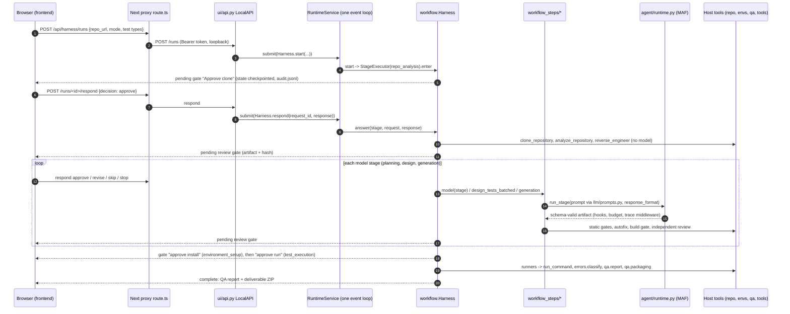

# Developer guide

Start here if you are going to change code. It tells you how to set up, where things live, how a run flows through the code, and the exact steps for the common changes. Rules that must never be broken are in [CLAUDE.md](../CLAUDE.md); branch and commit rules are in [CONTRIBUTING.md](../CONTRIBUTING.md). Every source directory also has its own short `CLAUDE.md` (purpose, key files, gotchas, test commands) that Claude Code loads automatically when you work there.

Contents: [1 Dev environment](#1-dev-environment) · [2 Layout](#2-repository-layout) · [3 Lifecycle](#3-request-to-workflow-to-stage-lifecycle) · [4 Recipes](#4-how-to-recipes) · [5 Debugging](#5-debugging) · [6 Testing](#6-testing-strategy) · [7 Conventions](#7-coding-conventions) · [8 Glossary](#8-glossary)

## 1. Dev environment

### 1.1 Prerequisites

- [Git](https://git-scm.com/).
- [Node.js 24](https://nodejs.org/). Exactly major 24 is required: `frontend/package.json` `engines` and `frontend/.npmrc` (`engine-strict=true`) refuse other versions. `frontend/.nvmrc` says `24`.
- [uv](https://docs.astral.sh/uv/getting-started/installation/). uv provisions Python 3.12 for the project.
- For the target repositories you test (not needed to develop the harness): their toolchains, such as a JDK with Maven or Gradle for Java, or the .NET SDK. See [ENVIRONMENTS.md](ENVIRONMENTS.md).

### 1.2 Set up a checkout

macOS and Linux:

```bash
git clone https://github.com/sarveshtalele/maf-harness-testing.git
cd maf-harness-testing
git checkout develop
uv sync --python 3.12 --extra dev --extra e2e
cd frontend
npm ci --include=dev
cd ..
cp .env.example .env
chmod 600 .env
```

Windows (PowerShell):

```powershell
git clone https://github.com/sarveshtalele/maf-harness-testing.git
cd maf-harness-testing
git checkout develop
uv sync --python 3.12 --extra dev --extra e2e
cd frontend; npm ci --include=dev; cd ..
Copy-Item .env.example .env
```

Notes:

- `--extra e2e` installs Python Playwright used by the e2e tests; `ui.yml` installs it.
- Edit `.env` to set `OPENAI_API_KEY`, `OPENAI_BASE_URL` and `OPENAI_MODEL`. Never commit it. It is git-ignored.
- `.env` is read from exactly one place, found from the code and never from the current directory: `<repository root>/.env` in a source checkout (`paths.env_file()`), and `<user data folder>/.env` in the packaged desktop app. A variable already set in the shell wins over `.env`.
- Setting the key later in the UI (Configuration page) is also possible. See [DESKTOP.md](DESKTOP.md) for the precedence order.

### 1.3 Run the API and the UI in dev mode

```bash
uv run python scripts/start_ui.py
```

This starts the Python API on `127.0.0.1:8765` and the Next.js dev server on `127.0.0.1:3000`. Open http://127.0.0.1:3000. Press Ctrl+C in the same terminal to stop both. The step 1.2 `npm ci` must have run first.

Flags (from `python scripts/start_ui.py --help`):

| Flag | Effect |
|---|---|
| `--port N` | UI port. Default 3000. Without an explicit value the launcher moves to the next free port (up to 10 tries). |
| `--api-port N` | API port. Default 8765, with the same recovery. |
| `--check-only` | Checks Node 24 and the ports, then exits. Exit code 10 means this checkout's app is already running. |
| `--prepare` | Runs `npm ci --include=dev` and the production UI build. |
| `--production` | Serves the built UI with `next start` instead of the dev server. Run `--prepare` first. |
| `--smoke-test` | Starts both services, checks the home page and the authenticated backend proxy, then stops. |

Launcher logs are in `.maf-harness/logs/launch-*.log`.

To run only the API, set a token of at least 32 characters:

```bash
HARNESS_API_TOKEN=<token-of-32-or-more-characters> uv run python -m maf_test_harness.ui.api --port 8765
```

### 1.4 Run from the command line

The CLI runs the same workflow as the UI, without a browser. It reads `.env` from the repository root (see step 3 above; the working directory is not read).

```bash
uv run maf-harness run https://github.com/owner/repo
uv run maf-harness run https://github.com/owner/repo --no-execution
uv run maf-harness run https://github.com/owner/repo --auto-approve
uv run maf-harness trace .maf-harness/runs/<run-id>
uv run maf-harness verify-run .maf-harness/runs/<run-id>
```

- Without `--auto-approve` every gate waits for an answer in the terminal.
- `--auto-approve` is explicit consent to clone the repository, install dependencies and run the generated tests on this machine.
- `--no-execution` stops after generation. No install and no test run.
- Ctrl+C stops the run and exits with code 130.
- Runs are written to `<repo-root>/.maf-harness/runs/<run-id>`. Override with `HARNESS_RUNS_DIR`.
- Live runs spend tokens. The daily ledger cap is `HARNESS_DAILY_TOKEN_LIMIT`. See [CACHING.md](CACHING.md).

### 1.5 Run the desktop shell in dev mode

```bash
cd frontend
npm ci --include=dev
DESKTOP_BUILD=1 npm run build
cd ..
cd desktop
npm ci
npm start
```

PowerShell (Windows):

```powershell
cd frontend
npm ci --include=dev
$env:DESKTOP_BUILD="1"; npm run build; Remove-Item Env:DESKTOP_BUILD
cd ..\desktop
npm ci
npm start
```

`npm start` compiles the shell with `tsc` and then starts Electron. Packaging and the first-run notes for unsigned builds are in [DESKTOP.md](DESKTOP.md).

### 1.6 Run each test layer

| Layer | Command |
|---|---|
| Python unit, component and workflow tests | `uv run pytest -q --ignore=tests/targets` |
| One file or one test subset | `uv run pytest -q tests/test_triage.py -k remedy` |
| Python lint | `uv run ruff check src tests scripts` |
| Python format check | `uv run ruff format --check src tests scripts` |
| Frontend types | `cd frontend && npm run typecheck` |
| Frontend production build | `cd frontend && npm run build` |
| Browser tests (Playwright) | see below |
| Desktop shell (`node:test`) | `cd desktop && npm ci && npm test` |
| Skill lock check | `uv run maf-harness lint-skills --strict` |
| Architecture map is current | `uv run python scripts/gen_architecture.py --check` |

Browser tests need the production build first, because Playwright starts the built UI on port 3100 and a fixture API on port 8876. Run them from `frontend/`:

```bash
cd frontend
npx playwright install chromium
npm run build
PYTHONPATH=<repo>/src OPENAI_API_KEY=dummy npm test
```

On Windows PowerShell:

```powershell
cd frontend
npx playwright install chromium
npm run build
$env:PYTHONPATH="<repo>\src"; $env:OPENAI_API_KEY="dummy"; npm test
```

- `PYTHONPATH` lets the fixture server import the code under test. `OPENAI_API_KEY` only needs a non-empty value. The fixture uses a scripted model.
- The Python used by the fixture is `HARNESS_TEST_PYTHON`, or `.venv` in the repository root.
- Tests that bind ports (launcher, Playwright) fail in restrictive sandboxes. Run them outside the sandbox.

### 1.7 Regenerate the architecture map

`docs/ARCHITECTURE_MAP.md` is generated. Never edit it by hand. After you add, remove, move or re-wire a `.py` or `.ts` module:

```bash
uv run python scripts/gen_architecture.py
```

`gen_architecture.py --check` exits 1 when the file is stale. CI runs `--check` on Linux with Python 3.12, and `tests/test_architecture_map.py` also fails.

### 1.8 Skill lint

Every skill folder under `skills/` must be hash-locked in `skills/SKILLS.lock.json`. After you edit a locked file, refresh only that file's hash, then run:

```bash
uv run maf-harness lint-skills --strict
```

Recipes for adding skills are in section 4.

### 1.9 How the per-directory CLAUDE.md files work

- The root `CLAUDE.md` holds the rules for the whole project. Claude Code loads it for every session.
- Each area has its own `CLAUDE.md`: `frontend/`, `desktop/`, `scripts/`, `skills/`, `tests/`, and `src/maf_test_harness/` with one per subpackage (`agent/`, `envs/`, `errors/`, `hooks/`, `llm/`, `monitoring/`, `qa/`, `repo/`, `skills/`, `tools/`, `ui/`, `workflow_steps/`).
- Claude Code loads a directory's `CLAUDE.md` when it works on files there. Humans should read the one for the area they change. Each file lists the key files, contracts, gotchas, test commands and change recipes for that area.
- When you change behaviour in an area, update its `CLAUDE.md` in the same commit.

### 1.10 Contribution flow

1. Branch from `develop`: `git checkout -b feature/<short-name> develop`.
2. Make one logical change per commit. Use Conventional Commits (section 7).
3. Run the checks in section 1.6, plus section 1.7 and section 1.8 when relevant.
4. Push the branch and open a pull request into `develop`.
5. Wait for green checks: workflow `ci` (jobs `test` and `secrets-scan`) and workflow `Local UI compatibility` (job `local-ui`, from `ui.yml`). Desktop `npm test` runs in `ui.yml`; run it locally for desktop changes.
6. Get a review. The repository owner sets up CODEOWNERS review rules; see [RELEASING.md](RELEASING.md). Security-sensitive changes (plugins, MCP, secrets, desktop) need extra care in review.
7. Merge into `develop`. Releases are cut from `develop` as described in section 4.

Branch and commit rules are in [CONTRIBUTING.md](../CONTRIBUTING.md).


### Internal environment variables

These are set by the launcher, the desktop app or the code itself. They are not user settings and are not in `.env.example`. `HARNESS_TOOL_NAMES` is a Python constant, listed here so the names are not mistaken for settings.

| Variable | Set by | Purpose |
|---|---|---|
| `HARNESS_API_TOKEN` | `scripts/start_ui.py`, `desktop/src/main.ts` | Per-launch bearer token for the loopback API (at least 32 characters) |
| `HARNESS_API_PORT` | `scripts/start_ui.py`, `desktop/src/main.ts` | Loopback port of the Python API |
| `HARNESS_BUILD_ID` | `scripts/start_ui.py` | Build fingerprint; the launcher never reuses a UI started from a stale build |
| `HARNESS_RESOURCE_ROOT` | `desktop/src/main.ts` | Bundled read-only resources (`<resources>/backend` when packaged) |
| `HARNESS_TOOL_NAMES` | `agent/runtime.py` | Python constant (not an env var) listing the harness tools for tool-trace accounting |

## 2. Repository layout

```text
.
├── CLAUDE.md                  project rules for agents and humans (read first)
├── CONTRIBUTING.md            branches, commits, local checks
├── README.md                  user-facing setup and usage
├── pyproject.toml, uv.lock    Python 3.12 package "maf_test_harness" (scripts: maf-harness, maf-backend)
├── start-*.{cmd,command,sh}   thin per-OS launchers -> scripts/start_ui.py
├── src/maf_test_harness/      the Python backend (each subpackage has CLAUDE.md)
│   ├── workflow.py            checkpointed MAF workflow: Harness, StageExecutor, gates
│   ├── workflow_support.py    STAGES, LANGUAGE_RULES, case_budget, shared helpers
│   ├── workflow_steps/        per-stage operations mixed into Harness
│   ├── agent/                 MAF runtime, personas, prompt settings, diagnosis agent
│   ├── repo/                  clone, static analysis, stack, routes, specs (greenfield)
│   ├── skills/                skill registry, trust/approval, host script runner, contracts
│   ├── envs/                  isolated environments, toolchains, runners, recovery, platform_compat
│   ├── errors/                error taxonomy, classifiers, playbook
│   ├── tools/                 deterministic central tools + typed tool registry
│   ├── hooks/                 fail-closed hook engine and built-ins
│   ├── qa/                    QA report, triage/remedies, step reports, deliverable ZIP
│   ├── llm/                   prompt section order (prefix cache), daily token ledger
│   ├── monitoring/            trace.jsonl recorder, observability report, telemetry
│   ├── ui/                    loopback HTTP API and its services (ETA, errors, evidence, settings)
│   └── cli.py, desktop_backend.py, settings.py, paths.py, models.py, run_options.py, storage.py
├── frontend/                  Next.js 16 UI + same-origin proxy + Playwright specs
├── desktop/                   Electron shell (main, process manager, keystore) + node:test
├── skills/                    Agent Skill packages + SKILLS.lock.json (hash lock)
├── scripts/                   start_ui, gen_architecture, vendor_skills, build_desktop, check_version
├── packaging/backend.spec     PyInstaller spec for the desktop backend
├── tests/                     pytest suite, fakes.py, ui_fixture_server.py
├── prompts/                   persona and reviewer prompt text shipped with the app
├── docs/                      documentation index in docs/README.md
├── .github/workflows/         ci, ui, nightly, desktop-prerelease, desktop-release
├── (azure-plan/, design/, patches/, agentic-testing-harness-v5-fixed.html (removed 2026-10-11; see git history))
│                              historical/design material, not part of the runtime
└── memory.md                  project log (orchestrator-owned)
```

Where code lives in more detail: generated [ARCHITECTURE_MAP.md](ARCHITECTURE_MAP.md) (every module with imports and importers) and [ARCHITECTURE.md](ARCHITECTURE.md) (the design and guarantees). Regenerate the map after adding, removing or re-wiring modules: `python scripts/gen_architecture.py` (CI runs `--check`).

## 3. Request to workflow to stage lifecycle

Stages (from `workflow_support.STAGES`): `repo_analysis`, `requirements`, `test_planning`, `test_design`, `test_generation`, `environment_setup`, `test_execution`. Each is a MAF `Executor` (`StageExecutor`) and ends in a human gate (a MAF `request_info` event raised by `Harness.ask`). Runs with `execute=False` (CLI `--no-execution`) end after generation. Greenfield runs replace repository analysis with `workflow_steps/greenfield.py`.



What to remember when changing it:

- Gates: `Harness.enter` decides what a stage does on entry; `Harness.review` stores `artifacts[stage]` and `{stage}-{revision}.json` and asks; `Harness.answer` handles approve / revise / skip / stop. State lives in `Harness.state`, saved via `Harness.save`; MAF checkpoints go to `run_dir/checkpoints`.
- Model stage: `PlanningSteps.model` builds the prompt (see `llm/prompts.py` ORDER lists), calls `MAFHarnessRuntime.run_stage`, validates against a `models.py` schema, then review. Design and generation are batched by component (`design_tests_batched`, generation gates in `workflow_steps/generation.py`).
- Workflow version 2: nothing is created in the target workspace, no installs, no runtime collection before `environment_setup` is approved. Old runs keep their saved stage order.
- Stop: UI Stop sets status stopping, cancel event + task cancel + `MiddlewareFailure` + process-tree kill. CLI Ctrl-C exits 130. Resume = rerun from the active stage (`workflow_steps/rerun.py`; old evidence goes to `attempts/<id>`).
- Coverage accounting and fail-soft rules: [CLAUDE.md](../CLAUDE.md) sections "Generation gate order" and "Coverage accounting".

## 4. How-to recipes

Run the checks in [section 6](#6-testing-strategy) after every recipe, and commit docs together with code.

### Add a workflow stage
1. `workflow_support.py`: add the name to `STAGES` (and `CORE_STAGES` if it must finish before execution approval).
2. `agent/personas.py`: add a `PERSONAS["<stage>"]` entry (name, role, goal, rules). If the stage returns a model artifact, add a pydantic schema to `models.py`.
3. `workflow.py`: handle it in `Harness.enter` (host stages) or let the default `self.model(...)` run it; put the logic in a `workflow_steps/` mixin and add the mixin to the `Harness` bases.
4. `skills/config.py` picks skills per stage from `plugin.yaml` `stages:` - give the stage a primary skill in `skills/` (and update the lock).
5. UI: `ui/eta.py` `DEFAULTS` (seconds per unit), `ui/progress.py`, `frontend/lib/harness.ts` `label` if the name needs special text, `qa/templates/NN-*.md` and `qa/step_reports.py` for the step report.
6. Tests: extend `tests/test_harness_gates.py` style flow with `ScriptedStageRuntime` (it answers by stage name). Update the diagram in `scripts/gen_architecture.py` (`FLOW`) and `ARCHITECTURE.md`; run `python scripts/gen_architecture.py`.

### Add a prompt section
1. Add the key to the sections dict the stage builds (in `workflow_steps/*.py`).
2. **Register it in `llm/prompts.py`**: `STAGE_ORDER` (planning, design, reviews), `GENERATION_ORDER` (generation) or `GENERATION_INPUT_ORDER` (inside `approved_inputs`). Stable keys first, per-batch keys later, so the provider prefix cache keeps hitting.
3. Keep the text language-neutral; language rules belong in `LANGUAGE_RULES`.
4. Test in `tests/test_prompt_assembly.py`; see [CACHING.md](CACHING.md).
User-editable prompt templates are separate (`agent/prompt_settings.py`, UI Prompts tab).

### Add a language
1. `workflow_support.py`: add a family to `LANGUAGE_RULES` (`declaration`, `parametrize`, `stdlib`, `retry`, `integration`, `rules`) and map the language name in `_FAMILY_BY_LANGUAGE`.
2. `skills/generic-test-generator/references/<lang>.md` (language conventions; the rest of the skill stays neutral). Refresh its hash in `skills/SKILLS.lock.json`, run `uv run maf-harness lint-skills --strict`.
3. Tooling map: detection in `repo/analyzer.py` (`_detect_frameworks`) and `repo/stack.py` (`detect_stack`, `StackProfile`); environment spec in `envs/spec.py` (follow the `spec` pattern in `envs/python_env.py`); toolchain detect/provision in `envs/toolchains.py`.
4. Runners: add the ecosystem to `resolve_ecosystem` and the plan builder in `envs/runners.py` (setup steps, test command, JUnit/report parsing via `execution.read_junit`).
5. Errors: classifier table in `errors/classifiers/<lang>.py`, registered in `BY_ECOSYSTEM` / `ALL_LANGUAGES` / `EXECUTION`; codes in `errors/taxonomy.py`.
6. Static gates for generated code (imports, mock pitfalls) in `tools/` and `workflow_steps/generation.py` as needed.
7. Tests: `tests/test_stack_and_runners.py`, `tests/test_errors.py`. Docs: [ENVIRONMENTS.md](ENVIRONMENTS.md).

### Add a skill plugin
1. Create `skills/<name>/` with `SKILL.md` (name equals folder, description under 1024 chars, under 500 lines, Goal -> Inputs -> Steps -> Output -> Self-check) and `plugin.yaml` (`stages`, `role`, `kind`, `purpose`, `applies_when`, `priority`). Spec: [SKILL_PLUGINS.md](SKILL_PLUGINS.md).
2. Lock it: `uv run python scripts/vendor_skills.py --lock-project`, then `uv run maf-harness lint-skills --strict`.
3. Companion skills only need the folder; a new primary per stage/kind conflicts with the existing one (lint says so). Scripts must be reviewed and listed in `REVIEWED_SCRIPTS` in `scripts/vendor_skills.py`.
4. End-user (non-repo) plugins are different: they live in the plugin dir (`HARNESS_PLUGIN_DIR`), are unverified until approved in the UI, companion-only, never host kind.
5. Tests: `tests/test_skill_plugins.py`, `tests/test_skills_registry.py`.

### Add an API route and UI panel
1. Method on `LocalAPI` (or `EvidenceAPI` / `SettingsAPI`) and a branch in `handle_request` in `ui/api.py`. Keep the response through `presentation.public` (redaction).
2. The Next proxy `frontend/app/api/harness/[...path]/route.ts` forwards any path of `[A-Za-z0-9_.-]` segments for GET and POST; only touch it for a new body-size limit or method.
3. Frontend: call `api('...')` from `frontend/lib/harness.ts` in a component under `frontend/components/`; for a run tab add the name to `tabs` in `workspace.tsx` and a `tab === '...'` block.
4. Tests: `tests/test_ui_api.py`; fixture response in `tests/ui_fixture_server.py` if the Playwright journey needs it; spec in `frontend/tests/`.

### Add an error classifier and remedy
1. `errors/taxonomy.py`: `_c("ENV-XX-NNN", category, autonomy, title, hint, recipes)`; ids are stable, never renumber.
2. `errors/classifiers/<ecosystem>.py`: add `("ENV-XX-NNN", r"regex")` to `RULES` (setup) or `EXEC_RULES` (test run output). Order is priority.
3. Automatable? add a `Recipe` to `errors/playbook.py` (`RECIPES`) and an action in `envs/recovery.py`; `playbook.validate()` must stay empty.
4. For generated-test mistakes shown in the QA report, add `(re.compile(...), "advice")` to `REMEDIES` in `qa/triage.py` (read by `remedy_for`).
5. Sample text in `tests/error_cases.py`; tests in `tests/test_errors.py`, `tests/test_triage.py`; document in [ERROR_PLAYBOOK.md](ERROR_PLAYBOOK.md).

### Add a test-tooling package
Generated tests sometimes need a helper the repository does not declare (for example the HTTP client behind `starlette.testclient`). Never touch packages the repository declares or relax its pins.
1. Add the detection pattern as an `ENV-PY-010` rule (named group `package`) in `errors/classifiers/python.py`, or a probe like `recovery.testclient_http_package`.
2. `envs/recovery.py` `test_client_packages(text, workspace)` filters out declared packages and invalid names; the install happens in the runner's recovery step in `envs/runners.py`.
3. For UI tooling availability checks extend `envs/env_check.py` `ui_tooling`.
4. Test: `tests/test_test_tooling_recovery.py`.

### Change the case budget or ETA defaults
- Cases per requirement: `settings.CASES_PER_REQUIREMENT` (env `HARNESS_CASES_PER_REQUIREMENT`, default 2, clamped 1-10). A run can override it (`state["case_budget"]["per_requirement"]`) until design is approved; read through `workflow_support.case_budget`; the UI endpoint is `POST /runs/<id>/case-budget` (`LocalAPI.set_case_budget`). Recommendations: `ui/eta.py` `budget_recommendations`, `case_budget_view`.
- Batch sizes: `HARNESS_GENERATION_BATCH_SIZE` (default 3, max 8); failed-batch tolerance `HARNESS_MAX_FAILED_BATCH_RATIO` (0.5); retries `HARNESS_GENERATION_MAX_ATTEMPTS` (3).
- ETA fallbacks (seconds per work unit when no history): `DEFAULTS` in `ui/eta.py`. Real durations come from `audit.jsonl` and `trace.jsonl` of earlier runs.
- Tests: `tests/test_case_budget.py`, `tests/test_ui_eta.py`.

### Package the desktop app
```bash
uv sync --extra dev --extra desktop
uv run python scripts/build_desktop.py --dry-run     # prints the steps
uv run python scripts/build_desktop.py                # PyInstaller backend, DESKTOP_BUILD=1 Next build, electron-builder
```
Each OS must be built on its own runner. Unsigned builds, first-run instructions and environment variables: [DESKTOP.md](DESKTOP.md). The shell itself: [desktop/CLAUDE.md](../desktop/CLAUDE.md).

### Release
Cut `release/x.y` from `develop`, bump `pyproject.toml` and `frontend/package.json` to the same version (`python scripts/check_version.py` verifies), QA the installers, PR to `main`, tag `vX.Y.Z`; the tag starts the `desktop-release` workflow which makes a draft GitHub Release. Full procedure and owner checklist: [RELEASING.md](RELEASING.md). Add a dated entry to the "Core memory log" via the orchestrator (do not edit `memory.md` yourself).

## 5. Debugging

**Where evidence lives**

| What | Where |
|---|---|
| Service/launcher logs | `.maf-harness/logs/launch-*.log` (UI: Configuration -> Debugging logs); desktop: `<userData>/logs/desktop-*.log` |
| Run folder | `.maf-harness/runs/<run-id>/` (`run.json`, `workflow.log`, `audit.jsonl`, `trace.jsonl`, `checkpoints/`, `prompts.json`, per-stage `{stage}-{revision}.json`) |
| Clone / analysis | `repo/`, `reverse_engineering.json`, `clone_operation.json` |
| Generation attempts | `generation_attempts/`, `build_checks/` |
| Install / test output | `environment/attempt-*/`, `executions/attempt-*/` (`stdout.log`, `stderr.log`, JUnit, reports) |
| Results | `qa_report.json`, `qa_report.md`, `deliverables/` (ZIP) |
| Reruns | `attempts/<id>/` (previous evidence is retained) |
| Token ledger | per machine, `HARNESS_USAGE_DIR` ([CACHING.md](CACHING.md)) |

**Tools**
- UI **Errors** tab: all run errors grouped (`ui/errors.py` `run_errors`, `categorize`): generation batches, stage errors, build gate, gates.
- UI **Logs**, **Audit**, **Observability** and **Test reports** tabs; Prompts tab shows the exact prompt snapshot.
- `uv run maf-harness trace <run-dir>` (same report as the Observability tab, `monitoring/report.py`); `verify-run` re-checks skill and MAF evidence.
- Run with `PYTHONPATH=src` and the scripted fakes to reproduce workflow logic without a model.
- Open telemetry: `monitoring/telemetry.py` (`configure_telemetry`, see [OBSERVABILITY.md](OBSERVABILITY.md)).

**Common failures and where the remedy comes from**
- Classified environment/infra/test-defect errors have a code, owner and recipe: `errors/taxonomy.py`, human table in [ERROR_PLAYBOOK.md](ERROR_PLAYBOOK.md). `envs/recovery.py` applies at most one allow-listed action.
- Test-defect hints in the QA report come from `REMEDIES` in `qa/triage.py` (examples: mocking `sys.exit`, bad patch targets, missing fixtures); `classify` returns `test_defect`, `check_application_then_expectation` or `needs_triage`.
- `generation_failed` cases: batch failed after retries (`generation_failures`); more than `HARNESS_MAX_FAILED_BATCH_RATIO` failed batches aborts the stage; failed cases block PASS.
- Incomplete installation is a blocking error (never fake dependencies). Strict mode: `HARNESS_STRICT_ENV`.
- 401/404 from the gateway: check `.env`, base URL (include `/v1` if the gateway needs it), model; restart both servers.
- Port busy / stale UI: stop the launcher with Ctrl+C, rerun; explicit `--port` values do not auto-recover.
- Windows-specific problems (sharing violations, `Scripts/` paths, long paths): [WINDOWS_SETUP_AND_DEBUGGING.md](WINDOWS_SETUP_AND_DEBUGGING.md); clone/platform diagnostics: [CLONE_AND_PLATFORM_DIAGNOSTICS.md](CLONE_AND_PLATFORM_DIAGNOSTICS.md).

## 6. Testing strategy

| Layer | What | Command (see section 1.6) |
|---|---|---|
| Unit / component | pure functions, classifiers, real MAF with a scripted transport | section 1.6 |
| Workflow e2e | real `Harness` with `ScriptedStageRuntime` (`tests/fakes.py`) and `clone_fixture`; drives every gate through `RuntimeService` | same suite (`test_harness_gates.py`, `test_execution_stage.py`, `test_fail_soft_generation.py`) |
| Static quality | lint, format, skills, architecture map | section 1.6 and 1.7 |
| Frontend | types and production build | section 1.6 |
| Browser (Playwright) | real UI against `tests/ui_fixture_server.py` (real `LocalAPI` and workflow, scripted model, fixture clone, no GitHub). Needs `npm run build` first | section 1.6 |
| Desktop | `node:test` for port/token/URL guards and keystore (runs in `ui.yml`) | section 1.6 |
| Live E2E | real gateway and a real repository; costs tokens, needs network | `uv run maf-harness run <url>`; acceptance against deployed apps in `tests/targets/` (skipped unless `PETSTORE_BASE_URL` is set) |

Notes:
- `tests/conftest.py` isolates the token ledger and hook config; tests must never read your real `~/.maf-harness`.
- Playwright needs `PYTHONPATH=<worktree>/src` so the fixture server imports the code under test, and a dummy `OPENAI_API_KEY` (any non-empty value; the fixture server also marks the key as configured). The Python used is `HARNESS_TEST_PYTHON` or `../.venv`.
- Tests that bind ports (launcher, Playwright) fail inside restrictive sandboxes; run them unsandboxed.
- CI (`.github/workflows/ci.yml`, `ui.yml`) runs ubuntu/windows/macos; keep tests OS-neutral.
- Pre-merge gate: full pytest 0 failures, ruff check+format, `lint-skills --strict`, `gen_architecture.py --check`, frontend `tsc` and `next build --webpack`, Playwright, desktop `npm test`.

## 7. Coding conventions

- **Cross-OS (strict):** `pathlib`, `encoding="utf-8"`, subprocesses via `run_command` / `run_cancellable` with process groups, never `shell=True`, OS branches only in `envs/platform_compat.py`, launchers stay thin. Node 24, Python 3.12.
- **Safety:** never relax repository dependency pins; never replace missing dependencies with fake tests; never print or commit credentials, `.env`, run evidence or `agent-framework.pdf`; UI shows only the last 4 chars of keys.
- **Determinism first:** facts the host can compute (imports, signatures, routes, compile) go in `tools/` or `repo/`, not in prompts. Model output is schema-validated and gated.
- **Honest wording:** static traceability is never "measured coverage". Report generated, baseline unit and baseline integration results separately.
- **Prompts:** language-neutral; language rules only in `LANGUAGE_RULES` and `skills/generic-test-generator/references/<lang>.md`; register section keys in `llm/prompts.py`.
- **Skills:** hash-locked; after editing a locked file refresh its hash and run `lint-skills --strict`.
- **Style:** ruff check and format (`pyproject.toml`), type hints on new public functions, small modules with a module docstring (the architecture map reads it), comments explain why.
- **Git:** Conventional Commits (`feat`, `fix`, `docs`, `chore`, `test`, `refactor`, `ci`), one logical change per commit, PRs into `develop`; never push to `main`/`develop` directly (the orchestrator merge described in CLAUDE.md is the only exception). Agents work in worktrees and never stash or push.
- **TypeScript versions differ on purpose:** `frontend/` pins TypeScript 7.0.2 (exact, in `package-lock.json`) with Next.js 16; `desktop/` uses TypeScript `^5.9.0` (locked to 5.x in its `package-lock.json`). The two packages are separate npm toolchains with separate lockfiles, so each keeps the compiler it was tested with. Do not align them without testing both.
- **Request logging is silenced on purpose:** `ui/api.py` `Handler.log_message` is a no-op because URLs and feedback can contain sensitive repository information. There is no supported switch to turn request logs on. For a local debugging session, temporarily call `super().log_message` in that method and do not commit it. Service and launcher logs are unaffected (see section 5).
- **Docs travel with code:** update the directory `CLAUDE.md`, this guide or the relevant `docs/*.md`, and regenerate the architecture map in the same commit. Dated reports and `docs/audit/` are historical: do not edit.

## 8. Glossary

| Term | Meaning |
|---|---|
| Run | One execution of the workflow for one repository (or spec set); a folder under `.maf-harness/runs/<run-id>` |
| Stage | One of the seven workflow steps in `workflow_support.STAGES` |
| Gate | A pause where a human approves, revises, skips or stops (a MAF `request_info`); tool gates approve machine actions, review gates approve artifacts |
| Brownfield / greenfield | Existing repository vs specs from documents or Jira Cloud (`run_options.parse_run_options`) |
| Batch | A group of requirements or cases sent in one model call, packed by component |
| Case | One designed test (id, requirement links, level unit/integration); case budget = cases kept per requirement |
| Witness | An existing repository test that statically invokes a requirement's source symbol (`pre_existing_witness`); not measured coverage |
| Requirement | A source-linked declaration candidate (or `SPEC-<hash8>-<n>` spec) that must become a case, a witness or a reasoned gap |
| Persona | The role instructions for a stage agent (`agent/personas.py`) |
| Skill | A folder with `SKILL.md` + `plugin.yaml`, loaded by the agent (model kind) or run by the host (host kind) |
| Plugin | A user-supplied skill in the plugin dir: companion-only, unverified until approved |
| Recipe | In `errors/playbook.py` a recovery action id; in `repo/import_recipes.py` a deterministic import bootstrap snippet |
| Verified / approved | A skill whose files match `SKILLS.lock.json` / a plugin whose hash is recorded in the approvals file |
| Hook | A check run before/after tool and model calls (`hooks/`); fail-closed |
| Central / typed tools | Deterministic functions agents may call (`tools/agent_tools.py`, `tools/typed.py`) |
| Build gate | Compile/collect check of generated tests after execution approval (`tools/build_gate.py`) |
| Fail-soft | A failed generation batch does not abort the stage unless too many fail; its cases are `generation_failed` |
| Deliverable | ZIP of the repo with generated tests and evidence (`qa/packaging.py`) |
