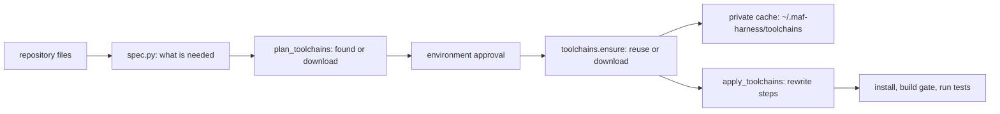

# Environments and toolchains

How the harness prepares an isolated environment for Python, Java (Maven and Gradle) and .NET, and what it does when
the machine lacks the right JDK, build tool or SDK. Code: `src/maf_test_harness/envs/`.

## 1. What is detected (`envs/spec.py`, no network)

| Ecosystem | Requirement | Read from |
|---|---|---|
| Python | interpreter version | `.python-version`, `runtime.txt`, `pyproject.toml` `requires-python`, `setup.cfg` / `setup.py` `python_requires` |
| Java | JDK release | `pom.xml` (`maven.compiler.release`, `release`, `source`, `target`, `java.version`), Gradle (`JavaLanguageVersion.of`, `sourceCompatibility`, `jvmToolchain`, `jvmTarget`), `.java-version`, `.sdkmanrc`, `.tool-versions`; default 17 |
| Java | Maven or Gradle | a `mvnw` / `gradlew` wrapper means the repository brings its own; otherwise Maven 3.9.9 or the version in `gradle-wrapper.properties` (default 8.10.2) |
| .NET | SDK | `global.json`, else the highest dotted `TargetFramework` (`net6.0`, `net8.0`, `netcoreapp3.1`); `net48` (.NET Framework) is ignored; default 8.0 |

## 2. Found, or provisioned

`toolchains.find` looks for a satisfying install on the machine first (`JAVA_HOME`/PATH `java` that also has `javac`,
`mvn -v`, `gradle -v`, `dotnet --list-sdks`, `python3.X` and the Windows `py` launcher), then in the harness cache. A JRE
without a compiler does not count as a JDK. A newer JDK or SDK satisfies an older requirement.

What is missing is downloaded into `~/.maf-harness/toolchains/<kind>/<version>-<os>-<arch>/` only after you approve
the environment plan (the approval lists every toolchain with its source):

| Toolchain | Source | Integrity |
|---|---|---|
| JDK | Eclipse Temurin via `api.adoptium.net` | SHA-256 from the vendor metadata |
| Maven | `archive.apache.org` | published `.sha512` |
| Gradle | `services.gradle.org` | published `.sha256` |
| .NET SDK | Microsoft release metadata (`releases.json`) | SHA-512 from the metadata |
| Python | `uv python install` (only when `uv` is on PATH) | uv's own verification |

Downloads are verified before extraction; a mismatch is deleted. Archives with entries that escape the target directory
are refused. Extraction happens in a staging directory under a file lock, so parallel runs are safe and an interrupted
download never leaves a half-installed toolchain. Every toolchain gets a `provenance.json` (URL, checksum, time).

Nothing system-wide changes: no PATH edit, no registry, no admin rights. A toolchain is used by giving the commands the
harness runs its environment (`JAVA_HOME`, `MAVEN_HOME`, `GRADLE_HOME`, `DOTNET_ROOT`, an isolated `DOTNET_CLI_HOME` and
`NUGET_PACKAGES`, and a PATH with the toolchain in front).

## 3. How the plan is rewritten

`apply_toolchains` rewrites the steps **before** they are shown for the run approval and hashed: `mvn`, `gradle`,
`java`, `dotnet` become absolute paths of the provisioned tool (on Windows the `.cmd`/`.exe` launcher, never an
extensionless script), `create-venv` uses the interpreter the project asks for, and the toolchain variables are added
to each step. The build gate uses the same rewritten plan, so a generated Java test is compiled with the JDK the project
needs. Required tools a toolchain covers are no longer reported as "not installed on the host".

## 3.0 Strict guardrail: install everything, then proceed

`HARNESS_STRICT_ENV` (default `on`). After the install steps the harness checks three things: no step failed, no *declared* package is
missing (`envs/env_check.missing_packages`), and no version conflict remains (`pip check`, section 3.1). If any check fails the run does
**not** reach a review it could approve: the environment gate becomes an error gate (`Environment incomplete: the strict guardrail
blocks the next stage`) that lists the reasons and offers only *Retry* or *Stop*. `Harness.enter` independently refuses to start any
later stage while the environment status is `incomplete`. Skipping the install stays possible, as the reviewer's explicit *Skip*.

Some failures are fixed by another interpreter, not by retrying: a pinned package that must be compiled or has no wheel for the current
Python (on the run that motivated this: `chromadb==0.4.24` needs `chroma-hnswlib==0.7.3`, which has no wheel for Python 3.12). For
`ENV-PY-001/002/003` the gate proposes the next interpreter from 3.11, 3.10, 3.12 that is installed or that `uv` can install
(`envs/recovery.python_fallback`). *Retry* then deletes the harness venv, records the choice (`env_python`, `env_python_tried`) and shows a
new install plan in which that Python is listed as a download (`exact` requirement, `envs/spec.detect_spec(python_override=...)`); you approve it like
any toolchain, and the venv is rebuilt with it. Each interpreter is tried once. With no candidate the gate says what to install (Microsoft
C++ Build Tools, `xcode-select --install`, `build-essential`, or a Python that has wheels).

New runs design and generate from source before installation. Live UI cases require a supplied application URL or an approved launch plan. Installation, application readiness and runtime checks occur at Test execution; unsupported startup is an explicit setup gap, not a fabricated successful browser run.

## 3.1 Consistency of the installed Python packages

`pip install -r requirements.txt` is all-or-nothing, so when one package cannot be built (a C/C++ compiler is missing) the harness retries package
by package. Installing one at a time loses the joint resolution: a later package can pull a newer dependency than an earlier pin allows. On a real
run `streamlit>=1.32.0` brought `starlette 1.6.0` next to `fastapi==0.110.0` (which needs `starlette<0.37`), and every generated test that built
the app failed with `TypeError: Router.__init__() got an unexpected keyword argument 'on_startup'`.

Now, after the per-package retry, everything that installed is resolved **together in one pip run** (so the resolver backtracks, here to an older
streamlit, without loosening any pin), and after all install steps the harness asks `pip check` (`envs/env_check.dependency_conflicts`). Conflicts are
repaired by re-resolving the declared requirements plus the ranges pip reports (`envs/runners.repair_conflicts`, at most two rounds, never a repeat
of the same install). The result is in the setup report (`dependency_conflicts`: found, repaired, remaining) and in a warning. What remains
inconsistent is diagnosed as `ENV-PY-009`: an API-mismatch `TypeError`/`ImportError` in that environment is classified as environmental, so the
build gate no longer spends generation retries on it. Agents see it through the `environment_gaps` central tool and `list_dependency_conflicts`.

## 4. Settings

| Variable | Effect |
|---|---|
| `HARNESS_TOOLCHAIN_DIR` | move the toolchain cache |
| `HARNESS_TOOLCHAIN_MIRROR` | send every metadata and download request to a mirror that serves the same paths (proxies, offline machines) |
| `HTTP_PROXY` / `HTTPS_PROXY` | honoured by downloads |

## 5. When it goes wrong

The error classifier (see [ERROR_PLAYBOOK.md](ERROR_PLAYBOOK.md)) recognises the failures of these tools; for example a
provisioned Maven started without a JDK prints `The JAVA_HOME environment variable is not defined correctly` and is
diagnosed as `ENV-JAVA-002` with the recipe `provision-jdk`. A failed provisioning ends the environment step with the
reason in `report.json` and the audit log (`toolchains_failed`); successful provisioning is recorded as
`toolchains_ready` with what was reused and what was downloaded.

## 6. Not covered yet

Scaffolding a Java or .NET *test project* for the generated tests, and provisioning Node or Go toolchains. Both are
listed in [../memory.md](../memory.md).

## Strict generation update — October 6, 2026

[Current intake, batching, Java quality gates and scoped QA](PETSTORE_STRICT_TEST_GENERATION.md) supersede earlier truncation and final-retry acceptance behavior. New deterministic requirements retain all discovered declarations; installation/runtime checks remain at Test execution. Maven baseline unit/integration and generated results are separate, and runtime coverage is explicitly unmeasured. Run logs default to the checkout’s `.maf-harness` directory.
