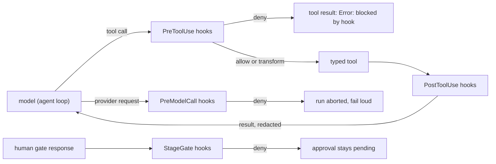

# Hooks and typed tools

Hooks are checks that run *around* what the harness and its agents do: before a tool runs, after it returns, before a
model call, at each human gate and when an environment or test run fails. They can allow, deny, rewrite or ask. Code:
`src/maf_test_harness/hooks/`. The typed tools they guard are in `src/maf_test_harness/tools/`.



## 1. Events

| Event | When | Enforcing? | What a deny does |
|---|---|---|---|
| `SessionStart` | a `Harness` is created or resumed | no | recorded only |
| `PreToolUse` | before any tool the agent calls (skills, central tools, typed tools) | **yes** | the tool does not run; the model gets `Error: blocked by hook (<hook>): <reason>` and carries on |
| `PostToolUse` | after the tool returned | no | recorded only; a *transform* rewrites the result before the model sees it |
| `PreModelCall` | before each provider request | **yes** | the run is aborted (`MiddlewareFailure`), because a model call that must not happen cannot be turned into a tool error the model could route around |
| `StageGate` | when the human answers a gate (`respond`) | **yes** | the response is refused with `PermissionError`; the approval stays pending and unconsumed, so the human sees why and can answer again |
| `OnEnvError` | the isolated environment did not become ready | no | recorded only |
| `OnExecError` | the test run did not pass | no | recorded only |
| `Stop` | the workflow completed | no | recorded only |

A `deny` or `ask` on a non-enforcing event is recorded in `audit.jsonl` as `hook_decision` with `enforced: false`; it
never blocks anything. Observer events are for reactions (notify, log, collect metrics), not for control.

## 2. Verdicts and how they combine

A hook returns one of `allow`, `deny` (with a reason), `transform` (with a payload) or `ask`.

* **deny beats ask beats transform beats allow**; the first enforced deny ends the event.
* **transforms chain**: each hook sees the arguments (before a tool) or the result (after) that the previous one produced.
  Before a tool the payload is `{"arguments": {...}}`; after it, `{"result": "..."}`.
* **fail closed**: a hook that crashes, times out or prints something that is not a verdict is a **deny** on an
  enforcing event, and is recorded as `hook_error`. On observer events it is only recorded.
* **`ask`** needs a human. With no approver configured it is treated as a deny, never as an allow.
* **evaluate-only mode** records what *would* have been blocked or rewritten and changes nothing. Use it to roll a new
  hook out safely, then switch to enforce.

## 3. Built-in hooks (on by default)

| Hook | Event | What it does |
|---|---|---|
| `secret_redaction` | Pre/PostToolUse | replaces API keys (`sk-…`, `ghp_…`, `AKIA…`, `Bearer …`), values after `password=` / `token:` / `api_key` (JSON stays valid) and the values of `OPENAI_API_KEY`, `ANTHROPIC_API_KEY`, `GITHUB_TOKEN`, `GH_TOKEN`, `AWS_SECRET_ACCESS_KEY` with `[REDACTED]`, in tool arguments and tool output |
| `path_scope` | PreToolUse on `write_test_file`, `delete_file` (and the reserved name `apply_env_fix`) | the `path` must stay inside the run's writable roots (the workspace); `..` escapes and absolute paths elsewhere are denied; with no root configured every write is denied |
| `download_consent` | PreToolUse on `provision_toolchain` | `ask` unless the environment approval has set `allow_downloads` |
| `stage_budget` | PreModelCall | optional soft cap: deny a model call once the stage has used `per_stage_tokens` (off unless configured; the daily cap in `usage.py` is separate and always on) |
| `audit` | StageGate, OnEnvError, OnExecError, Stop | writes `hook_event` records to `audit.jsonl` |

The typed file tools enforce the same scope themselves. `path_scope` and the tool are two independent locks: turning hooks
off (`HARNESS_HOOKS=off`) does not open the filesystem.

## 4. Your own hooks: `.harness/hooks.json`

Two files are read, user first, then project: `~/.maf-harness/hooks.json` and `<directory you start the harness from>/.harness/hooks.json`.
**The repository under test is never consulted**: a cloned repository cannot install hooks. A malformed file stops the run
before it starts, with the file and entry named; ignoring a broken safety hook silently would be worse.
Copy [`.harness/hooks.json.example`](../.harness/hooks.json.example) to start.

```json
{
  "mode": "enforce",
  "builtins": {"stage_budget": {"per_stage_tokens": 2000000}, "audit": true},
  "hooks": [
    {"event": "PreToolUse", "matcher": "^write_test_file$", "command": ["python", "hooks/check_path.py"], "timeout": 5},
    {"event": "PostToolUse", "python": "my_hooks:scrub_output"},
    {"event": "StageGate", "matcher": "^environment_setup$", "command": ["python", "hooks/change_window.py"]}
  ]
}
```

| Key | Meaning |
|---|---|
| `mode` | `enforce` (default) or `evaluate_only` |
| `builtins` | per built-in: `false` switches it off, an object sets options; unknown names are rejected |
| `hooks[].event` | one of the events above |
| `hooks[].matcher` | regular expression on the tool name (tool events) or the stage (other events); no matcher = every event |
| `hooks[].command` | an argv list, **never a shell line**. `python` / `python3` mean the interpreter running the harness. A relative path is resolved against the config file, not the current directory |
| `hooks[].python` | `package.module:function`; receives the event as a dict |
| `hooks[].timeout` | seconds for a command hook (default 10, at most 300) |
| `hooks[].name` | label used in the audit log and in deny reasons |

**Command hooks** get the event as JSON on stdin (`{"event", "stage", "tool", "arguments", "result", "data"}`) and a minimal
environment (no credentials). Exit code `2` denies, with stderr as the reason. Exit `0` with nothing on stdout allows. Exit `0`
with `{"verdict": "deny" | "transform" | "ask" | "allow", "reason": "...", "payload": {...}}` on stdout decides. Any other exit
code, a timeout or unparsable output is a failure (a deny on enforcing events).

**Python hooks** return a `Decision`, a verdict dict (same shape) or `None` (allow).

### The switch: `HARNESS_HOOKS`

| Value | Effect |
|---|---|
| `enforce` (default) | built-ins plus your hooks, enforced |
| `evaluate_only` | everything is evaluated and recorded, nothing is blocked or rewritten |
| `off` | no hooks at all (`hooks_disabled` is written to the audit log); for debugging only |

## 5. Typed tools (`tools/registry.py`, `env_tools.py`, `file_tools.py`, `typed.py`)

Every typed tool takes arguments validated against a JSON schema and returns the same envelope, so an agent acts on
fields instead of parsing text:

```json
{"ok": false, "code": "ENV-JAVA-002", "category": "environment", "evidence": "The JAVA_HOME environment variable is not defined correctly",
 "data": {"autonomy": "ask", "environmental": true, "diagnoses": []},
 "suggested_fixes": ["Install a JDK...", "Download the Temurin JDK the project needs into the toolchain cache."],
 "next_actions": ["ask the human to approve: Download the Temurin JDK the project needs into the toolchain cache."]}
```

`code` is an error code from [ERROR_PLAYBOOK.md](ERROR_PLAYBOOK.md) or a tool code (`TOOL-ARGS`, `TOOL-ERROR`,
`HOOK-DENIED`, `FILE-SCOPE`, `CONSENT-REQUIRED`, …); `category` says whose fault it is
(`environment`, `infra`, `test_defect`, `app_defect`).

| Tool | Does | Changes anything? |
|---|---|---|
| `detect_stack` | ecosystems, build files, test runner | no |
| `detect_toolchains` | which Python/JDK/Maven/Gradle/.NET the repository needs; found or would be downloaded | no |
| `provision_toolchain` | download one toolchain into the harness cache | **yes**, only after the environment approval (`allow_downloads`); also gated by `download_consent` |
| `list_missing_packages` | declared dependencies not installed in the isolated environment | no |
| `plan_env_fix` | preview which allow-listed recovery the harness would apply to a failed command (nothing is executed) | no |
| `diagnose_env_error` | classify an install/build log: code, category, recipe, how far the agent may go alone | no |
| `diagnose_exec_error` | classify a test-run log: environment problem, test defect (regenerate) or application defect (report) | no |
| `read_file`, `list_dir` | read the repository/workspace; secret-looking files (`.env`, keys) are refused and hidden | no |
| `write_test_file`, `delete_file` | create or delete a generated test file inside the writable root | **yes**, scoped by the tool and by `path_scope` |
| `check_skill_output` | run a reviewed validator script of one of the stage's own skills on a draft (opt-in, `HARNESS_SKILL_EVALUATORS=on`) | no (temp dir, hash-checked script) |

`ToolRegistry.call` is validate → PreToolUse → handler → PostToolUse and never raises. `as_function_tools(stage)` exposes
the same tools to a MAF agent; there the agent's hook middleware is what guards the call (the registry does not run the
hooks a second time). The hooks' facts (`writable_roots`, `allow_downloads`) follow the tool context via `sync_hook_context()`.

Recipes are executed by the harness itself, not by a tool an agent could misuse: see [AUTOMATION.md](AUTOMATION.md) (recovery
engine, diagnosis agent). The model stages keep the [central tools](CATALOG.md#3-central-tools-what-an-agent-can-call); the
typed tools serve the diagnosis agent and, opt-in, the design stage's skill validators.

## 6. Where hooks run in the harness

* `Harness.__init__` builds the engine (`hooks.build_engine`), shares it with the runtime, fires `SessionStart`.
* `Harness.respond` fires `StageGate` before an approval is consumed.
* `run_environment` sets `allow_downloads` (the approved plan lists every download) and fires `OnEnvError` when the result is not `ready`.
* `run_execution` fires `OnExecError` when the status is not `passed`.
* the workflow's completion fires `Stop`.
* `MAFHarnessRuntime._middleware` orders the agent middleware `[HookChatMiddleware, BudgetGuard, ToolTraceMiddleware, HookFunctionMiddleware]`:
  a denied model call reserves no budget, and a denied tool call is still traced.

## 7. Relation to MAF Agent Hooks

MAF 1.18 ships `create_agent_hooks_middleware` (experimental), which needs the optional `agent-hooks-sdk` package
(AGENT-HOOKS-0.1). The harness has two enforcement backends for the agent loop, with the same engine and the same rules:

| `HARNESS_HOOKS_BACKEND` | Enforced by | Needs |
|---|---|---|
| `inhouse` (default) | `hooks/maf_bridge.py`: function + chat middleware | nothing |
| `sdk` | `hooks/agent_hooks_bridge.py`: one `agent_hooks.Interceptor` whose verdicts come from the engine, installed as MAF's middleware bundle | `pip install maf-test-harness[hooks]` |

The SDK backend additionally brackets the run input and final output, records signed interception records and gates durable
history behind verdicts; the workflow events (`StageGate`, `OnEnvError`, `OnExecError`, `Stop`) stay with the `Harness` in both.
The bundle sits outermost, so a tool call the hooks deny is never seen by the tool trace. The SDK is alpha (`0.1.0a5`) and
MAF marks the feature experimental: that is why the in-house backend is the default. The configuration format is the same.

## 8. Not a sandbox

Hooks and typed tools reduce what an agent can do and leave an audit trail. They do not isolate a process: install and test
commands still run as local processes (see [ARCHITECTURE.md](ARCHITECTURE.md) §4). A command hook is trusted code you wrote;
it runs with the harness's privileges.
