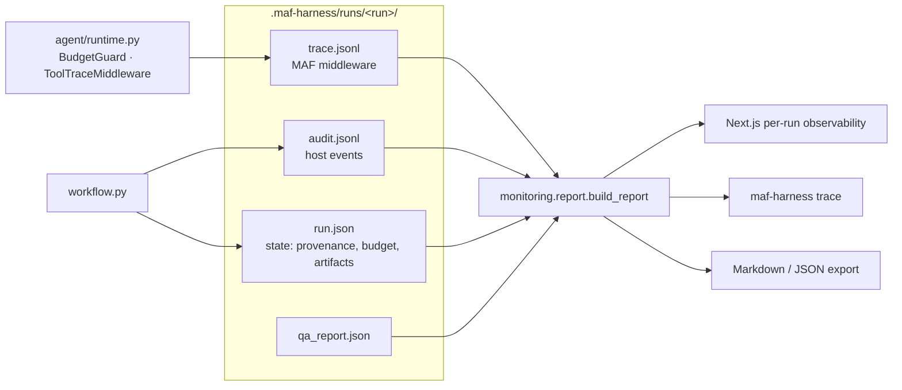

# Observability and traceability

Every run has an **Observability** tab (and a `maf-harness trace` command) that answers, from files on disk and without re-running anything:

* which **skills** were loaded, by which stage, and whether every assigned skill really went through MAF's `load_skill`;
* which **tools** were invoked (skill tools, central harness tools, anything unexpected), with arguments, outcome and duration, and which tools were *never* used;
* what each stage **cost**: provider calls, tokens, model time, repairs, errors;
* how each requirement **traces** to test cases, generated files and results, and which skills produced each link;
* whether the trace is **consistent** with the run's own accounting (integrity checks).

## 1. Design, from the Microsoft Agent Framework guide

The plan follows the "Observability" material in the MAF documentation (`agent-framework.pdf`):

| MAF guidance | What the harness does |
|---|---|
| Agents, chat clients, tools and workflows are instrumented by default and emit spans following the OpenTelemetry **GenAI semantic conventions**; the application owns providers and exporters (`configure_otel_providers()` or the standard `OTEL_*` variables) | `monitoring.telemetry.configure_telemetry()` (`HARNESS_OTEL` = `off` (default), `console` or `otlp`) calls `configure_otel_providers` once per process when asked, and degrades to a recorded reason when the OpenTelemetry SDK is not installed. Nothing else is required for the tab. |
| Telemetry contains **metadata only** by default; capturing prompts, responses and tool arguments (`ENABLE_SENSITIVE_DATA`, `OTEL_INSTRUMENTATION_GENAI_CAPTURE_MESSAGE_CONTENT`) is an explicit opt-in for exporters with an appropriate retention policy | Sensitive-data capture is **always off**. The harness's own trace stores summarised, redacted arguments and hashes; never prompts, model responses or complete generated files. |
| Do not instrument the same client twice (duplicate spans) | The harness adds no second instrumentation layer to the harness agent; its recorder is MAF **middleware** (`ChatMiddleware`, `FunctionMiddleware`) beside the framework's spans. |
| Use middleware for passive tracing, metrics and logs without changing execution | `BudgetGuard` (provider calls) and `ToolTraceMiddleware` (tool calls) emit events; they do not alter results. |
| Workflows emit events for observability | Workflow gates and host actions are already in `audit.jsonl`; the tab merges them into one timeline. |

The harness's own record exists because a UI must be able to open **any past run** with no collector running: MAF spans are exported to whatever backend the operator configures, while `trace.jsonl` sits in the run directory.

## 2. Data model



`trace.jsonl` (append-only, one JSON object per line, `seq` increasing):

| `kind` | Written by | Fields |
|---|---|---|
| `model_run` | `run_stage` / `_prime_skill` | `stage`, `phase` (`prime` loads skills, `structured` returns the artifact), `attempt` / `run_index`, `skills`, `temperature`, `status`, `duration_ms`, `tool_calls`, `prompt_sha256`, `response_sha256` |
| `chat_call` | `BudgetGuard` (every provider request) | `stage`, `phase`, `status` (`ok`/`error`), `duration_ms`, `tokens` (`input`/`output`/`total`), `token_source`, `reserved_tokens`, `error` |
| `tool_call` | `ToolTraceMiddleware` (every MAF tool invocation) | `stage`, `phase`, `name`, `category` (`skill_load`, `skill_resource`, `skill_script`, `harness`, `unexpected`), `arguments` (summarised, redacted), `ok`, `duration_ms`, `result_chars` |

Runs made before this file existed still render: tools come from the recorded model runs (names only) and the tab says so (`trace_level = summary`).

## 3. The Observability tab

| Sub-tab | Shows |
|---|---|
| **Overview** | Stage table (actor, assigned vs verified-loaded skills, model runs, tool calls, tokens, repairs, errors, approval), tokens-by-stage chart, every model run; the *Prompt cache* table (provider-reported hit and repeated-prefix share per stage; also in the exports as `cache`), see [CACHING.md](CACHING.md) |
| **Skills** | Each skill (origin: upstream/local, role, stages, loads, scripts run, package hash) and every skill-tool call |
| **Tools** | Usage by tool name including harness tools with **0 calls**, plus a filterable call log (stage, category, failures only) |
| **Automation** | What acted on its own: hook decisions (enforced denies, would-block in evaluate-only mode, hook errors, whether hooks were disabled), typed-tool calls, automatic recoveries (applied, and those left to a human as `needs_approval`/`manual`) and diagnosis-agent notes. Rebuilt from `audit.jsonl` and the `environment/`/`executions/` reports; see [HOOKS.md](HOOKS.md) and [AUTOMATION.md](AUTOMATION.md) |
| **Timeline** | Human gates, host actions, model runs, skill and tool calls in time order, on lanes, with a scatter view |
| **Traceability** | requirement → case → generated file → result, filterable by requirement state, with the skills that produced each link; warns about requirements without cases and cases without requirements |
| **Integrity checks** | Every assigned skill loaded via MAF · no unexpected tools · tool and provider calls succeeded · reviewed-script policy · trace tokens equal the ledger-accounted tokens · OpenTelemetry mode |
| **Export** | Markdown and JSON download of the same report |

Command line: `maf-harness trace .maf-harness/runs/<run> [--format md|json] [--out FILE]` (exit code 1 when an integrity check fails, 2 for a missing run).

## 4. Interpreting it

* **Skills loaded ≠ skills obeyed.** The check proves the framework executed `load_skill` for every assigned skill; it cannot prove the model followed the skill text.
* **Unused harness tools are a finding about the model, not a defect.** In the measured run the agents called none of the eleven central tools; the host applies the same checks itself.
* **A partial trace fails the token check on purpose.** If a run was resumed across the introduction of tracing, trace tokens will not equal the ledger's; the check names both numbers.
* **The token check compares provider-reported usage** (`reported_tokens`); calls without provider usage are marked `token_source = unreported`.

## 5. Optional OpenTelemetry export

```bash
pip install opentelemetry-sdk opentelemetry-exporter-otlp   # not a hard dependency
export HARNESS_OTEL=console          # or: otlp, with OTEL_EXPORTER_OTLP_ENDPOINT=http://localhost:4317
```

The mode and outcome are stored in `state.telemetry` and shown under *Integrity checks*. Prompts, responses and tool arguments are never exported by the harness.

## 6. Verification

* `tests/test_observability.py` – real MAF harness agent with a scripted transport: the recorder sees the prime run, the structured run, every provider call and both tool calls (one skill, one harness), and the report built from that run passes its checks; redaction; torn-line tolerance; older runs; failing/unexpected tools; traceability (before and after execution); CLI; telemetry.
* `tests/test_execution_stage.py` – a complete scripted workflow yields the full traceability chain.
* `tests/targets/test_harness_browser.py` – the tab in a real browser (metrics, tabs, filters, exports).
* Real data: the tab and CLI were run on the stored `final5-reverse` run (44 provider calls, 1,154,828 tokens, 25 passed / 9 failed, all reproduced).
