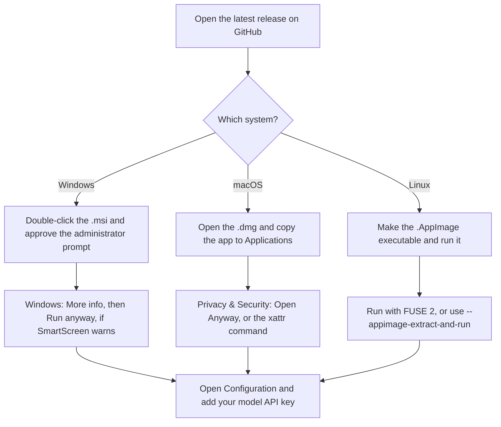

# Agentic QE Platform: user guide

This guide is for people who want to install the desktop app and use it. It does not cover code changes. For that, see the [README](../README.md) and the [developer guide](DEVELOPER_GUIDE.md).

## What it does

Agentic QE Platform helps you test software. You give it a GitHub repository, or specs from documents or Jira Cloud. It reads the code, plans the tests, writes unit and integration tests, and runs them after you approve each step. At the end you get a QA report and a ZIP file with the tests and the evidence.

The app asks you before it does anything with side effects. It clones the repository, installs dependencies and runs tests only after you approve each of those steps.

## System requirements

| System | Requirement |
|---|---|
| Windows | Windows 10 or 11, 64-bit (x64) |
| macOS | macOS with Apple silicon (arm64) or Intel (x64) |
| Linux | 64-bit (x64) desktop. The AppImage needs FUSE 2, or see the first-launch steps. |
| All | Git installed. Internet access to GitHub and to your model gateway. |
| All | A model API key from your OpenAI-compatible gateway. |

Repositories you test may need their own tools, such as a JDK with Maven or Gradle for Java, or the .NET SDK. See [ENVIRONMENTS.md](ENVIRONMENTS.md).

## Install the desktop app

Download the installer for your system from the [latest release](https://github.com/sarveshtalele/maf-harness-testing/releases/latest). Each version has its own page under [Releases](https://github.com/sarveshtalele/maf-harness-testing/releases).

| Your system | File to download |
|---|---|
| Windows | `Agentic-QE-<version>-win-x64.msi` |
| macOS, Apple silicon (M1 or later) | `Agentic-QE-<version>-mac-arm64.dmg` |
| macOS, Intel | `Agentic-QE-<version>-mac-x64.dmg` |
| Linux | `Agentic-QE-<version>-linux-x86_64.AppImage` |

The installers are **unsigned**. Your operating system will warn you the first time you open the app. This is expected. Use the steps for your system below.



### First launch on Windows

1. Double-click the `.msi` file.
2. Windows asks for administrator approval (User Account Control). The app installs for all users into `C:\Program Files\Agentic QE`, where standard users cannot modify it. UAC may show **Unknown publisher**, because the build is unsigned.
3. SmartScreen may still show "Windows protected your PC", because the build is unsigned. Choose **More info**, then **Run anyway**. The MSI installs the app in Program Files, where standard users cannot modify it, and supports managed deployment. Code signing is still what proves who published the app, and these builds are not signed yet.
4. If you installed the older per-user `.exe` build, uninstall it first: **Settings**, **Apps**, then **Agentic QE**, then **Uninstall**. The two builds install to different locations, so keeping both gives you two copies of the app. Your runs, settings and API key are kept, because they live in your user profile, not in the install folder.

**For IT:** deploy silently from an administrator prompt with `msiexec /i Agentic-QE-<version>-win-x64.msi /qn`. Each new version upgrades the installed one in place, because the MSI keeps a fixed upgrade code.

### First launch on macOS

The app is not signed with an Apple Developer ID, so macOS shows **"Agentic QE" Not Opened — Apple could not verify "Agentic QE" is free of malware**. The app is not damaged. Click **Done** (not *Move to Bin*), then use one of these:

**Option A — System Settings (no Terminal)**

1. Open the `.dmg` and drag **Agentic QE** to **Applications**. Do not run it from the `.dmg` window.
2. Open the app once from Applications. When the warning appears, click **Done**.
3. Open **System Settings → Privacy & Security**, scroll to **Security**, and click **Open Anyway** next to *"Agentic QE" was blocked*.
4. Confirm with **Open Anyway** and your password or Touch ID.

**Option B — Terminal**

1. Drag **Agentic QE** to **Applications**.
2. Run:

   ```bash
   xattr -dr com.apple.quarantine "/Applications/Agentic QE.app"
   ```

3. Open the app normally.

On macOS 15 (Sequoia) and later, right-click → **Open** no longer bypasses this check; use Option A or B. You need to do this once per installed version. Only do it for installers from the team's GitHub Releases page.

### First launch on Linux

1. Make the file executable:

   ```bash
   chmod +x ./Agentic-QE-*-linux-x86_64.AppImage
   ```

2. Run it. If it fails because FUSE 2 is missing, run it with:

   ```bash
   ./Agentic-QE-*-linux-x86_64.AppImage --appimage-extract-and-run
   ```

3. On Ubuntu 23.10 and later, AppArmor can block the user namespaces that the app's sandbox needs. The app then exits with a `chrome-sandbox` error. Either ask an administrator to allow the sandbox for the app through an AppArmor profile, or start the app with `--no-sandbox`:

   ```bash
   ./Agentic-QE-*-linux-x86_64.AppImage --no-sandbox
   ```

   `--no-sandbox` removes one isolation layer of the app's window. Use it only on a machine you trust.

## Set your model API key

1. Open the app and go to **Configuration**.
2. In **Model & API key**, enter your API key, your gateway URL and the model name. The model must support tool calling.
3. Save.

Where the operating system can encrypt it, the key is stored encrypted. Otherwise it stays in memory until you close the app. The app shows only the last 4 characters of the key. Keep the key private. Do not paste it into a run or into a document.

The **Daily usage** panel on the same page shows token use. A daily cap applies across all runs on this computer.

## Start a run

1. Go to **New run**.
2. Choose a **mode**:
   - **Brownfield repository**: an existing project. Enter its GitHub URL. A public repository needs no login. For a private repository, see [Private repositories](#private-repositories).
   - **Greenfield specs**: new work. Upload documents (`.md`, `.txt`, or `.docx`; PDF is not supported yet), or connect a Jira Cloud project with a site URL, a JQL query or issue keys, your email and an API token. The Jira token is used once to fetch stories and is not saved with the run.
3. Choose the **test types**: **Unit**, **Integration**, or both. You need at least one.
4. Optionally give the run a name. Set **Test cases per requirement**. Fewer cases make the run faster. You can change this until test design is approved.
5. Select **Start repository review**.

## The nine approval gates

The run pauses at each gate. For review gates you can **approve**, **revise**, **skip** or **stop**. For machine actions you can approve or deny.

```mermaid
flowchart LR
  G1["1. Approve clone"] --> G2["2. Review repository analysis"]
  G2 --> G3["3. Review requirements"]
  G3 --> G4["4. Review test plan"]
  G4 --> G5["5. Review test design, by component"]
  G5 --> G6["6. Review generated test code"]
  G6 --> G7["7. Approve installing the test environment"]
  G7 --> G8["8. Approve running the tests"]
  G8 --> G9["9. Review the QA report, then the ZIP is built"]
```



Nothing is installed and no test runs before gates 7 and 8.

## Read the results

After the run, use the tabs at the top of the run page:

- **Review**: the gate you are on. Approve, revise, skip or stop here.
- **Errors**: every error in the run, grouped. Each error has a code and a suggested fix. The meanings are in the [error playbook](ERROR_PLAYBOOK.md).
- **Generated tests**: the test files the run produced.
- **QA report**: results per case. Each requirement is shown as a new case, an existing test that already covers it, excluded, or an unexplained gap.
- **Test reports** and **Logs**: the raw output from the test runs and the workflow.
- **Observability** and **Audit**: the evidence trail, including every approval you gave.
- **Prompts**: the exact prompts sent to the model.

The deliverable ZIP is built after gate 9. It is in the `deliverables` folder of the run. Runs are stored under `runs/` in the data folder (see [Uninstall the app](#uninstall-the-app)).

**Important.** A green result is not complete coverage. Read the QA report and its warnings before you treat a run as finished.

### Stop a run

Select **Stop** and confirm. The run stops after the current step ends, which takes up to about 30 seconds. To continue later, run it again. It starts again from the step where it stopped. Earlier evidence is kept.

## Private repositories

The app clones with the Git on your computer, using your own Git credentials. It never asks for a password inside the app. If a clone needs a login and none is set up, the clone fails with a message instead of a prompt.

To set up access once, use one of these:

- GitHub CLI: run `gh auth login`, then `gh auth setup-git`.
- Git Credential Manager, which ships with Git for Windows.

Test that a clone works from a terminal before you start a run.

## Update the app

1. Close the app.
2. Open the [latest release](https://github.com/sarveshtalele/maf-harness-testing/releases/latest) and download the installer for your system.
3. Install it over the old version. Your runs and settings stay in the data folder (see below).

Help, then **Check for updates** opens the Releases page. The app does not update itself.

### Roll back to an older version

- **Windows:** the installer refuses to install an older version over a newer one. Uninstall the current version first (**Settings**, **Apps**, **Agentic QE**, **Uninstall**), then run the older installer. Your runs, settings and API key are kept.
- **macOS:** move the current `Agentic QE.app` out of Applications, then copy the older app in.
- **Linux:** delete the current `.AppImage` and keep the older one.

Runs created by a newer version are not guaranteed to open in an older one. Keep the newer installer until you have checked the older version.

## Uninstall the app

1. Remove the app the normal way for your system:
   - Windows: **Settings**, **Apps**, then **Agentic QE**, then **Uninstall** (or `msiexec /x Agentic-QE-<version>-win-x64.msi` as an administrator).
   - macOS: drag **Agentic QE** from **Applications** to the Trash.
   - Linux: delete the `.AppImage` file.
2. To remove your runs, settings and logs, also delete the data folder. Deleting it removes saved runs and the encrypted key file.

| System | Data folder |
|---|---|
| Windows | `%APPDATA%\Agentic QE` |
| macOS | `~/Library/Application Support/Agentic QE` |
| Linux | `~/.config/Agentic QE` |

Inside it, `runs/` holds run folders, `logs/` holds the app logs and `secrets.bin` holds the encrypted key.

## Troubleshooting

- The app does not start: open the desktop log in the data folder's `logs/` folder. The file name starts with `desktop-`. Share the log with the maintainer, but first check that it does not contain your key.
- A run stops with an error: open the **Errors** tab. Look up the code in the [error playbook](ERROR_PLAYBOOK.md).
- Windows problems, such as antivirus locks, long paths or log locations: [WINDOWS_SETUP_AND_DEBUGGING.md](WINDOWS_SETUP_AND_DEBUGGING.md).
- A repository fails to clone: [CLONE_AND_PLATFORM_DIAGNOSTICS.md](CLONE_AND_PLATFORM_DIAGNOSTICS.md).
- Authentication errors from the model: check the key, the gateway URL and the model name in **Configuration**. Some gateways need a `/v1` suffix on the URL.

## Security notes

- **The app runs commands on your computer.** Generated tests, and the commands of the repositories you test, run as your user. This is not a sandbox. Use a separate computer or account for repositories you do not trust.
- The app stores your key encrypted where your system supports it. Never share your data folder.
- Run evidence can contain repository code and logs. Do not commit it.
- To report a security problem, contact the maintainer privately. Do not open a public issue.
