# Workflow and service migration proposal

> Historical plan/evidence. Counts and earlier UI/setup descriptions are preserved as observations from that date. See [current branch behavior](PETSTORE_STRICT_TEST_GENERATION.md); current UI is Next.js and setup/runtime checks occur at Test execution.

Status (checked against code 2026-10-11): implemented as the modular workflow with deferred Test execution setup. See [MODULAR_WORKFLOW_IMPLEMENTATION.md](MODULAR_WORKFLOW_IMPLEMENTATION.md) for what shipped. The proposal below records the approved scope. Existing source files will not be deleted without explicit approval.

## Reviewed implementation

The application currently has a Next.js UI (`frontend/`) and one Python backend package (`src/maf_test_harness/`). The UI proxies requests to the loopback Python HTTP adapter. `workflow.py` owns approvals, checkpoints, generation and execution; `ui/api.py` directly creates a Harness/runtime instance.

Current stages: repository analysis → requirements → environment setup → test planning → test design → test generation → test execution. `plan_environment()` creates the workspace and requests approval to install dependencies. `_build_gate()` compiles/collects generated candidates using that prepared environment. `plan_execution()` writes generated tests and prepares execution against the environment installed earlier.

Python dependencies are isolated in `workspace/.harness-venv`; Node dependencies live in the applicable component's `node_modules`; build/toolchain caches are separate. These paths isolate dependencies, not operating-system permissions. Source copy, package installation, compilation, test collection and application startup are distinct operations; several can execute repository code.

## Proposed complete workflow

1. **Clone approval:** validate the public GitHub URL; show clone action and destination. Clone into the run's `repo/`, record the exact commit, and inspect source/manifests without running repository code.
2. **Repository setup plan:** inventory components, frameworks, routes, manifests, lockfiles, language constraints and entrypoints. Produce a reviewable plan with component directories, dependency commands, toolchains, isolation paths, services, readiness probes, disposable fixture strategy and browser requirements. Detect missing information explicitly; unsupported components stay visible.
3. **Requirements:** derive requirements from the actual source. Include the repository setup plan as a versioned artifact. The plan is informational here: no dependency installation, toolchain download, target application startup or test collection.
4. **Test planning and design:** preserve existing review gates and case traceability. Use statically detected capabilities, labeled as planned/unverified, rather than claiming an installed environment exists.
5. **Test generation:** preserve persona prompts, batching, schema checks, source ownership checks, traceability and repair limits. Generate test artifacts without creating the target runtime environment. Syntax checks must not import or execute target modules. Compilation, dependency-based validation and collection are explicitly pending.
6. **Test execution — setup-plan review:** materialize the isolated execution workspace, stage approved generated artifacts, revalidate the pinned source/manifests and finalize the setup plan against generated frameworks. Show exact commands, paths, network/install effects, application services and fixture requirements. Any plan changes invalidate the prior plan approval.
7. **Test execution — installation approval:** after approval only, provision existing supported toolchains and component dependencies into the isolated paths. Preserve current credential filtering, prerequisite guards, timeout rules, install reports and recovery decisions. No global package installation.
8. **Test execution — validation:** perform existing compile/collection/build gates in the prepared environment. Preserve bounded repair behavior and publish failures/changes for review; revised generated artifacts require approval before execution. Installation or collection failure blocks execution rather than being reported as an application test failure.
9. **Test execution — run approval:** approve final test commands and application startup/fixture effects. Start required component services, check readiness, run native suites, and record raw exit codes, JUnit, Playwright HTML/assets/screenshots/traces and logs. Preserve failure classifications and truthful case mapping.
10. **Results and delivery:** preserve QA, recommendations, audit, observability, prompt snapshots and portable exports. Stop all child services on completion/failure/cancellation. Retain run evidence and the environment for approved retry; do not automatically delete source or evidence. Reruns use the recorded plan and expose any drift.

“Environment setup” becomes a subsection of Test execution, rather than an early install stage. Earlier stages can show the proposed setup plan. No created environment is reported as ready until verification succeeds.

## Modular harness structure — clarified scope

The user clarified that the goal is modular harness code rather than monolithic files, within the current repository. Keep the existing Next.js and Python server arrangement, local storage and launcher. Do not introduce new repositories, network worker services, queues or distributed deployment.

Keep `workflow.py` as the public compatibility facade and orchestration owner; extract its large responsibilities into focused internal modules using existing state/runtime helpers. Suggested package `workflow_steps/`:

| Module | Responsibility |
| --- | --- |
| `repository.py` | Clone approval and static source inspection |
| `planning.py` | Requirements, setup-plan preview, planning/design artifact validation |
| `generation.py` | Batching, static checks, generation repair and traceability |
| `execution.py` | Execution setup approval, existing environment installation, deferred build/collection, run approval and test invocation |
| `results.py` | Execution artifact assembly, QA and evidence handoff |

Keep checkpoint persistence, approval dispatch and stage transitions centrally owned. Reuse `envs/` for platform-specific installation/execution, `agent/` for runtime/personas, `qa/` for reporting and `monitoring/` for audit/observability. Do not split every helper into a file or introduce a framework. Use ordinary functions and explicit context inputs; maintain the public Harness interface and CLI/API imports.

Split `ui/api.py` only where distinct route responsibilities justify it: run lifecycle, prompt/settings, evidence/export. Shared authentication, origin validation and filesystem containment remain centralized. Review `envs/runners.py` for ecosystem-specific extraction using the existing `envs/spec.py` detection and `python_env.py` before creating alternatives. Determine final extraction boundaries from dependency/caller review, not file size alone.

```mermaid
flowchart LR
  U[Next.js UI] --> A[Existing Python API]
  A --> H[Harness orchestration and checkpoints]
  H --> R[Repository analysis module]
  R --> P[Requirements, setup plan and design module]
  P --> G[Static generation module]
  G --> E[Test execution module]
  E --> I[Approved environment provisioning]
  I --> V[Deferred compile and collection checks]
  V --> T[Approved test execution]
  T --> Q[QA, evidence and export modules]
  Q --> A
```

This gives independently maintainable code responsibilities without adding network contracts or changing the existing deployment topology.

## Files affected after approval

| Files / area | Proposed change |
| --- | --- |
| `workflow.py` | Move environment setup and dependency-backed generation gates into execution substates; retain approval/hash/checkpoint semantics; delegate to focused internal execution functions |
| `models.py`, workflow schemas | Version execution setup/validation/job state and compatibility handling |
| `envs/environment.py`, `envs/runners.py`, `envs/execution.py`, `envs/app_launcher.py`, `envs/recovery.py` | Reuse existing commands, isolation, recovery and subprocess behavior from the execution module |
| `tools/build_gate.py`, `tools/env_tools.py`, `tools/agent_tools.py` | Route side effects through the approved execution phase; prevent early environment creation |
| `agent/personas.py`, `prompts/personas.json`, `prompts/repository-review.md` | Explain planned capabilities and deferred runtime validation accurately |
| `ui/api.py`, `frontend/lib/harness.ts`, UI stage/review/artifact components | Expose setup plan and execution substates; preserve approval, retry, stop and report views |
| `qa/report.py`, `qa/packaging.py`, monitoring | Record setup/collection/test outcomes separately and retain native evidence and portable reruns |
| `scripts/start_ui.py`, `start-macos.command`, `start-windows.cmd` | Keep starting and stopping the existing two servers; propagate private tokens/ports/storage roots; real startup checks |
| `pyproject.toml`, lockfiles, frontend package metadata | Preserve package entrypoints; adjust package discovery only if required by extracted modules |
| `.github/workflows/`, `tests/`, frontend tests | Windows/macOS contracts, startup, cancellation, failure, old-run compatibility and real report verification |
| `README.md`, relevant `docs/` | Complete clone/setup/run guide and service ownership; update only affected documentation |

Final extracted module paths will be recorded after caller/dependency review, before implementation. Preserve the supplied PDF and historical design files.

## Implementation sequence and approval gates

1. Record current regression results and characterize existing workflow approvals, generated artifacts, statuses and exports. Deferred validation is confirmed; modular refactoring stays in this repository.
2. Introduce execution setup/validation substates and an explicit setup-plan artifact. Move side effects later while reusing existing implementation functions. Verify old runs load; do not silently reinterpret previously approved pending actions.
3. Extract focused internal workflow modules while retaining Harness as the single decision/checkpoint owner. Verify imports, approval dispatch, cancellation and interrupted-run handling.
4. Extract API route groups and ecosystem helpers only where reuse and caller review justify it. Preserve public entrypoints and avoid circular imports. No new repositories or service processes.
5. Update UI and Windows/macOS scripts together. Publish a guide that begins with clone, prerequisites and `.env`, then installation, service startup, approvals, execution, reports, shutdown and retry.
6. Run regression and real target acceptance checks; compare decisions, test commands, case mapping and exported evidence. Publish only after verification, with any remaining limitations stated.

Changing installation timing necessarily changes when failures are discovered. “Preserve logic” means retaining validation rules, commands, approval controls and outcome interpretation; it cannot mean identical stage timing while also moving environment creation later.

## Acceptance criteria

- Before execution approval: no target virtual environment, dependency install, toolchain download, target app startup or dependency-backed collection. Repository clone and static artifacts remain available.
- Complete source-derived setup plan visible before installation; amended plan requires fresh approval.
- Execution creates environments only at the displayed per-user/run/component locations; target processes receive no model secrets.
- Unsupported toolchains/setup/collection failures remain explicit; no false PASS or invented screenshot evidence.
- Compile/collection safeguards and bounded repair are preserved at the new execution point.
- Existing run history, approvals, prompts, native evidence, retry/cancel and portable export remain compatible or receive an explicit safe resume path.
- macOS and Windows launch actual services, validate the homepage and authenticated connection, and stop the entire process tree. Paths, executables and reruns work on both systems.
- Module boundary regression tests and real end-to-end tests pass; modular extraction is not presented as distributed microservices.

## Approval requested

Confirmed: modular code in this repository, with all installation and runtime checks deferred to Test execution. Implementation was approved, including setup guidance using pasted repository knowledge. The deployment remains two local servers. New runs retain `environment_setup` as a compatibility stage ID but display it as Test execution · Setup after generation. Saved runs retain their original stage order.
