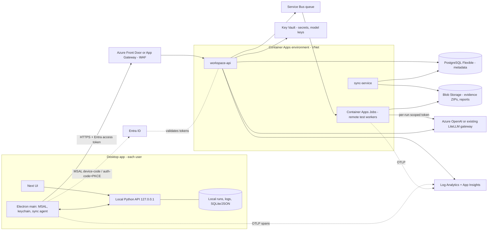

# Azure workspace for the desktop app (hybrid plan)

> Note: the `azure-plan/` folder this plan refers to was removed 2026-10-11 (see git history). File paths below name the removed evidence.

Status: **proposal, nothing built or deployed** (checked against code 2026-10-11: the Electron shell, keychain storage and skill approvals it builds on exist; the Azure workspace is not implemented). Supersedes the web-hosting direction of
[AZURE_DEPLOYMENT_PROPOSAL.md](AZURE_DEPLOYMENT_PROPOSAL.md) (which hosts the whole UI in App Service and needs per-user
isolation added to the backend). Here the desktop app stays the product; Azure is an optional, shared **workspace** it can connect to.
Pricing figures are estimates (section 8).

What exists today (facts this plan builds on):

- Electron shell (`desktop/src/main.ts`, `process-manager.ts`, `keystore.ts`) starts the Python API on `127.0.0.1` with a per-launch
  `HARNESS_API_TOKEN` and a Next standalone UI. Data lives in `HARNESS_DATA_DIR` (`src/maf_test_harness/paths.py`).
  See [DESKTOP.md](DESKTOP.md).
- Model key/base URL/model are stored with Electron `safeStorage` in `<userData>/secrets.bin` and passed to the backend as `OPENAI_*`.
- Skill plugins: `plugin.yaml` + `SKILL.md`, hash-based approvals in `HARNESS_PLUGIN_APPROVALS`, zip import with limits
  ([SKILL_PLUGINS.md](SKILL_PLUGINS.md)).
- Optional OpenTelemetry export (`HARNESS_OTEL=off|console|otlp`, `monitoring/telemetry.py`, [OBSERVABILITY.md](OBSERVABILITY.md)).
- `azure-plan/` holds a single-resource-group Terraform for an App Service pilot (resource group, Linux plan, web app), Mermaid, and dated
  Retail Prices evidence. GitHub Actions already use `dev` / `prod` environments (`nightly.yml`, `desktop-prerelease.yml`, `desktop-release.yml`).

Everything else below is proposed.

## 1. Goals and non-goals

Goals
- Local-first remains the default. A fresh install never contacts Azure; every feature works offline, as today.
- Optional "workspace" adds: shared run history, a team dashboard, central skills/plugins with approvals, a central model gateway and keys,
  and remote isolated test workers.
- Offline use is never blocked: cloud features degrade to a queue and a "not synced" badge.
- Small internal team (3-4 people, one private GitHub repo): cheapest design that is still secure and reproducible.

Non-goals
- No hosted web UI for browsers (that is the older App Service proposal).
- No multi-tenant SaaS, no external customers, no cross-organisation sharing.
- No automatic upload of repository source or prompts. Remote execution is an explicit per-run choice.
- No HA / multi-region in v1.
- No replacement of the local API token model: the local API stays loopback-only.

## 2. Architecture



Components
- **Desktop sync agent** (new, in Electron main): acquires tokens (MSAL Node; interactive auth-code + PKCE with loopback redirect, device-code as
  fallback on headless/Linux), talks to the workspace, and reads/writes through the existing local API. It is the only component that holds
  the Azure token; the renderer and local API never see it.
- **workspace-api** (Container App, Python/FastAPI, stateless): validates Entra JWTs (issuer, audience, tenant, `roles`/group claim), RBAC,
  CRUD for runs/skills/approvals, issues short-lived Blob SAS (user delegation) URLs so large evidence ZIPs bypass the API, enqueues remote runs.
- **sync-service**: may be the same container as workspace-api in v1 (one app, two routers). Split only if load requires it.
- **PostgreSQL Flexible Server** (Burstable B1ms): metadata only (run rows, step/QA report JSON, skill manifests, approvals, audit).
- **Blob Storage**: `evidence/`, `reports/`, `skills/` containers; lifecycle rules for retention.
- **Key Vault**: workspace secrets and the model key for the gateway. Container Apps read it via managed identity references.
- **Model gateway**: the workspace-api (or a sidecar) forwards model calls to Azure OpenAI or the existing LiteLLM endpoint; desktops get a
  workspace-issued, per-user, rate-limited gateway token instead of a raw provider key.
- **Remote workers**: Container Apps Jobs triggered by queue depth (KEDA Service Bus scaler); one execution per run. Ephemeral VMs are the fallback if
  a repo needs Docker-in-Docker or a Windows toolchain (not supported by Jobs).
- **Telemetry**: desktop sets `HARNESS_OTEL=otlp` to an OTLP-to-App-Insights path only when connected and the user opted in; the existing
  "metadata only, no prompts" rule applies unchanged.

## 3. Sync protocol

Principles: the local store is the source of truth for the user's own runs; the workspace is a replica plus shared catalogue. Sync is
pull/push over HTTPS, idempotent, resumable, and never required.

What syncs (all opt-in, "Share" is per run, default **off**)
| Object | Direction | Content | Notes |
|---|---|---|---|
| Run metadata | up | run id, repo name/URL, commit, mode, test types, status, counts, durations, owner, timestamps | no source code |
| QA / step reports | up | report JSON (already redacted), error summaries | redaction applied before upload (reuse the existing redaction used for downloadable logs) |
| Evidence ZIP | up | the evidence bundle the app already produces | uploaded direct to Blob via SAS, SHA-256 recorded |
| Skill packages | down (and up by maintainers) | zipped skill folder + manifest hash | same validation as `POST /skills/import` (20 MB / 500 files / no symlinks) |
| Approvals | down | `{name, sha256, approved_by, approved_at}` | see below |
| Team dashboard | down | aggregates (pass rate trend, flaky cases, cost) | read-only |

Identifiers and conflicts
- Run ids are generated locally (existing 12-hex ids) and namespaced by `(workspace, owner_oid, run_id)`; collisions are not possible across users.
- Runs are append-mostly. Server accepts `PUT /runs/{id}` with a monotonically increasing `rev`; an older `rev` is rejected (409) and the client
  re-reads. For a single owner this is last-writer-wins by `rev`; other users have read-only access, so there are no multi-writer merges.
- Skills/approvals are content-addressed by sha256. A name with two different hashes is shown as two versions; the **maintainer-approved hash
  wins** for "workspace-approved" status, a local approval is unaffected. A workspace approval is advisory: the desktop still applies its own
  hash check, and an approval only enables a skill whose files match the hash exactly (same rule as the local approvals file).
- Deletes are tombstones for 30 days, then purged.

Offline queue
- Outbox table in the local data dir (`sync_outbox`: object type, id, rev, payload pointer, attempts, next_try). Drained by the sync agent with
  exponential backoff; survives restart. Evidence uploads are resumable (block blobs, per-block commit).
- UI shows state per run: local only / queued / synced / failed (with reason).

Consent and data minimisation
- First connect shows exactly what is uploaded. Per-run "Share to workspace" toggle plus a workspace-level default that an owner may set to
  "ask" (never "always" in v1).
- Never uploaded unless remote execution is chosen: repository source, generated test source beyond what is inside the evidence bundle the user
  shares, `.env`, tokens, absolute local paths (path scrubbing before upload), model prompts/responses.
- A "Share" can be revoked: the server deletes the run's blobs and rows (hard delete honoured within 24 h; backups follow retention).

Retention (defaults, configurable by owner)
- Metadata and reports: 12 months. Evidence ZIPs: 90 days, then Blob lifecycle moves to Cool and deletes. Audit log: 12 months. Remote worker
  workspaces: deleted at job end.

## 4. Remote execution

When to use
- The repository is untrusted or heavy (arbitrary install scripts, large builds), the user's machine lacks the toolchain, or CI-like
  reproducibility is wanted. Local execution remains the default for trusted repos; the UI asks per run.

Flow
1. Desktop requests `POST /runs/remote` with repo URL + commit + options. The workspace never receives source from the desktop; the worker clones
   it (private GitHub repo: a GitHub App installation token minted by the workspace, read-only, scoped to the repo, TTL 10 min).
2. Message goes to the queue; a Container Apps Job execution starts; the worker runs the same backend entrypoint in headless mode.
3. Results (reports, JUnit, screenshots, traces) go to Blob; the desktop pulls them into the local run store when online.

Isolation (required, none of it exists today; the current runner only does argv-only, temp-dir, timeout)
- One ephemeral container per run, no reuse; non-root, read-only root filesystem except a tmpfs workspace, no privileged mode, seccomp default.
- CPU/memory/time limits per execution (e.g. 2 vCPU, 4 GiB, 30 min hard timeout); disk quota on the scratch volume; output size cap.
- Network: workers sit in a dedicated subnet with an egress firewall (Azure Firewall or NAT + NSG with FQDN allow-list): package mirrors/registries
  (PyPI, npm, Maven Central, NuGet), GitHub for clone, and the model gateway endpoint only. No access to Key Vault, PostgreSQL, or the workspace
  admin plane; storage access only via a per-run SAS limited to that run's prefix.
- Worker identity: a user-assigned managed identity with only "write to blob prefix" via SAS issued per run; no Key Vault access. The model call
  uses a per-run gateway token with a token budget.
- Plugin/skill scripts run in the worker only if the skill hash is workspace-approved.

Cost controls
- Per-user and per-workspace monthly caps (runs, vCPU-seconds, model tokens), enforced at enqueue; max concurrent runs (default 2).
- Scale-to-zero (Jobs cost nothing idle); Budget alerts in Azure Cost Management at 50/80/100%; workspace-api refuses new remote runs at the cap.

## 5. Security and compliance

Identity
- Entra ID, single tenant, workforce accounts. App registrations: `agentic-qe-desktop` (public client, PKCE, no secret) and `agentic-qe-workspace-api`
  (exposes scope `workspace.access`, app roles `Owner`, `Maintainer`, `Viewer`). Assign roles to an Entra group; the API reads the `roles` claim.
- Workspace API validates signature (JWKS), `iss`, `aud`, `tid`, `exp`; rejects tokens without an assigned role. Conditional Access / MFA is
  inherited from the tenant.

RBAC
| Capability | Viewer | Maintainer | Owner |
|---|---|---|---|
| View shared runs, dashboard | yes | yes | yes |
| Share own runs | yes (own) | yes | yes |
| Publish skills, approve hashes | no | yes | yes |
| Start remote runs | no | yes | yes |
| Manage members, caps, retention, model gateway | no | no | yes |

Secrets
- Desktop: Azure tokens (MSAL cache) are encrypted with the same keychain mechanism as `secrets.bin` (`keystore.ts`, Electron `safeStorage`) and
  never written in plaintext; if OS encryption is unavailable, keep in memory only (same fallback as the model key today). Refresh token
  revoked on "Disconnect".
- Cloud: all secrets in Key Vault (RBAC mode, soft-delete + purge protection), referenced by Container Apps through managed identity. No
  secrets in Terraform state beyond what the provider returns (use variables from OIDC / Key Vault references). Central model key replaces
  distributing provider keys to desktops.

Network
- Private endpoints for PostgreSQL, Blob and Key Vault; public network access disabled on those. Container Apps environment is VNet-integrated
  (internal), exposed only through Front Door / App Gateway with WAF. Front Door Premium is needed for Private Link to an internal Container Apps
  environment; to save cost the dev environment may use public ingress with Entra-only access and IP allow-list (decision in section 10).

Threat model (summary)
| Threat | Mitigation |
|---|---|
| Untrusted repository test/install code escapes or exfiltrates | ephemeral containers, egress allow-list, no creds in the worker, resource limits, no shared state; local runs unchanged (user accepts risk) |
| Stolen desktop token | encrypted cache, short access-token TTL, role-limited API, revoke in Entra, server-side audit |
| Malicious skill/plugin | hash approvals by Maintainer, same package validation as local import, plugins stay companions only, scripts run with the hash-checking runner; workers run only workspace-approved hashes |
| Compromised sync payload (zip bombs, path traversal) | server-side size/file limits, extraction in the worker only, treat evidence as opaque blobs, content-type download headers + `Content-Disposition: attachment` |
| Cross-user data access | owner check on every object, RBAC claims, tests with two identities |
| Prompt/secret leakage in telemetry or reports | redaction before upload, metadata-only OTel, no `ENABLE_SENSITIVE_DATA` |
| Cost abuse via the model gateway | per-user gateway tokens, quotas, budget alerts |

Supply chain
- Workspace images built in GitHub Actions, pinned by digest, scanned (Defender for Cloud / Trivy), SBOM published; base images pinned.
  Skill packages are signed by hash (sha256 recorded in the approval row); optional later: Sigstore signing by Maintainers.
- Dependency updates via the existing CI; lockfiles required for worker toolchain images.

Compliance notes: internal tooling; data stays in one Azure region; document the data categories (run metadata, reports, evidence) for the
organisation's own review. No claim of any certification is made by this plan.

## 6. Desktop changes required

| Area | Change | Existing module(s) |
|---|---|---|
| Settings | New "Workspace" page: Connect / Disconnect, tenant, workspace URL, status, sharing default, remote-run option | `frontend/components/model-settings.tsx` (pattern), `frontend/components/workspace.tsx`, `src/maf_test_harness/ui/settings_api.py` |
| Auth | MSAL Node in Electron main; auth-code + PKCE (loopback), device-code fallback; silent refresh | `desktop/src/main.ts`, `desktop/src/preload.ts` (narrow IPC: `workspace:connect`, `workspace:status`, `workspace:disconnect`) |
| Token storage | Encrypted MSAL cache via `safeStorage`, separate file from `secrets.bin` | `desktop/src/keystore.ts` |
| Sync agent | Outbox, upload/download, backoff, per-run share state; runs in main (or a utility process), calls local API with the loopback token | new `desktop/src/sync/*`; `desktop/src/process-manager.ts` for lifecycle |
| Local API | Endpoints for sync state (`/sync/outbox`, `/runs/{id}/share`), export of a run bundle, import of workspace skills (reuse import + approval code) | `src/maf_test_harness/ui/api.py`, `ui/evidence_api.py`, `skills/trust.py`, `paths.py` (new data subdir for the outbox) |
| Skills | "Workspace approved" badge, pull central skills, pending-approval request | `frontend/components/skills.tsx`, `skills/registry.py` |
| Model | Option "Use workspace gateway": store the gateway token like the model key; resolution order gains `workspace` below runtime override | `ui/settings_api.py`, `docs/DESKTOP.md` resolution order |
| Dashboard | Team dashboard tab (read-only, shows "offline" when not connected) | `frontend/app`, `frontend/components/reports.tsx` |
| Telemetry | When connected and opted in, set `HARNESS_OTEL=otlp` + endpoint | `monitoring/telemetry.py` (config only) |
| Feature flags | Proposed, not implemented: `HARNESS_WORKSPACE=off` default; build-time `DESKTOP_WORKSPACE_ENABLED`; whole UI hidden when off. Dev/prod channels map to dev/prod workspace URLs | `desktop/package.json`, CI workflows |
| CSP / nav guard | Allow the workspace origin for the main-process HTTP client only; the renderer CSP is not widened | `desktop/src/main.ts`, `util.ts` |

## 7. Infrastructure as code

Extend `azure-plan/` (today: resource group, Linux plan, web app) into modules. Terraform `azurerm ~> 4.0`, remote state in a Storage account
with locking (replaces local state).

```
azure-plan/
  modules/
    network/        vnet, subnets (aca, workers, private endpoints), NSGs, private DNS zones
    observability/  log analytics workspace, application insights
    data/           postgresql flexible server + db, storage account + containers + lifecycle, private endpoints
    secrets/        key vault (RBAC), role assignments
    platform/       container apps environment, workspace-api app, user-assigned identities, ACR or GHCR pull config
    workers/        service bus namespace + queue, container apps job, KEDA scaler, egress firewall / NAT + FQDN rules
    edge/           front door (or app gateway) + WAF policy, custom domain
    identity/       entra app registrations and app roles (azuread provider), group assignment
    budget/         cost management budget + action group
  envs/dev/   main.tf, terraform.tfvars
  envs/prod/  main.tf, terraform.tfvars
```

- Environments `dev` and `prod` match the GitHub environments of the same name; separate resource groups (ideally subscriptions), separate
  Entra app registrations, separate state keys. `dev` uses cheaper SKUs and scales to zero; `prod` enables backups/PITR and purge protection.
- The existing App Service resources stay only if that pilot is still wanted; otherwise they are removed in P1.
- CI/CD (GitHub Actions): `terraform fmt/validate/plan` on PRs (plan posted as a comment, using a read-only federated identity), `apply`
  on merge for `dev` and on approval for `prod` (GitHub environment protection rules). Azure login via **OIDC** (`azure/login` with
  `client-id`, `tenant-id`, `subscription-id` as environment variables, `permissions: id-token: write`); a federated credential per environment
  restricted to repo + environment subject. No client secrets in GitHub. App image build -> scan -> push by digest -> `az containerapp update`.
  Desktop release workflows are unchanged except for embedding the workspace URL per channel.

## 8. Cost estimate (4 users, USD per month, East US 2)

**These are rough estimates, not quotes.** Only the App Service B1 figure ($12.41 at 730 h) comes from `azure-plan/retail-prices.json`
(retrieved 2026-10-02); every other line is an order-of-magnitude assumption from public list pricing and must be re-checked with the
Retail Prices API (`azure-plan/refresh_prices.py`) and the Azure calculator before approval. Taxes and discounts excluded.

Assumptions: 4 users, ~20 shared runs/user/month, evidence ~50 MB per run, 5-20 remote runs/month at ~15 min on 2 vCPU/4 GiB, Container
Apps consumption plan with scale-to-zero for workers and 1 small always-on replica for the API, one region, no HA, Front Door Standard
(low), App Gateway/Front Door Premium with Private Link (high).

| Item | Low | Expected | High | Notes |
|---|---|---|---|---|
| Container Apps (workspace-api, min 1 replica 0.5 vCPU/1 GiB) | 15 | 25 | 45 | idle replica dominates |
| Container Apps Jobs (remote workers) | 0 | 3 | 25 | scales to zero; high = ~100 runs |
| PostgreSQL Flexible Burstable B1ms + 32 GiB | 15 | 25 | 60 | high = zone redundant / larger |
| Blob Storage (hot to cool, ~1-5 GB) | 1 | 2 | 8 | |
| Key Vault | 1 | 1 | 3 | operations only |
| Service Bus (Basic/Standard) | 0 | 1 | 10 | Standard has a base fee |
| Front Door / WAF | 35 | 40 | 330 | Standard vs Premium (private link) |
| Log Analytics + App Insights | 3 | 8 | 30 | depends on OTel volume |
| Private endpoints / egress firewall | 0 | 22 | 450 | low = public + IP allow-list; high = Azure Firewall |
| Azure OpenAI / model gateway usage | 20 | 60 | 300 | pass-through, driven by token use; excluded from infra if gateway exists |
| **Total (rounded)** | **~90** | **~190** | **~1,260** | |

Cheapest viable pilot (dev): public ingress with Entra-only access, skip Front Door and the egress firewall, NAT/NSG FQDN rules only, no
private endpoints: roughly 60-90 per month excluding model usage. The expected column assumes private endpoints on three services and an
egress NAT but not Azure Firewall.

## 9. Phased rollout

| Phase | Scope | Effort (1 dev, ideal days) | Exit criteria |
|---|---|---|---|
| P0 Manual export/import | "Export run bundle" and "Import run bundle" zip in the desktop app (metadata + reports + evidence, redacted); team shares via a storage location of their choice; skill zip export/import already exists | 4-6 | A run exported on macOS imports on Windows with identical counts; redaction test passes; no Azure resources needed |
| P1 Auth + read-only sync | Terraform for dev (network, data, secrets, platform, observability, identity); workspace-api with JWT validation + RBAC; desktop Connect (MSAL, encrypted cache), upload of shared runs (metadata, reports, evidence), read-only history view | 15-20 | Two users see each other's shared runs; Viewer cannot write; revoked user loses access in <= 1 h; dev env created from CI via OIDC; offline start unaffected |
| P2 Full sync + team dashboard | Outbox/resume, skills/approvals sync, central model gateway tokens, dashboard, retention jobs, prod environment, budgets, OTel | 15-20 | Offline for a day then reconnect syncs without loss; maintainer approval of a skill hash reaches all desktops; dashboard matches local data on a sample; cost alerts live; prod deployed via protected environment |
| P3 Remote workers | Service Bus + Jobs, egress-restricted subnet, GitHub App clone, per-run SAS and gateway tokens, quotas, UI "Run remotely" | 20-25 | Malicious-repo test (tries network egress, fork bomb, large output, reading metadata endpoint) is contained and killed at limits; results return identically to a local run on 3 reference repos; cost cap stops new runs |

Total roughly 55-70 ideal days; each phase is releasable on its own and keeps the feature flag off by default.

## 10. Risks and open questions

Risks
- Scope: this is a second product surface (cloud service) for a 3-4 person team; operations (patching, on-call, cost) fall on them.
  Mitigation: P0/P1 first, stop after P1 if value is not proven.
- Isolation depth: Container Apps Jobs give container (not VM) isolation; kernel escapes are a residual risk for hostile code.
  Mitigation: ephemeral VMs or Container Apps dynamic sessions (Hyper-V isolated) for P3 if the repo set includes untrusted code.
- Windows/.NET-specific toolchains do not run on Linux Jobs.
- Private-networking cost (Front Door Premium / Firewall) can dominate the bill.
- Token and refresh handling on Linux AppImage without a keyring: falls back to memory-only (re-login each launch).
- Unsigned desktop builds cannot rely on OS-level app attestation; the token cache's safety rests on `safeStorage` and the user session.
- Sync schema drift between desktop versions: need an API version header and a minimum-supported-client check.

Open questions
1. Does the organisation have an Entra tenant where we can register apps and create groups (admin rights)? (The earlier plan flagged this as unconfirmed.)
2. Reuse the existing LiteLLM gateway or Azure OpenAI? Who owns quota and keys?
3. Private networking required for the team, or is public ingress with Entra-only access acceptable for an internal pilot?
4. Residency / retention requirements for evidence (does it contain customer data from the repos under test)?
5. Is a GitHub App (read-only clone for workers) allowed on the organisation, or must a fine-grained PAT in Key Vault be used?
6. Subscription layout: one subscription with two resource groups, or separate dev/prod subscriptions?
7. Should P0 be enough (shared drive + export/import) for a team of 3-4, making the Azure work optional?
